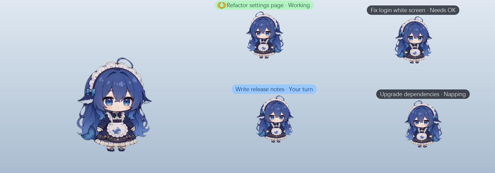
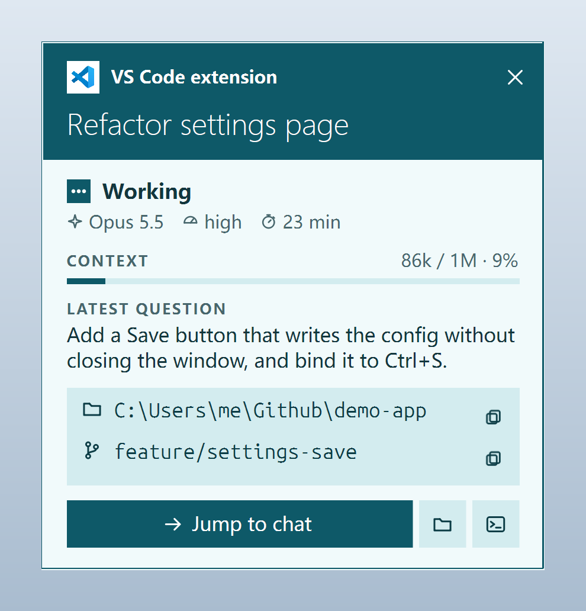
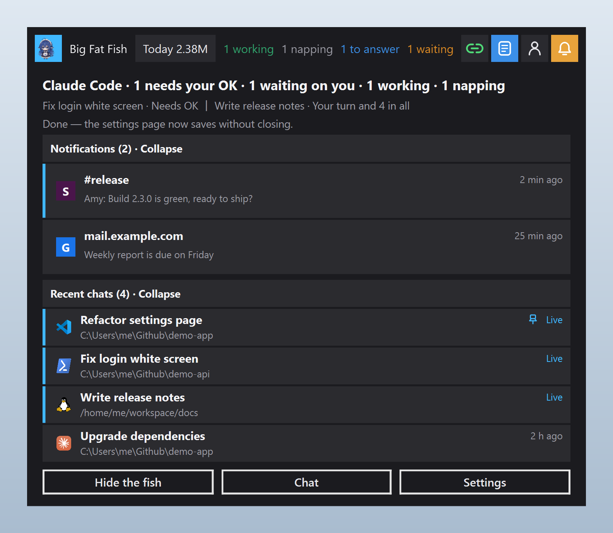
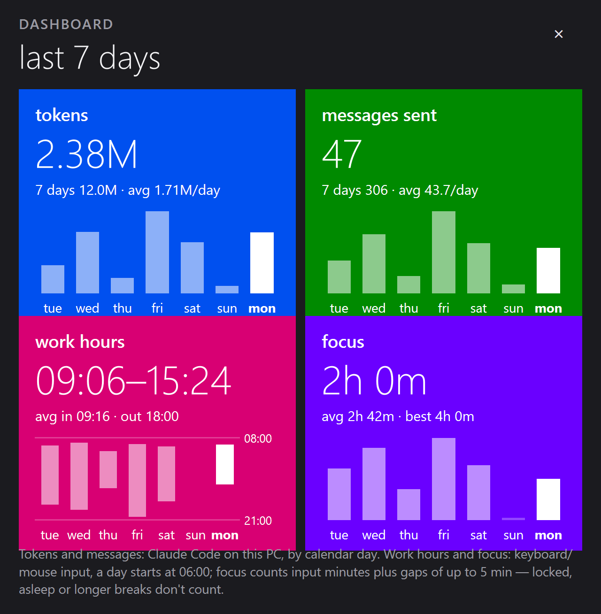
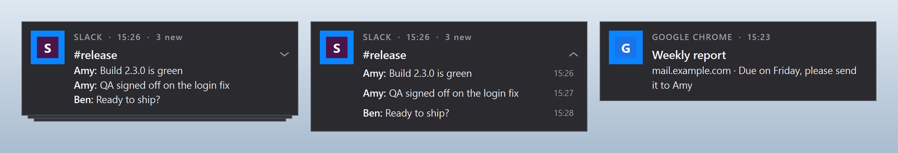
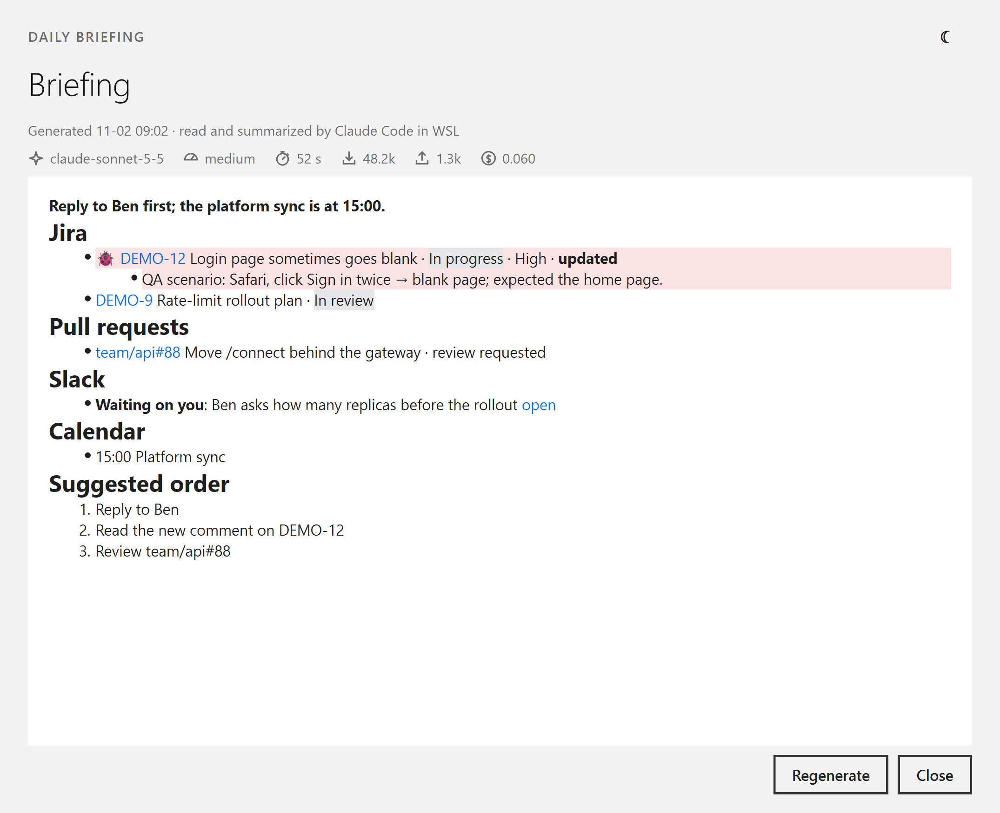
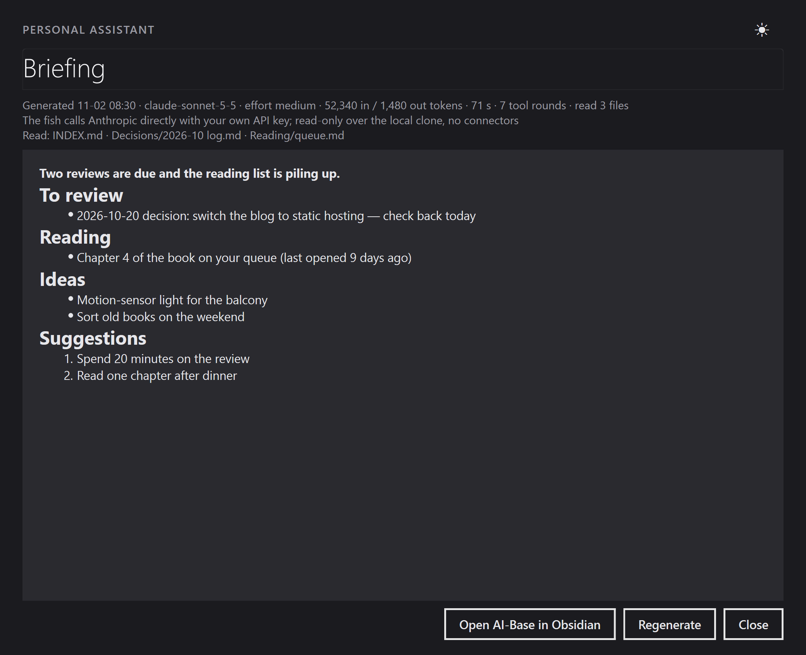
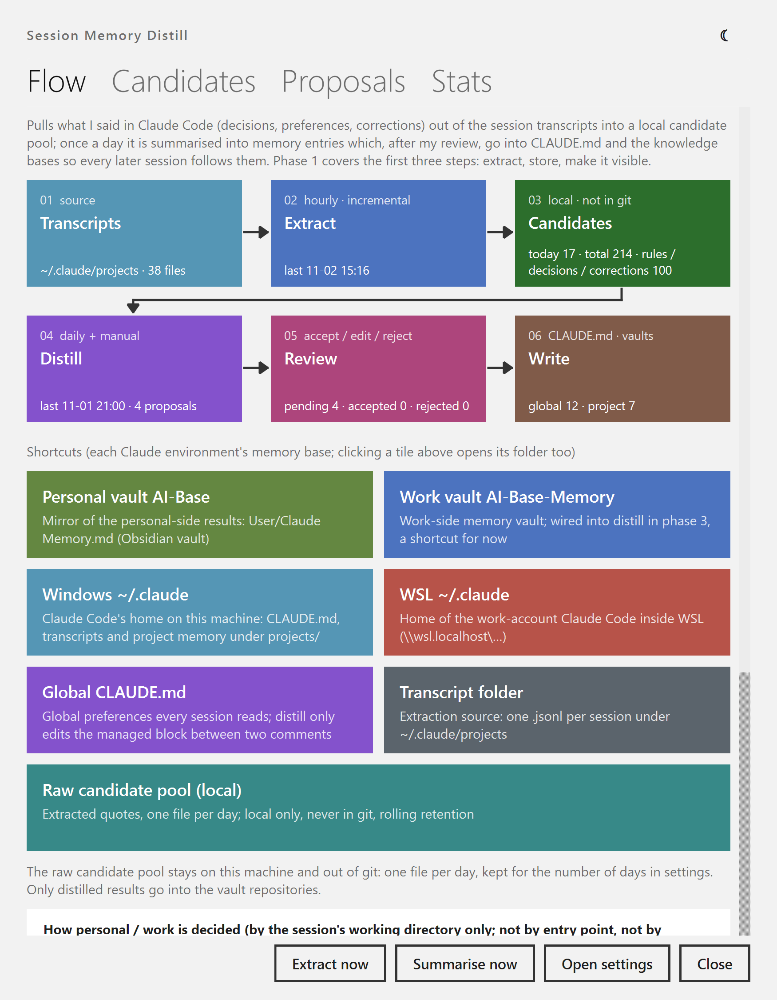

# BigFatFish

**English** · [简体中文](README.zh-CN.md)

**A desktop pet for people who live in Claude Code.** Every Claude Code conversation you open gets its own little
fish on the desktop. The label over its head shows the conversation's title and state. The fish works while the
conversation works, nudges you when a tool needs your OK, and one click takes you back to that conversation.

<p align="center"></p>

BigFatFish started as a fork of [MerZlin/dsh-pet-indesktop](https://github.com/MerZlin/dsh-pet-indesktop)
(`main@ee699c7`, 2026-10-06), a desktop pet built for DeepSeek Harness. It is now developed on its own around
Claude Code. The pet itself (animations, play, menus, settings) is still there. See
[Relationship to upstream](#relationship-to-upstream).

> **Status:** runs from source, developed and tested on Windows 11. There are no installers or releases.

**Contents:** [Quick start](#quick-start) · [Features](#features) · [Known limitations](#known-limitations) ·
[Privacy and data](#privacy-and-data) · [Removed from upstream](#removed-from-upstream) ·
[Relationship to upstream](#relationship-to-upstream) · [For contributors](#for-contributors)

## Quick start

You need Windows, Python 3.10 or newer, and Claude Code.

```powershell
git clone https://github.com/LiminCode/BigFatFish.git
cd BigFatFish
python -m venv .venv
.\.venv\Scripts\python.exe -m pip install -r requirements.txt
```

1. Double-click `run.bat`. The program shows up as **BigFish** in Task Manager and the taskbar.
2. Right-click the fish → **Agent link** → tick **Claude Code**. If you also use Claude Code inside WSL, tick
   **Claude Code (WSL)**. The fish adds a few hooks to `~/.claude/settings.json`.
3. Open a new Claude Code conversation and ask something. A fish for it appears on the desktop.

To use Claude for the pet's own chat and "look at my screen": Settings → **AI and chat**, set the provider URL to
`https://api.anthropic.com` and paste an API key. Leave the model empty to use `claude-sonnet-5`.

The interface follows **Settings → General → Language** (中文 / English).

## Features

### Session fish: one fish per Claude Code conversation

- **One fish per conversation**, for conversations on Windows and in WSL. The fish are half the size of the big fish.
- **The label over its head** reads "title · state". The four states are *Working* (light green), *Needs OK*
  (waiting for a tool approval), *Your turn* (sky blue: the turn finished and you haven't looked yet) and *Napping*.
  A fish stays on *Your turn* until you jump to the conversation or type in it, so you can see at a glance which
  finished conversations you haven't read.
- **A gold laurel** marks conversations running the models you pick (right-click → Agent link → *Laurel for which model*).
- **It follows the conversation:** the fish works while the conversation works, celebrates when a turn ends, waits
  for you, and leaves when the conversation closes. If Claude Code is killed, the fish notices within 60 seconds
  and leaves too.
- **Click a fish for its detail card:** where it was opened (VS Code extension, Claude Desktop, terminal, WSL),
  state, model and effort, how long it has been running, context usage, your last question, the folder and Git
  branch, and buttons to jump, open the folder or copy the resume command.
- **Jump back to the conversation:** VS Code brings the right window forward and opens that conversation, Claude
  Desktop opens the session directly, and Windows Terminal selects the tab by title. When none of those works, the
  fish copies `claude --resume <id>`.
- **Rally:** right-click the big fish → *Rally* gathers every small fish around it.

<p align="center"></p>

### Dynamic island

A capsule at the top of the screen. Click it to expand the card.

- Session counts on the capsule ("1 working · 1 to answer · 1 waiting"), a green or red API connection icon,
  and buttons for the work briefing, the personal assistant and notifications.
- **The card** lists the conversations that need you, your **recent notifications** and your **recent
  conversations**. Recent conversations remember where each one was opened, because `claude --resume` only lists
  conversations from the current folder. Click a row to go back. Right-click to resume in a terminal, open in
  VS Code, pin it, or copy the path.
- **Today's usage:** the token count of all Claude Code conversations today, read from local files. The Windows
  account and the one inside WSL are shown side by side (`Win 2.4M · WSL 1.8M`). Click it to open a **7-day
  dashboard**: tokens and messages sent per account, when you started and stopped working, and focus time.
- Two looks: the original dark capsule, or Metro tiles.

<p align="center">
  
  
</p>

### Notifications

- The fish reads Windows notifications through the official `UserNotificationListener` API and lists them on the
  island.
- **Its own pop-ups**, Windows Phone / Metro style, in the corner and on the monitor you choose. Several stay on
  screen at once, for anywhere from a few seconds to "until I close it".
- **Stacking by source:** Slack notifications stack by channel and Chrome notifications by site, each with its own
  switch. Click a stack to expand it, then click the message you want.
- **Clicking jumps straight to the source:** Slack opens that message, and Chrome hands the click back to the page
  (Gmail opens the mail). No trip through the Action Center.
- No pop-ups while you are in a full-screen app or Do Not Disturb is on.
- Settings → **Notifications**. Pop-ups are off by default.

<p align="center"></p>

### Daily summaries

All of these live under Settings → **Briefings & notes**. Every prompt is editable, and you choose the model,
the effort level and when each one runs.

- **Work briefing:** on workdays, the Claude Code account signed in inside WSL reads your Jira, pull requests,
  Slack, calendar and (optionally) email, then writes a briefing. Only read-only tools are allowed. A one-line
  summary pops up in a bubble, and the full text opens in a window. Bugs are pinned and highlighted.
- **Slack watch:** while you are at the computer, every 15 minutes the same account checks Slack for anything
  waiting on you. New items pop up in a bubble, and you can open, snooze or mark each one done.
- **Work notes:** paste a Slack or Jira link or a snippet. Claude reads it, summarizes it and sets a reminder.
  Notes are saved as Markdown.
- **Personal assistant** (person icon on the island): the fish's own Claude, using your API key, reads a local
  clone of your Markdown knowledge base and writes a personal briefing. You can also jot ideas, which are appended
  and pushed with git.
- **Session memory distill:** pulls what you said in Claude Code (decisions, preferences, corrections) out of the
  session transcripts into a local candidate pool. Once a day it is summarized into proposals for your memory.
  You accept, edit or reject each proposal; accepted ones go into a managed block of `~/.claude/CLAUDE.md` and
  your project memory, so later sessions follow them.

<p align="center">
  
  
</p>
<p align="center"></p>

### Chat with Claude

- **Claude channel:** the pet's chat and screen reading can talk to the Anthropic Messages API directly (official
  SDK), alongside the original OpenAI-compatible channel. Streaming and "look at my screen" both work. You can set
  the effort level. "Test connection" doesn't spend output tokens.
- Replies are rendered as Markdown. You can paste or drop images and files into the input box. Each message carries
  its send time, so the model knows how long you were away.
- **GitHub connector** (off by default): read-only questions about repositories, commits, issues and PRs.

### Everything else

- **Multiple monitors:** drag a fish to any screen. It stays there after a restart, and "look at my screen" looks
  at the screen the fish is on.
- **Launchers** in the right-click menu: VS Code workspaces (open and recent), Claude Desktop, Claude Code (WSL),
  and YouTube Music.
- **Metro-style settings** with a *Save* button (`Ctrl+S`) that applies changes without closing the window.
- **Animated GIF / WebP** in bubbles. Images, lines and pop-ups are drawn without repeats until every item has
  appeared once.
- **Custom tray icon** and island icon, and five color schemes for the detail card.
- **Your own characters:** the [prompt recipes](prompts/README.md) and the
  [asset pipeline](tools/asset_pipeline/README.md) turn green-screen video into a character package (see
  [THIRD_PARTY_NOTICES.md](THIRD_PARTY_NOTICES.md) for their terms).
- Everything from upstream that still applies: animations, throwing and edge play, self-talk bubbles, the
  hourly voice chime, festival reminders, lyrics, to-do reminders, and the configurable right-click menu.

## Known limitations

- **Windows only** for everything added here; only tested on Windows 11. macOS and Linux were never tested.
- **Jumping** to a VS Code conversation brings the right window forward, but the program cannot confirm from the
  outside that the right tab was selected. VS Code asks for confirmation the first time.
- **Multiple monitors:** a thrown fish stays on its own screen. Dropping files to feed the fish only works on the
  primary screen. Mixed display scaling has not been tested.
- **Today's usage** reads the WSL account over the `\\wsl.localhost` share, so it only counts distros that are
  already running (it never starts one); while a distro is down the slot shows `WSL --` and retries a minute later.
- **Claude Code's internal formats:** the detail card, recent conversations, usage and memory distill read Claude
  Code's transcripts and running-session list. These are not public interfaces, so a Claude Code update can break
  them. When that happens the affected item stays empty and nothing else is affected.
- **Notifications:** if you turn Windows notifications off globally, Windows drops them and the fish gets nothing.
  Turn off the banners per app instead.
- **Work briefing, Slack watch and work notes** need WSL with Claude Code signed in, and the connectors for the
  sources you want.

## Privacy and data

- **Prompts are never written to disk by the hooks.** They record only the session ID, state, tool name, project,
  title and path. "Last question" on the detail card is read when you open it and kept in memory.
- **Recent conversations, today's usage and notifications** are read from local files and APIs. None of them goes
  online.
- **Screen reading** sends screenshots to the AI provider you configured.
- **The work briefing, Slack watch and work notes** run in your own Claude Code account inside WSL, with read-only
  tools only.
- **The personal briefing and memory distill** send excerpts (knowledge-base files, or sentences you said) to
  Anthropic with your API key. The raw candidate pool stays on this machine and out of git.
- The image pool (`assets/big_blue_fat_fish/`) and `raw-material/` contain images collected from the web whose
  sources and licenses were not checked one by one. They are for personal, non-commercial use only. See
  [THIRD_PARTY_NOTICES.md](THIRD_PARTY_NOTICES.md) §6.

## Removed from upstream

| Removed | Why |
|---|---|
| Online updates, installers, release builds, and their CI workflows | They installed upstream's releases. This project runs from source (`run.bat` / `python -m pet`). |
| DeepSeek entries: balance, Harness, web page, and the balance slots on the island | This project centers on Claude Code. The code is still there, only the entry points are gone. |
| NetEase / QQ Music launchers and the startup disk scan for them | Replaced by YouTube Music. The scan took 3–5 s at every start. Lyrics still work. |
| The status dot on the island capsule | Replaced by the API connection icon and session counts. |

## Relationship to upstream

- Lineage: [PC2005-cloud/dsh-pet](https://github.com/PC2005-cloud/dsh-pet) →
  [MerZlin/dsh-pet-indesktop](https://github.com/MerZlin/dsh-pet-indesktop) → BigFatFish. Thanks to both authors
  and all upstream contributors.
- Upstream's README (installation, usage guide, animation assets, v4.x changelog):
  [README.md @ ee699c7](https://github.com/MerZlin/dsh-pet-indesktop/blob/ee699c7/README.md). Upstream documents
  that no longer apply here were moved out of this repository and are listed in [docs/UPSTREAM.md](docs/UPSTREAM.md).
- Upstream changes are cherry-picked, not merged (see
  [docs/PR-REPORT-UPSTREAM-SYNC-2026-10-24.md](docs/PR-REPORT-UPSTREAM-SYNC-2026-10-24.md)).
- The program's system name is `big-fat-fish`: the data folder is `%APPDATA%\big-fat-fish\`, and the keychain
  service and autostart entry use the same name. Data from the old name `dsh-pet-standalone` is migrated on first
  start.
- License: **MIT**, inherited from upstream (see [LICENSE](LICENSE)). Third-party assets and components:
  [THIRD_PARTY_NOTICES.md](THIRD_PARTY_NOTICES.md).

## For contributors

- [AGENTS.md](AGENTS.md): engineering guide (project shape, change discipline, PR evidence rules).
- [docs/INDEX.md](docs/INDEX.md): index of every document, with when to read each one.
- [CONTEXT.md](CONTEXT.md): domain glossary.
- Tests: `python -m pytest -q` (set `QT_QPA_PLATFORM=offscreen` when headless).
- The screenshots in this README come from the real widgets fed with demo data. To regenerate them, run
  `python scripts/capture_readme_shots.py` (it needs the frame sequences a first run of the fish generates).
