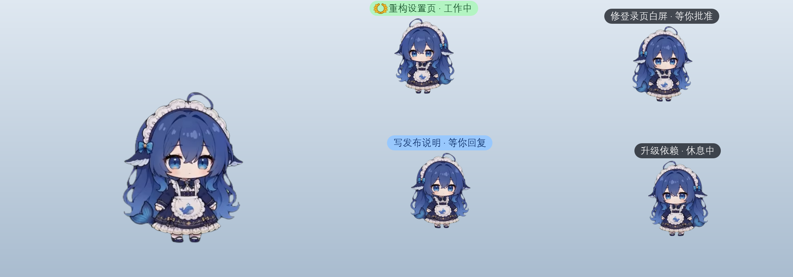
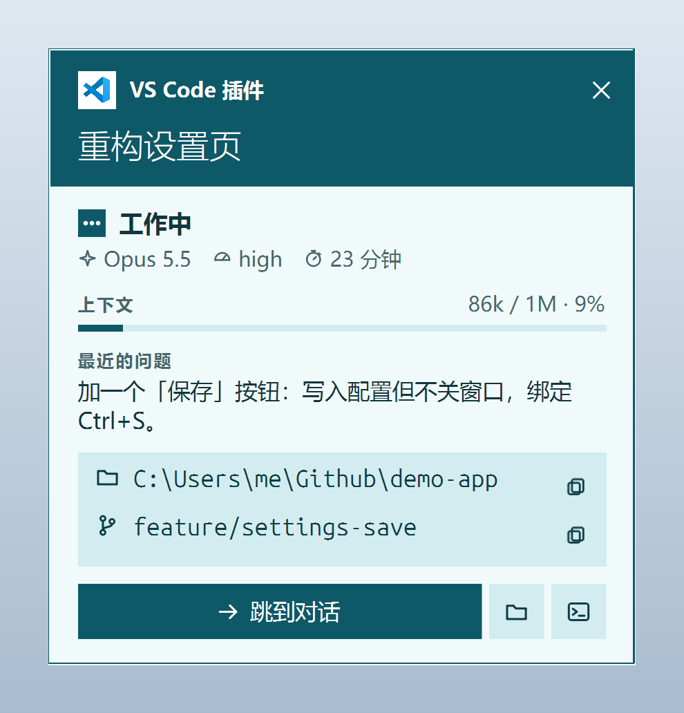
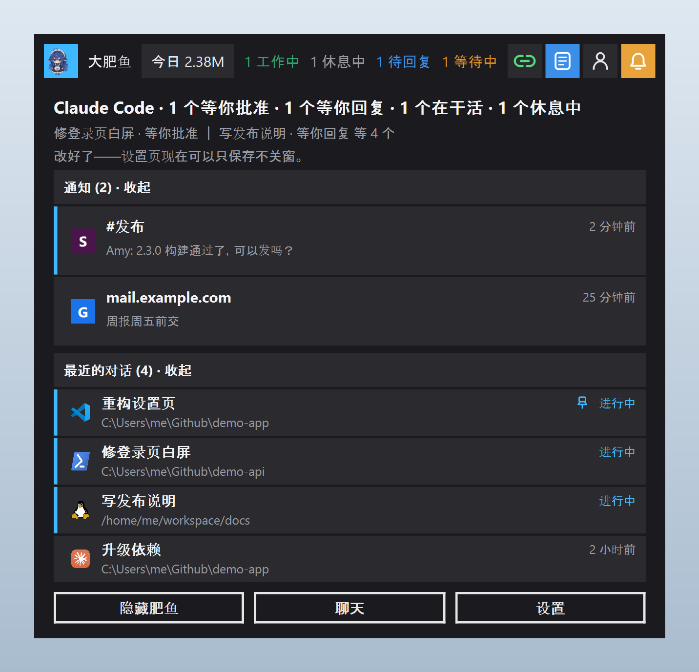
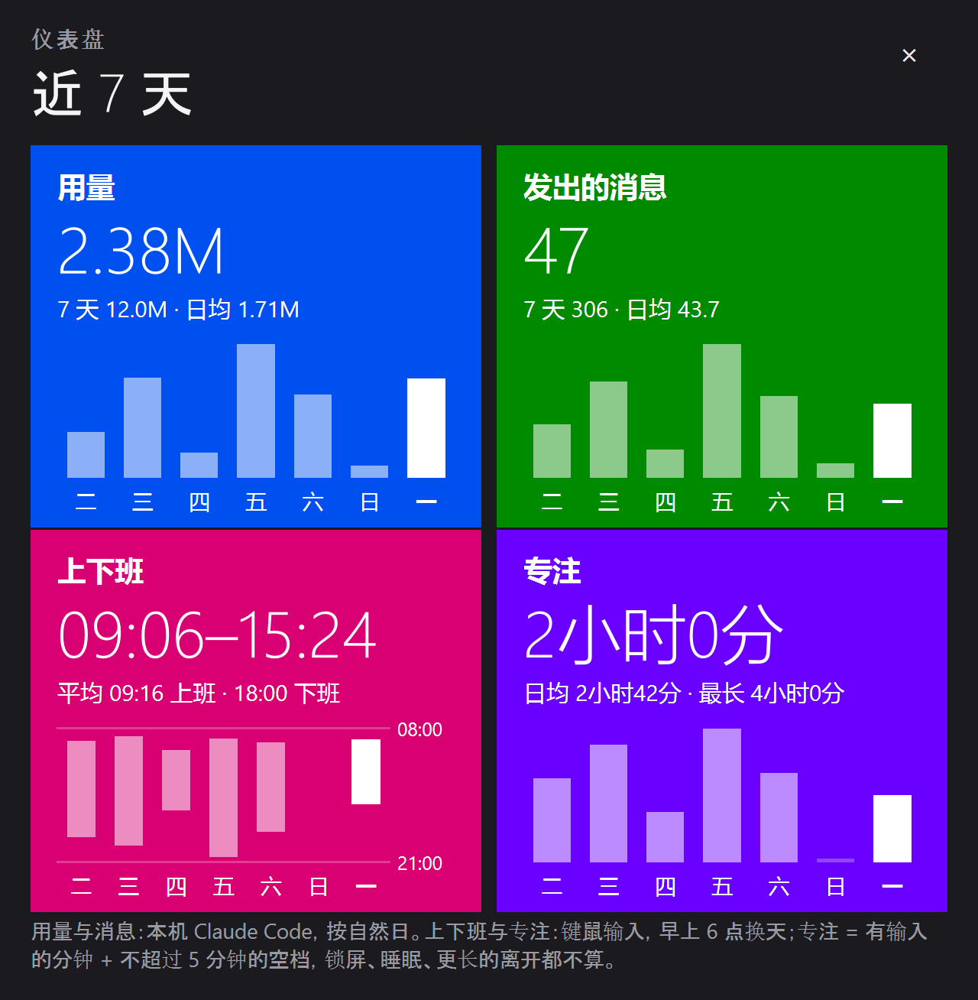
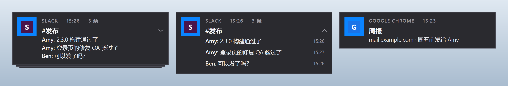
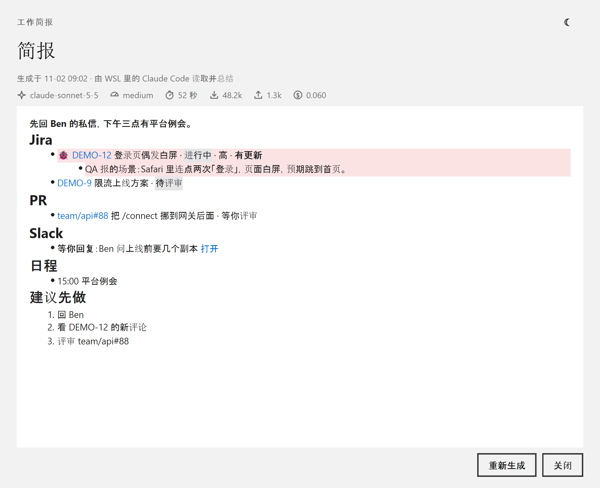
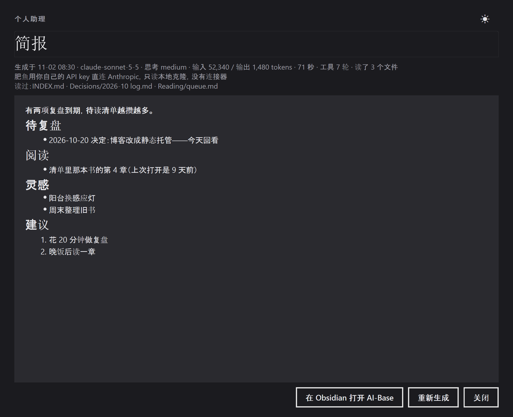
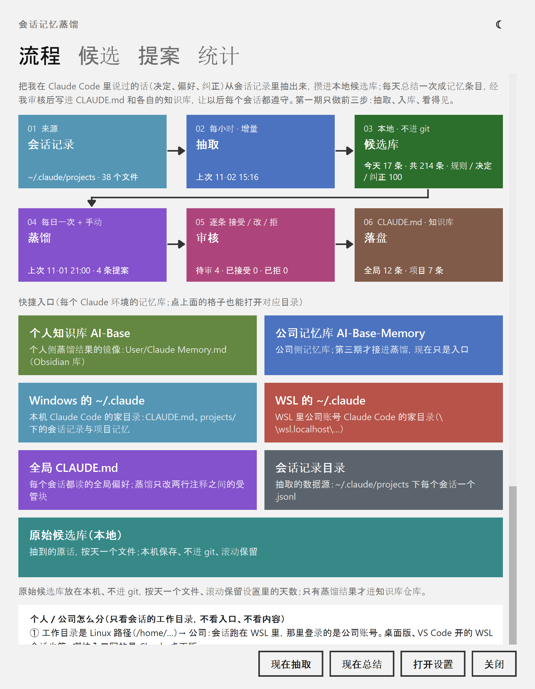

# BigFatFish

[English](README.md) · **简体中文**

**给 Claude Code 用的桌面宠物。** 每开一个 Claude Code 对话，桌面上就多一条小肥鱼：头顶写着这个对话的标题和状态，
对话在干活它就干活，等你批准时它提醒你，点它一下就跳回那个对话。

<p align="center"></p>

本项目最初 fork 自 [MerZlin/dsh-pet-indesktop](https://github.com/MerZlin/dsh-pet-indesktop)（`main@ee699c7`，
2026-10-06）。上游是为 DeepSeek Harness 做的桌宠；本项目已独立开发，围绕 **Claude Code** 工作，桌宠本体
（动画、玩法、菜单、设置）都还在。见[与上游的关系](#与上游的关系)。

> **现状**：从源码运行，在 Windows 11 上开发和实测，不出安装包、不发版。

**目录**：[快速开始](#快速开始) · [功能](#功能) · [已知限制](#已知限制) · [隐私与数据](#隐私与数据) ·
[相对上游移除的](#相对上游移除的) · [与上游的关系](#与上游的关系) · [参与开发](#参与开发)

## 快速开始

需要 Windows、Python 3.10 或更高版本，以及已经装好的 Claude Code。

```powershell
git clone https://github.com/LiminCode/BigFatFish.git
cd BigFatFish
python -m venv .venv
.\.venv\Scripts\python.exe -m pip install -r requirements.txt
```

1. 双击 `run.bat` 启动。程序在任务管理器和任务栏里叫 **BigFish**。
2. 右键肥鱼 → **Agent 联动** → 勾选 **Claude Code**。在 WSL 里也用 Claude Code 的，再勾 **Claude Code（WSL）**。
   肥鱼会在 `~/.claude/settings.json` 里登记几条 hook。
3. 新开一个 Claude Code 对话并提问，桌面上就会出现它的那条小鱼。

想让肥鱼自己的聊天和「看看屏幕」用 Claude：设置 → **AI 与对话**，服务商地址填 `https://api.anthropic.com`，
填入 API Key，模型留空即用 `claude-sonnet-5`。

界面语言在 **设置 → 常规 → 语言 / Language** 里切换（中文 / English）。

## 功能

### 会话小鱼：每个 Claude Code 对话一条

- **一个对话一条小鱼**，本机和 WSL 里的对话都算；小鱼是大肥鱼的一半大。
- **头顶标签**写「对话标题 · 状态」。状态有四种：*工作中*（淡绿底）、*等你批准*（等工具审批）、*等你回复*
  （天蓝底：这一轮做完了你还没看）、*休息中*。小鱼会一直停在「等你回复」，直到你跳过去看过或在那个对话里接着提问，
  一眼就分得出哪些做完了还没看。
- **金色桂冠**：给跑着指定模型的对话戴（右键 → Agent 联动 → *桂冠给哪个模型*）。
- **跟着对话动**：对话干活时它干活，一轮结束庆祝一下、等你，对话关了就离场；Claude Code 被直接杀掉时，
  60 秒内也会发现并离场。
- **单击看详情卡**：在哪打开的（VS Code 插件 / Claude 桌面版 / 终端 / WSL）、状态、模型与思考强度、持续多久、
  上下文用量、最近的问题、目录与 Git 分支，以及跳转、打开文件夹、复制恢复命令三个按钮。
- **跳回对话**：VS Code 里的先调出对的窗口再打开这个对话；Claude 桌面版直接打开那个会话；Windows Terminal 按标题选中
  标签页。都不行时复制 `claude --resume <会话ID>`。
- **护驾**：右键大肥鱼 →「护驾」，所有小肥鱼围到它身边。

<p align="center"></p>

### 灵动岛

屏幕顶上的一颗胶囊，单击展开卡片。

- 胶囊上直接显示会话计数（「1 工作中 1 待回复 1 等待中」）、API 连接图标（绿 = 通、红 = 不通），以及工作简报、
  个人助理、通知三个按钮。
- **卡片**里是需要你管的对话、**通知**和**最近的对话**。最近的对话记下每个对话是在哪个目录打开的
  （`claude --resume` 只列当前目录的对话），点一行跳回去；右键可在终端恢复、在 VS Code 打开、置顶、复制路径。
- **今日用量**：今天所有 Claude Code 对话用掉的 token，只读本机文件；Windows 账号和 WSL 里的账号并排各显各的
  （`Win 2.4M · WSL 1.8M`）。点它弹出**近 7 天仪表盘**：按账号分开的用量与发出的消息、上下班时间、专注时长。
- 两种外观：原来的深色胶囊，或 Metro 磁贴。

<p align="center">
  
  
</p>

### 通知

- 用 Windows 官方的 `UserNotificationListener` 接口读各个应用的通知，铺在灵动岛上。
- **自家的通知弹窗**，Windows Phone / Metro 风格，出现在你选的角落和显示器上；几条可以同时留在屏幕上，
  停留时间从几秒到「一直留着」。
- **按来源叠放**：Slack 按频道、Chrome 按网站叠成一摞，各有开关；点一摞先展开，再点要看的那条。
- **点了直接跳到出处**：Slack 打开那条消息，Chrome 把点击交还给网页（Gmail 打开那封邮件），不经过通知中心。
- 全屏应用里或开着勿扰时不弹。
- 设置 → **通知**。弹窗默认关闭。

<p align="center"></p>

### 每日总结

都在 设置 → **简报与笔记** 里。每一项发给模型的提示词都能改，模型、思考强度和运行时机都能选。

- **工作简报**：工作日让 WSL 里登录着的 Claude Code 账号读你的 Jira、PR、Slack、日程（邮件可选），写一份简报。
  只放行读取类工具。一句话概要冒在气泡里，全文在窗口里看；bug 单置顶并标红。
- **Slack 关注**：你在电脑前时，每 15 分钟让同一个账号看一眼 Slack 有没有等你回复或处理的，新的冒气泡，
  每条可以查看、稍后再提醒或标成完成。
- **工作笔记**：随手贴一个 Slack / Jira 链接或一段话，Claude 去读、写摘要、定提醒，存成 Markdown。
- **个人助理**（岛上的人形图标）：肥鱼自己的 Claude（用你的 API Key）读本地的 Markdown 知识库副本，写一份个人简报；
  也能随手记灵感，追加后用 git 推送。
- **会话记忆蒸馏**：把你在 Claude Code 里说过的话（决定、偏好、纠正）从会话记录里抽出来，攒进本地候选库；
  每天总结一次成记忆提案，你逐条接受、修改或拒绝，接受的写进 `~/.claude/CLAUDE.md` 的受管块和项目记忆，
  以后每个会话都照着做。

<p align="center">
  
  
</p>
<p align="center"></p>

### 和 Claude 聊天

- **Claude 通道**：肥鱼的聊天和识屏可以直连 Anthropic Messages API（官方 SDK），与原来的 OpenAI 兼容通道并存；
  流式回复和「看看屏幕」都支持，可调思考强度；「测试连接」不花输出额度。
- 回复按 Markdown 渲染；输入框能粘贴、拖入图片和文件；每条消息带发送时间，模型知道你离开了多久。
- **GitHub 连接器**（默认关）：在对话里只读地查仓库、提交、Issue 和 PR。

### 其它

- **多屏**：鱼能拖到任何一块屏上，重启后回到原来那块；「看看屏幕」看鱼所在的那块。
- **右键菜单里的入口**：VS Code 工作区（开着的和最近用过的）、Claude Desktop、Claude Code（WSL）、YouTube Music。
- **Metro 风格的设置页**，带一个「保存」按钮（`Ctrl+S`）：写入并生效，不关窗口。
- 气泡里的 **GIF / 动态 WebP** 会动；配图、台词、彩蛋弹窗洗牌式抽取，一轮之内不重复。
- **自定义托盘图标**和灵动岛图标；详情卡有五套配色。
- **做自己的角色**：[提示词配方](prompts/README.md)和[素材生成链](tools/asset_pipeline/README.md)把绿幕视频做成角色包
  （许可见 [THIRD_PARTY_NOTICES.md](THIRD_PARTY_NOTICES.md)）。
- 上游仍然适用的功能都在：动画、抛掷与贴边玩法、自言自语气泡、语音报时、节日提醒、歌词、待办提醒、可编排的右键菜单。

## 已知限制

- **新增功能只支持 Windows**，只在 Windows 11 上实测过；macOS 和 Linux 没有测试过。
- **跳转**：VS Code 里的对话，窗口能调到前台，但目标标签页是否被切到前面，从程序外部无法确认；第一次使用时
  VS Code 会弹一次确认。
- **多屏**：抛出去的鱼不跨屏；拖文件投喂只在主屏生效；各屏缩放比例不同的情况没有实测。
- **今日用量**经 `\\wsl.localhost` 共享读 WSL 账号，只读正在运行的发行版（不会把它拉起来）；发行版没开着时
  显示 `WSL --`，下一分钟再试。
- **依赖 Claude Code 的内部格式**：详情卡、最近的对话、用量、记忆蒸馏读的是 Claude Code 的对话记录和运行中会话清单，
  这些不是公开接口，Claude Code 升级后可能读不到。读不到时对应内容留空，不影响其它功能。
- **通知**：如果在 Windows 里把通知总开关关掉，Windows 会直接丢弃通知，肥鱼也拿不到；要安静请按应用关掉横幅。
- **工作简报、Slack 关注、工作笔记**需要 WSL 里登录着的 Claude Code，以及对应来源的连接器。

## 隐私与数据

- **提问正文不落盘**：hook 写下的只有会话 ID、状态、工具名、项目名、标题和路径。详情卡里的「最近的问题」是点开时临时读的，
  只在内存里。
- **最近的对话、今日用量、通知**都只读本机文件和系统接口，不联网。
- **识屏**会把截图发给你配置的 AI 服务商。
- **工作简报、Slack 关注、工作笔记**在 WSL 里你自己的 Claude Code 账号下运行，只放行读取类工具。
- **个人简报和记忆蒸馏**会用你的 API Key 把摘取的内容（知识库文件、你说过的句子）发给 Anthropic；原始候选库只存在本机，
  不进 git。
- 配图池（`assets/big_blue_fat_fish/`）和 `raw-material/` 里有从网络收集的图片，出处与授权没有逐张核实，仅作个人非商业使用，
  见 [THIRD_PARTY_NOTICES.md](THIRD_PARTY_NOTICES.md) 第 6 节。

## 相对上游移除的

| 移除了什么 | 原因 |
|---|---|
| 在线更新、安装包、发版构建及其 CI 工作流 | 它们装的是上游的发布版；本项目从源码运行（`run.bat` / `python -m pet`）。 |
| DeepSeek 的入口：余额、Harness、网页版，以及灵动岛上的余额信息 | 本项目围绕 Claude Code；代码保留，只是摘掉了入口。 |
| 网易云 / QQ 音乐的启动入口，以及启动时为找它们扫磁盘 | 改用 YouTube Music；那次扫描每次启动要 3～5 秒。歌词照旧。 |
| 灵动岛胶囊上的状态圆点 | 换成了 API 连接图标和会话计数。 |

## 与上游的关系

- 项目沿革：[PC2005-cloud/dsh-pet](https://github.com/PC2005-cloud/dsh-pet) →
  [MerZlin/dsh-pet-indesktop](https://github.com/MerZlin/dsh-pet-indesktop) → BigFatFish。感谢两位原作者和上游的各位贡献者。
- 上游 README 原文（安装、使用教程、动画素材、v4.x 变更记录）：
  [README.md @ ee699c7](https://github.com/MerZlin/dsh-pet-indesktop/blob/ee699c7/README.md)。在本项目已不适用的上游文档
  已移出本仓库，清单见 [docs/UPSTREAM.md](docs/UPSTREAM.md)。
- 上游的改动按需挑拣，不整体合并（见 [docs/PR-REPORT-UPSTREAM-SYNC-2026-10-24.md](docs/PR-REPORT-UPSTREAM-SYNC-2026-10-24.md)）。
- 程序在系统里的名字是 `big-fat-fish`：数据目录 `%APPDATA%\big-fat-fish\`，钥匙串服务名和开机自启项也用它；
  旧名字 `dsh-pet-standalone` 下的数据在首次启动时自动迁移。
- 许可证沿用上游的 **MIT**（见 [LICENSE](LICENSE)）；第三方素材与组件的声明见 [THIRD_PARTY_NOTICES.md](THIRD_PARTY_NOTICES.md)。

## 参与开发

- [AGENTS.md](AGENTS.md)：工程指南（项目结构、变更纪律、PR 交付证据要求）。
- [docs/INDEX.md](docs/INDEX.md)：全部文档的索引，每篇写明什么时候该读。
- [CONTEXT.md](CONTEXT.md)：领域术语表。
- 测试：`python -m pytest -q`（无界面环境设 `QT_QPA_PLATFORM=offscreen`）。
- 本页的截图是真实组件喂演示数据渲染的。重新生成：`python scripts/capture_readme_shots.py`
  （需要肥鱼第一次运行时生成的帧序列）。
