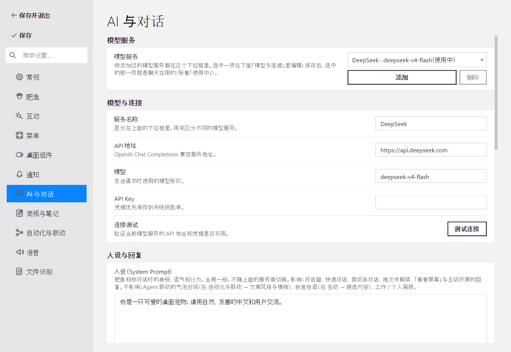
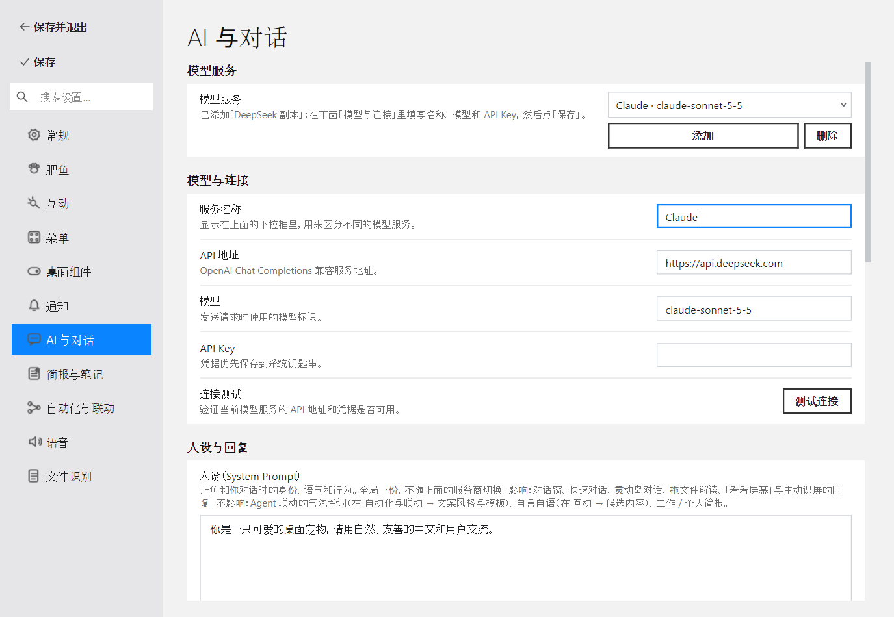
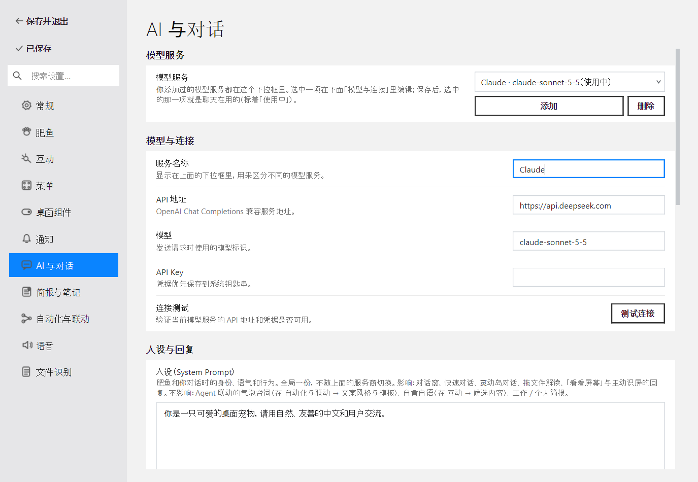
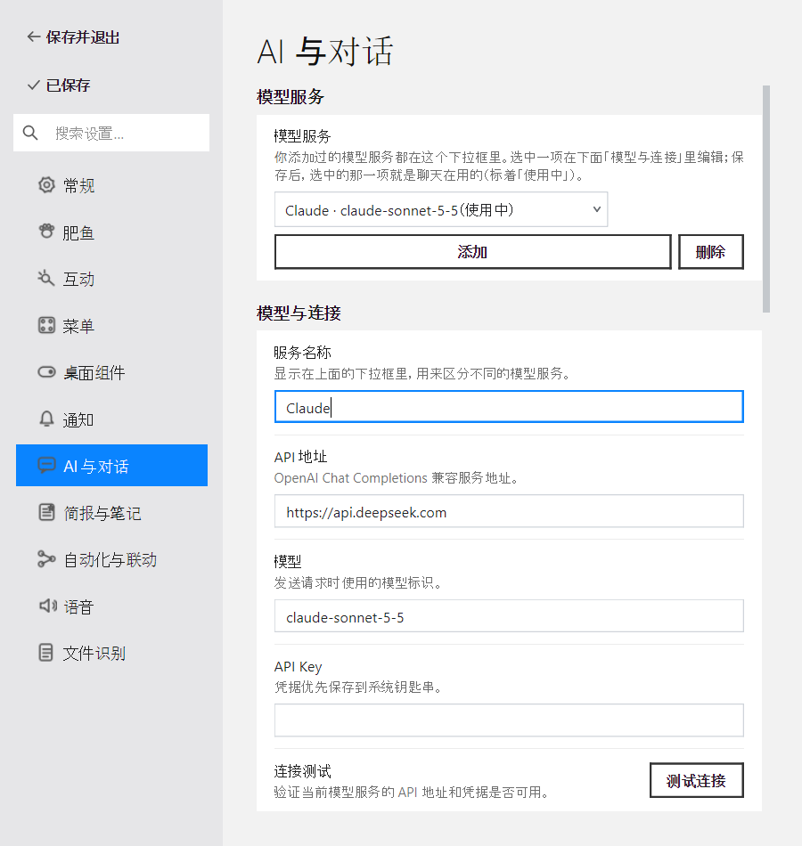
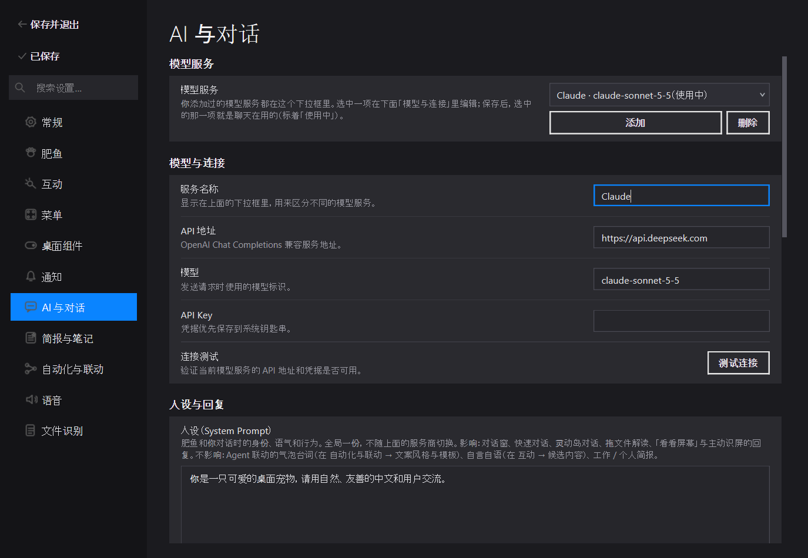
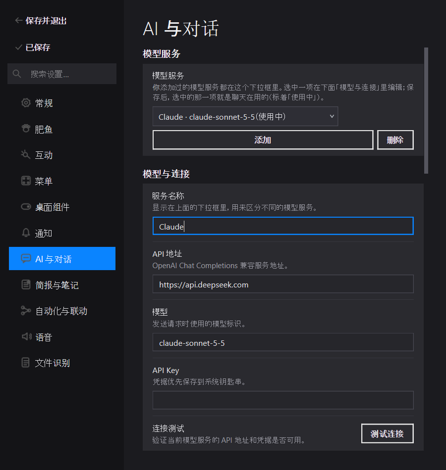

# PR 报告：AI 设置「模型服务」列表看得见自己的改动（2026-11-13）

> **基线**：`f5e2923a`（Config: survive a system crash mid-save, #40）
> **分支**：`claude/ai-provider-list-ux`　**日期**：`2026-11-13`
> **范围**：4 个实现文件（含两份语言文件）、1 个测试文件、6 张截图、本报告与索引
> **关联**：`tests/test_api_provider_list.py`（列表的添加 / 切换 / 删除，既有）

## 一、核心特性

用户反馈两句话：「API 列表是什么？」「我添加了一个模型，保存后看不到在哪里，这里整个需要优化一下交互。」

**复现（离屏、真实设置对话框）**：点「添加」→ 名称改成 `Claude`、模型改成 `claude-sonnet-5-5` → 点「保存」。
新服务**已经写进配置**（`active_provider = api-2`），但下拉框一直显示添加那一刻的
`DeepSeek 副本 · deepseek-v4-flash`：它只在添加和重开设置时生成文字，不跟名称 / 模型的编辑走，保存后也不刷新。
用户看到的就是「加了、存了，列表里却找不到」。另外列表里看不出聊天到底在用哪一项，行提示写的是内部词
`active_provider`，分节叫「API 列表」、字段叫「Provider 名称」。

| # | 能力 | 说明 |
|---|---|---|
| 1 | 下拉框跟着编辑走 | 名称、模型输入框每次变化，当前那一项立刻显示新的「名称 · 模型」 |
| 2 | 标出在用的那一项 | 聊天在用的服务（盘上的 `active_provider`）后面加「（使用中）」；保存后标记移到选中项，各项文字换成存下的值 |
| 3 | 添加后说下一步 | 行提示换成「已添加「…」：在下面「模型与连接」里填写名称、模型和 API Key，然后点「保存」。」；名称输入框获得焦点并全选，直接打字就替换掉「副本」；切换服务或保存后提示复原 |
| 4 | 说人话 | 「API 列表」→「模型服务」，「Provider 名称」→「服务名称」，行提示改为说明下拉框是什么、保存后哪一项生效；连接测试的说明里的「Provider」同改 |
| 5 | 下拉框放得下 | 宽度 230 → 300 px；`ModernSelect` 文字放不下时右侧省略（以前直接截断） |

**红线 / 不变量**：保存语义不变——仍是「保存时选中的那一项成为 `active_provider`」，草稿、Key、删除集合、与磁盘快照合并的逻辑都没动；没有新增或改名任何持久设置键，`setting_id`（`provider_list` 等）不变。

## 二、修改文件说明

### 实现

| 文件 | 增删 | 改动意图 |
|---|---|---|
| `pet/chat/ai_settings_page.py` | +50 / −12 | 新增 `_in_use_provider`、`_combo_label`（「名称 · 模型」+「使用中」）、`_refresh_current_label`（接名称 / 模型 `textChanged`）、`_relabel_providers`、`_set_provider_hint`；`provider_list` 行存为 `_provider_list_row` 以便改提示；`_add_provider` 末尾设提示、聚焦并全选名称；`_on_provider_changed` 复原提示；`save()` 在套用草稿后移动「使用中」、刷新各项、复原提示；下拉框宽 300 |
| `pet/settings_widgets.py` | +13 / −1 | `ModernSelect.setItemText`（与 `QComboBox` 同名同义，改当前项即重画）；`paintEvent` 文字按字体度量右侧省略 |
| `pet/locale/zh.json` / `en.json` | +8 / −6 各 | 改 6 个键的文案（`settings.ai.api_list`、`settings.dlg.api_list`、`settings.ai.provider_name`、`settings.ai.pick_model_service_edit_switch`、`settings.ai.tells_model_services_apart`、`settings.ai.check_current_provider_api_address`），新增 `settings.ai.in_use`、`settings.ai.added_next_step`；逐行替换 / 插入，不重新序列化整份文件 |

### 测试

| 文件 | 增删 | 覆盖 |
|---|---|---|
| `tests/test_api_provider_list.py` | +100 / −0 | ① 编辑名称 / 模型后下拉框当前项文字跟着变，新加未保存的那项不标「使用中」；② 打开时在用项带「使用中」，点「保存」后标记移到新项、提示复原、配置里 `active_provider` 是新项；③ 添加后行提示是「下一步」文案、名称全选，切走后复原；④ 分节名 / 提示不含「API 列表」「Provider」「active_provider」；⑤ `ModernSelect.setItemText` |

### 截图

`docs/screenshots/ai-provider-list-2026-11-13/`：打开（1100 浅）、添加并编辑后（1100 浅）、保存后（1100 / 720 × 浅 / 深），虚构数据。

### 未改动（故意）

- 旧的「AI 设置」对话框 `pet/chat/settings_dialog.py`（`ChatSettingsDialog`）有同样的下拉框，用户这次用的是新设置窗口，本 PR 不碰；它的 `chat.settings.api_list` 文案也不变。
- 「添加」仍复制当前那一项（地址、模型、参数），名称仍叫「… 副本」：同一家服务商换模型是最常见的用法，复制省事；名称已全选，打字即替换。

## 三、实现要点

- **为什么用 `textChanged` 而不是保存时才刷新**：用户的困惑发生在保存之前（改了名字，列表还是「副本」）。按键时刷新只改一项文字（实测约 4 µs），没有理由等。
- **「使用中」以谁为准**：以盘上 / 上次保存的 `active_provider` 为准，而不是下拉框当前选中项——选中只表示「正在编辑哪一项」，保存才切换聊天用的服务。保存时 `_in_use_provider` 跟到保存的那一项。
- **提示复原的时机**：切换服务（用户已经离开新加的那项）和保存（下一步已完成）。程序化切换（添加时）在 `_loading_provider` 保护下不触发 `_on_provider_changed`，所以不会把刚设的「下一步」提示冲掉。
- **设置窗口会把行搬家**：新设置窗口按 `setting_id` 把 AI 页的行重新分节到自己的页面，所以页面代码持有行对象引用（`_provider_list_row`），不靠 `findChild` 在 AI 页下找。

## 四、性能分析

**方法**：`QT_QPA_PLATFORM=offscreen`，真实 `ModernSettingsDialog`（含 AI 页），先添加到 10 个服务，再
`model.setText(...)` 2000 次、`_relabel_providers()` 500 次。环境：Windows 11 Pro 10.0.26300、Python 3.13.15、PySide6（仓库 `.venv`）。

| 指标 | 实测 | 归属 |
|---|---|---|
| 一次按键（`setText` + 当前项改字） | 中位 4.4 µs，p95 4.8 µs | 新增，每次按键 |
| 保存时刷新全部 10 项 | 中位 6.1 µs | 新增，每次保存 |

**结论**：① 稳态零开销——只在用户编辑名称 / 模型或点保存时运行；② 新增路径每次几微秒，触发频率等于按键 / 保存次数；③ 无新的系统调用、网络、磁盘或线程；④ 内存只多一个字符串属性。

## 五、实机运行记录

**根因复现（本机，离屏平台、真实设置对话框与配置读写，临时 APPDATA）**：

```
after add, combo ['DeepSeek · deepseek-v4-flash', 'DeepSeek 副本 · deepseek-v4-flash'] | current DeepSeek 副本 · deepseek-v4-flash
form name/model DeepSeek 副本 / deepseek-v4-flash
（名称改成 Claude、模型改成 claude-sonnet-5-5，点「保存」）
button text 已保存
disk api-2 {'openai-main': ('DeepSeek', 'deepseek-v4-flash'), 'api-2': ('Claude', 'claude-sonnet-5-5')}
combo now ['DeepSeek · deepseek-v4-flash', 'DeepSeek 副本 · deepseek-v4-flash']   ← 存上了，列表看不出来
```

**修后（Windows 平台插件 `QT_QPA_PLATFORM=windows`，真实字体渲染，临时 APPDATA；脚本见报告同批 scratch `capture_provider_ux.py`）**：

```
1-open-1100-light.png  | DeepSeek · deepseek-v4-flash（使用中） | 你添加过的模型服务都在这个下拉框里。…
2-added-1100-light.png | Claude · claude-sonnet-5-5             | 已添加「DeepSeek 副本」：在下面「模型与连接」里填写…
3-saved-1100-light.png | Claude · claude-sonnet-5-5（使用中）   | 你添加过的模型服务都在这个下拉框里。…
```

1100 与 720 宽、浅色与深色下无裁切；720 宽时下拉框与按钮换到提示下方（`ResponsiveActionRow` 既有行为），长提示按字体度量换行。

| 打开 | 添加并编辑后 | 保存后 |
|---|---|---|
|  |  |  |

| 保存后 720 浅 | 保存后 1100 深 | 保存后 720 深 |
|---|---|---|
|  |  |  |

**没在用户真实设置窗口里点**：用户提出问题时自己的设置窗口正开着、里面有未保存的改动；我没有用合成点击去操作它，也没有动它的配置。合并后从 main 重启桌宠，新代码在用户下次打开设置时生效。

## 六、测试与验证

| 门 | 命令 | 结果 |
|---|---|---|
| 静态检查 | `python -m ruff check pet tests` | All checks passed |
| 空白 | `git diff --check` | 通过 |
| 聚焦 | `pytest -q tests/test_api_provider_list.py` | 新增 5 条在基线代码上红（标签不变、无「使用中」、提示不变、旧文案、无 `setItemText`），修后 10 passed |
| 相关 | 设置窗口、菜单布局、聊天子系统、多语言等 32 个文件 | 579 passed，1 skipped |
| 全量 | `python -m pytest -q --ignore=tests/manual_ssl_proxy_check.py` | 7 failed / 6169 passed / 14 skipped（7 分 40 秒）；7 个都与本改动无关：本机 5 个环境基线 + 基线 `f5e2923a` 上已复现的 2 个（`test_modern_context_menu_has_compact_semantic_groups`、`test_host_icons_are_warmed_at_the_cards_size`） |

## 七、设置变更门禁（`docs/SETTINGS-CHANGE-GATES.md`）

- **契约**：无新增 / 改名 / 删除持久设置；保存语义不变；`setting_id` 不变，搜索按新文案生效。
- **TDD**：见第六节；Qt 行为从设置窗口 seam 测试（`ModernSettingsDialog` + 「保存」按钮）。
- **布局与可访问性**：1100 / 720、浅 / 深截图无裁切；文字换行按字体度量；添加后焦点落在名称输入框（键盘可直接输入）。放大字体与 High DPI 未单独截图（本次只改文案与一项文字，不改控件结构）。
- **跨平台**：纯 Qt 控件与文案，无平台分支；真实平台只验证了 Windows。
- **视觉与文档**：截图如上；Shared UX Contract 未变，不需要更新 `CONTEXT.md`。

## 八、已知限制与后续

- 旧的 `ChatSettingsDialog` 仍是旧交互（见第二节）。
- 下拉框仍是下拉框：服务多了以后看全部要点开；用户若希望平铺成列表，可以另做。

## 九、风险与回滚

只改界面与文案，无配置迁移。`git revert` 即可回滚，无残留状态。
