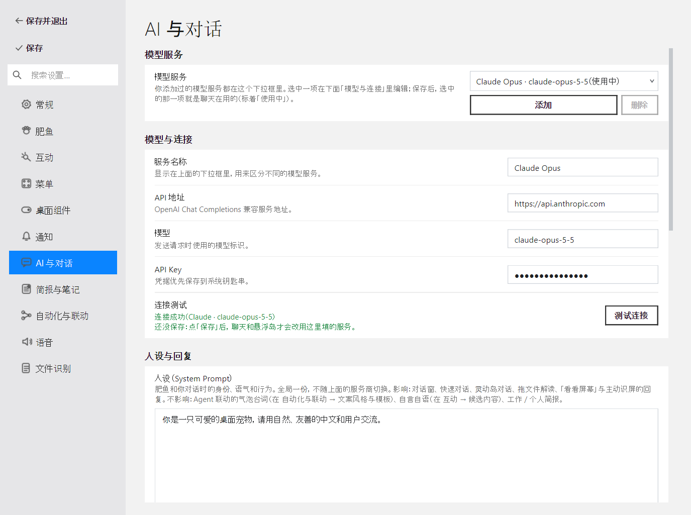
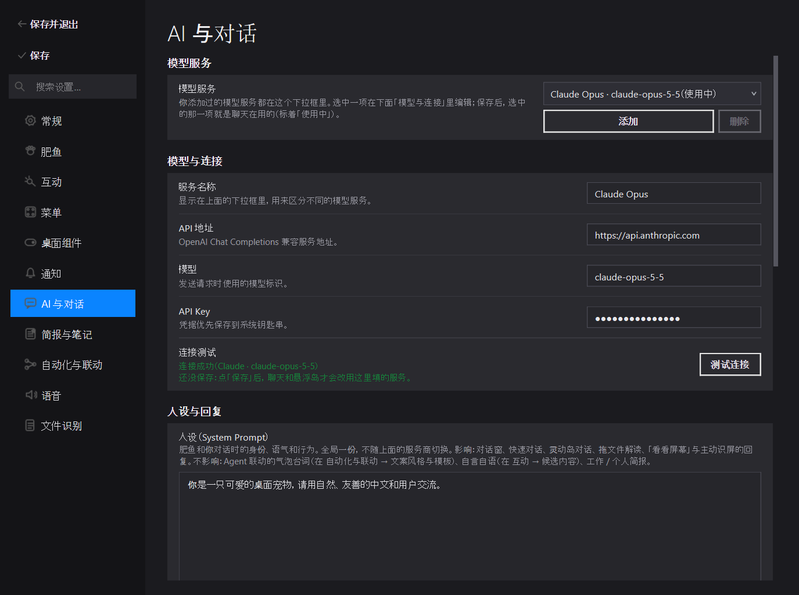

# PR 报告：岛上说清查的是哪一个服务，设置里说清「测试通过 ≠ 已经在用」（2026-11-14）

> **基线**：`177b256c`（Island: show the character's display name…, #42）
> **分支**：`claude/island-api-status-clarity`　**日期**：`2026-11-14`
> **范围**：4 个实现文件（含两份语言文件）、3 个测试文件、2 张截图、本报告与索引
> **关联**：同批另两个 PR——模型服务列表（`PR-REPORT-MODEL-SERVICE-LIST-2026-11-14.md`）、
> 岛上的模型连接面板（`PR-REPORT-ISLAND-CONNECTIONS-PANEL-2026-11-14.md`）；
> `PR-REPORT-AI-PROVIDER-LIST-UX-2026-11-13.md`（#41，保存后哪一项生效）

## 一、核心特性

用户：「我设定了 Claude API，连接测试成功，但似乎悬浮岛上的状态没有更新？」

**现场查证（本机，用户真实环境，只读）**：

- 主进程日志 `pet-52788.log` / `pet-53396.log`：岛的体检一直是
  `API 体检：不可用（认证失败（HTTP 401）：Authentication Fails, Your api key: ****XXXX is invalid …）`——
  这是 DeepSeek 的报错格式，Key 却是 Claude 那把。
- 盘上 `config.json`（19:33:25 写入）：`active_provider = api-2`，名称「DeepSeek 副本」、地址 `https://api.deepseek.com`。
- 用户的设置窗口（独立进程，19:32:44 起一直开着）用 UI Automation 读表单（只读）：
  服务名称 `Claude Opus`、API 地址 `https://api.anthropic.com`、模型 `claude-opus-5-5`、Key 已填。

结论：**表单里的 Claude 还没保存**。「测试连接」测的是表单里的值；岛体检的是盘上已保存的那一项。
「保存之后岛会不会更新」这一半我用集成测试走了一遍（设置进程写盘 → 主进程去抖重读 → `ApiKeyMonitor.refresh`
→ 重新体检 → 岛变色），**本来就是通的**，不是 bug。问题在于两边各说各的，用户看不出岛查的是谁、也不知道还要点保存。

| # | 能力 | 说明 |
|---|---|---|
| 1 | 岛上写明查的是谁 | 体检结论前面加服务名：「DeepSeek 副本 · 认证失败（HTTP 401）…」（悬停提示）；`ApiKeyMonitor.service_name` |
| 2 | 测试通过时提醒保存 | 「测试连接」通过、而表单的地址 / 模型 / Key / 证书校验与在用的不同（或选中的不是在用那项、或是刚加的）时，结果下面多一行「还没保存：点「保存」后，聊天和悬浮岛才会改用这里填的服务。」 |
| 3 | 守住「保存后一定更新」 | 新增端到端测试：设置进程保存新地址 / 新 Key → 主进程 `_on_config_change_debounced` → 再体检一次 → 岛 `ok`，提示以「Claude Opus · 」开头 |

**红线 / 不变量**：保存语义、体检节奏（启动 3 s、通过后 30 min、失败后 5 min）、指纹规则都不变；测试没通过时不提保存；
名称改了但连接字段没变不算「没保存」（名称不影响连不连得上）。

## 二、修改文件说明

### 实现

| 文件 | 增删 | 改动意图 |
|---|---|---|
| `pet/api_key_monitor.py` | +15 / −3 | `_launch` 记下被查服务的名称（`self._service`），`_labelled()` 给「正在检查」、体检结论、`note_success` 的说明加「名称 · 」前缀；新增只读属性 `service_name`。没有名称（旧测试的替身）时不加前缀 |
| `pet/chat/ai_settings_page.py` | +23 / −0 | `_form_differs_from_saved()`：只比连接相关字段（地址、模型、Key、证书校验）与盘上在用那项；`_run_test` 发起时记下 `_tested_unsaved`，`_on_test_done` 通过且未保存时在结果下追加提醒 |
| `pet/locale/zh.json` / `en.json` | +1 / −0 各 | 新增 `settings.ai.test_ok_not_saved` |

### 测试

| 文件 | 增删 | 覆盖 |
|---|---|---|
| `tests/test_api_key_monitor.py` | +19 / −0 | 体检结论带服务名、`service_name` |
| `tests/test_api_provider_list.py` | +61 / −0 | 真实设置窗口 + 真线程跑「测试连接」：没改动不提醒；改了地址 / Key 提醒；保存后不提醒；新加的服务提醒；失败不提醒 |
| `tests/test_island_shell_wiring.py` | +43 / −0 | 端到端：设置进程写盘 → 主进程重读 → 重新体检 → 岛变绿、提示带新名字（基线代码上就是绿的：守住既有行为） |

### 截图

`docs/screenshots/island-api-status-2026-11-14/`：测试通过但未保存（1100 宽，浅 / 深），虚构数据。

### 未改动（故意）

- 没有让设置里的「测试通过」直接把岛变绿：测的是没保存的表单，岛若跟着变绿就是在撒谎（聊天实际还在用旧的）。
- 没碰主进程与设置进程「整份配置覆盖写」的既有并发模型。

## 三、实现要点

- **为什么比「连接字段」而不是整个表单**：提醒的含义是「岛 / 聊天还没在用你刚测的这个」。名称、温度、超时不影响连通性，
  改了它们再测通过时不该提醒。
- **对比基准是 `config.chat_settings()`**：设置进程自己的那份配置，等于打开时的盘上内容，保存后跟着更新；
  页面里的 `self.settings` 混着草稿，不能用。Key 用钥匙串里存的那份比（输入框为空 = 不改）。
- **记在发起时**：`_tested_unsaved` 在点「测试连接」那一刻算好，测试在飞时用户再改表单也不影响这次的结论。

## 四、性能分析

**方法**：`QT_QPA_PLATFORM=offscreen python scratch/perf.py <合并树>`（真实 `ModernSettingsDialog`，10 个服务；钥匙串单独测真实后端）。
环境：Windows 11 Pro 10.0.26300、Python 3.13.15、PySide6 6.12.0（仓库 `.venv`）。

| 指标 | 实测 | 归属 |
|---|---|---|
| `_form_differs_from_saved()`（内存钥匙串） | 中位 18 µs，p95 31 µs，n=500 | 新增，每次点「测试连接」一次 |
| 真实 Windows 钥匙串读一次（未命中，含旧服务名回退） | 中位 207 µs，p95 400 µs，n=50 | 上一行在真机上多出的部分 |
| 体检说明加前缀 | 一次字符串拼接 | 新增，每次体检结论（≥ 5 min 一次） |

**结论**：① 稳态零开销——没有新定时器；② 新增路径只在点「测试连接」时跑一次，真机约 0.2–0.4 ms（一次钥匙串读）；
③ 无新的网络、线程、磁盘写；多一次钥匙串**读**；④ 内存多一个字符串属性。

## 五、实机运行记录

**现场（见第一节）**：日志 401 行、盘上配置、设置窗口表单（UI Automation 只读）三处对照，确认根因是「没保存」，不是刷新链路坏了。
用户的设置窗口里有未保存的改动，我没有点它、没有关它，也没有改用户的配置。

**修后，真实环境探针**（合并树 `.claude/worktrees/conn-all`；Windows 平台插件；用户真实配置的**副本**放临时 APPDATA；
真实 Windows 钥匙串只读；真实网络体检；脚本 `probe_real_panel.py`）：

```
island probe after 0.5s: state=bad
island tooltip: DeepSeek 副本 · 认证失败（HTTP 401）：Authentication Fails, Your api key: ****XXXX is invalid (requ…
shots saved; real config untouched: 1794713605823240900   ← 探针前后 config.json 的 mtime 相同
```

悬停提示现在先说「DeepSeek 副本」，用户一眼能看出岛查的不是表单里的 Claude。

**设置提醒（Windows 平台插件、真实字体；虚构数据，连接测试替身）**：

```
light | 连接成功（Claude · claude-opus-5-5） / 还没保存：点「保存」后，聊天和悬浮岛才会改用这里填的服务。
dark  | 连接成功（Claude · claude-opus-5-5） / 还没保存：点「保存」后，聊天和悬浮岛才会改用这里填的服务。
```

| 浅色 | 深色 |
|---|---|
|  |  |

**用户这边要做的**：在开着的设置窗口里点「保存」（或关掉设置窗口——关窗也会保存），岛几秒内就会改查 Claude。

## 六、测试与验证

| 门 | 命令 | 结果 |
|---|---|---|
| 静态检查 | `python -m ruff check pet tests` | All checks passed |
| 空白 | `git diff --check` | 通过 |
| 聚焦（先红） | `pytest -q tests/test_api_key_monitor.py tests/test_api_provider_list.py` | 基线代码上新增 2 条红（`service_name` 不存在 / 结果里没有提醒），修后 24 passed |
| 相关 | 岛接线、状态图标、信息槽、聊天子系统、多语言、设置窗口共 10 个文件 | 390 passed，1 skipped |
| 全量 | 见同批合并树的全量结果（三份报告共用） | 见 PR 描述 |

## 七、设置变更门禁（`docs/SETTINGS-CHANGE-GATES.md`）

- **契约**：无新增 / 改名 / 删除持久设置；保存语义不变；只多一行提示。
- **TDD**：见第六节；Qt 行为从真实设置窗口 seam + 真线程测试。
- **布局与可访问性**：提示写在既有结果标签里（自动换行），1100 宽浅 / 深截图无裁切。
- **跨平台**：纯 Qt 文案，无平台分支；真实平台只验证了 Windows。

## 八、风险与回滚

只改提示与说明文字，无配置迁移。`git revert` 即可回滚。
