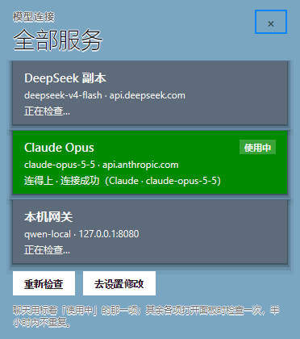
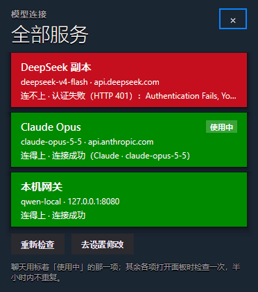

# PR 报告：点岛上的连接图标，看全部模型服务的连接状态（2026-11-14）

> **基线**：`177b256c`（Island: show the character's display name…, #42）
> **分支**：`claude/island-connections-panel`　**日期**：`2026-11-14`
> **范围**：2 个新实现文件 + 4 个改动文件（含两份语言文件）、1 个新测试文件、4 张截图、本报告与索引
> **关联**：同批 `PR-REPORT-ISLAND-API-STATUS-2026-11-14.md`（岛上写明查的是谁）、
> `PR-REPORT-MODEL-SERVICE-LIST-2026-11-14.md`（模型服务列表）；外壳沿用近 7 天仪表盘（`usage_dashboard_ui.py`）

## 一、核心特性

用户：「悬浮岛上的连接状态需要更新，点击那个连接状态，要显示配置的所有连接。」

以前：连接图标只表达聊天**在用**的那一项；点它和点胶囊别处一样是展开卡片，看不到别的服务。

| # | 能力 | 说明 |
|---|---|---|
| 1 | 连接图标可点 | 普通样式与 Metro 磁贴都有可点区（`DynamicIsland.link_rect`），点了发 `connections_requested`，不展开卡片；悬停提示多一行「点击查看全部模型服务的连接状态」 |
| 2 | 全部服务一屏看完 | 岛的上方弹出「模型连接 / 全部服务」：每个服务一张 Metro 实色磁贴——名称（在用的标「使用中」）、模型 · 主机、状态与原因；底色即状态：翡翠绿连得上、红连不上、钢灰还没查 / 正在查 |
| 3 | 状态从哪来 | 在用的那一项直接用岛上的体检结论（`ApiKeyMonitor`，不重复发请求）；其余各项打开面板时各查一次（同一个体检函数），按「地址 / 模型 / Key」指纹缓存 30 分钟；Key 或地址变了立刻重查 |
| 4 | 两个按钮 | 「重新检查」：让岛重查在用的那一项、其余各项不论缓存都重查；「去设置修改」：收起面板、打开设置 |
| 5 | 收起 | 点别处、Esc、右上角 ×，或再点一次连接图标 |

**红线 / 不变量**：岛的体检节奏不变（面板不启动任何定时器）；面板关着零开销；点胶囊其他位置的行为不变；
体检请求在后台线程、结果排队回 GUI 线程，晚到的旧结果丢弃。

## 二、修改文件说明

### 实现

| 文件 | 增删 | 改动意图 |
|---|---|---|
| `pet/island_connections.py`（新增） | +256 / −0 | `ServiceRow`；纯函数 `build_rows(settings, statuses, in_use=)`（配置顺序、主机名、去掉体检说明里重复的「名称 · 」前缀、没结论时给「还没检查 / 正在检查」）；控制器 `ConnectionsPanel`：`toggle`（`place_above` 摆在岛上方）、`rows`、`refresh(force=)`（跳过在用项、按指纹 + 30 min 缓存、按服务的代号丢弃旧结果）、`recheck`、`on_monitor_changed(state, detail)`、`settings_requested` |
| `pet/island_connections_ui.py`（新增） | +218 / −0 | `ServiceTile`（实色磁贴、白字三行、「使用中」小标、可访问名称 / 描述、悬停显示原因全文）；`ConnectionsWindow`（透明底 + 磁贴阴影、光晕页头页脚、Metro 令牌明暗主题、「重新检查」「去设置修改」、失焦 / Esc / × 收起；`set_rows` 行数不变原地更新，增删服务时重建） |
| `pet/dynamic_island.py` | +19 / −0 | `connections_requested` 信号；`link_rect()`（Metro 用 `link` 磁贴的可点区，普通样式按 `_toolbar_left` 倒推连接图标位置，与 `_content_cache` 的排法一致）与 `_link_hit`；`mouseReleaseEvent` 里在「今日用量」之后、展开卡片之前分流；悬停提示加一行 |
| `pet/app.py` | +19 / −0 | 建岛时接 `connections_requested → _toggle_connections_panel`；面板懒创建，接 `settings_requested → _open_settings_from_island`、`ApiKeyMonitor.status_changed → on_monitor_changed` |
| `pet/locale/zh.json` / `en.json` | +14 / −0 各 | `island.connections.*` 14 个键 |

### 测试

| 文件 | 增删 | 覆盖 |
|---|---|---|
| `tests/test_island_connections.py`（新增） | +266 / −0 | 点连接图标发信号、不展开卡片，点头像照旧展开；Metro 磁贴可点；不显示状态时没有可点区；`build_rows` 的顺序 / 主机 / 在用项 / 去重名前缀 / 没结论的说明；打开时在岛上方、列出全部、在用项不发请求、其余后台查、结果回来重画；一分钟内重开不重查、「重新检查」全部重查并让岛重查、半小时后重开重查；Key 变了重查且旧结果丢弃；在用项跟随岛的体检；「去设置修改」与 Esc；AppShell 接线（岛信号开 / 关面板、体检结论同步到面板） |

### 截图

`docs/screenshots/island-connections-2026-11-14/`：正在检查 / 检查完（浅 / 深），虚构数据。

### 未改动（故意）

- 没让 `ApiKeyMonitor` 去定时体检所有服务：只有聊天在用的那项需要常亮的灯；其余各项按需（打开面板时）查，避免给每个服务都定时发请求。
- 磁贴不可点进编辑：编辑在设置里（同批「模型服务列表」PR），面板只给「去设置修改」入口，不复制一套编辑界面。

## 三、实现要点

- **在用项不重复发请求**：岛的 `ApiKeyMonitor` 本来就在定时查它；面板读它的结论（信号带来的 `(state, detail)` 优先，没有时读
  `monitor.state / detail`），体检说明里的「名称 · 」前缀（同批岛状态 PR 加的）在行上去掉，不重复。
- **缓存与作废**：指纹 = 地址、路径、模型、接口格式、证书校验 + Key 的 SHA-256 前 12 位（不可逆推原 Key）。
  每个服务每次发起带一个递增代号；结果回来代号不匹配（期间 Key / 地址变了、或又点了重新检查）就丢弃。正在查的项再次 `refresh`
  不重复发起。删掉的服务从缓存里清掉。
- **体检函数**：默认走 `api_key_monitor._default_probe`（调用时再取，测试夹具对它的替身同样生效）——Claude 通道用 token 计数接口，
  不花输出额度；OpenAI 兼容通道发 max_tokens=1 的请求。
- **视觉**：Metro 实色磁贴、白字不描边、玻璃阴影，与近 7 天仪表盘同一外壳；底色对白字对比度：#008a00 4.5、#c50f1f 6.0、#5d6b7a 5.5。

## 四、性能分析

**方法**：`QT_QPA_PLATFORM=offscreen python scratch/perf.py <合并树>`；环境：Windows 11 Pro 10.0.26300、Python 3.13.15、PySide6 6.12.0。

| 指标 | 实测 | 归属 |
|---|---|---|
| `build_rows`，3 个服务 | 中位 2.6 µs，p95 3.5 µs，n=2000 | 新增，每次重画 |
| `build_rows`，10 个服务 | 中位 9.0 µs，p95 12.3 µs，n=2000 | 同上 |
| 打开面板，3 个服务 | 首次（建窗）8.3 ms，之后中位 1.22 ms，n=30 | 新增，每次点连接图标 |
| 打开面板，10 个服务 | 首次 3.8 ms，之后中位 1.91 ms，n=30 | 同上 |
| 体检请求 | 打开时 n−1 个（在用项除外），30 分钟内重开 0 个 | 新增网络，按需 |
| 真机一次体检往返（DeepSeek，401） | 0.5 s（真实环境探针，见第五节） | 后台线程，不阻塞界面 |

**结论**：① 稳态零开销——面板没有定时器，关着什么都不做；岛的体检节奏不变；② 新增路径：打开面板约 1–2 ms（首次建窗 4–8 ms），
加上每个非在用服务一次后台体检请求、30 分钟内不重复；③ 新增网络请求（按需、每服务一次）与短命 daemon 线程（每个请求一个，
请求结束即退出）；无磁盘写；④ 内存：每个服务一条缓存（状态、说明、指纹、时刻）与一张磁贴控件，面板窗口懒创建后复用。

## 五、实机运行记录

**真实环境探针**（合并树 `.claude/worktrees/conn-all`，含同批三个 PR；Windows 平台插件；用户真实配置的**副本**放临时 APPDATA；
真实 Windows 钥匙串只读；真实网络；脚本 `probe_real_panel.py`）：建岛 + 真 `ApiKeyMonitor`，等体检回来，在进程内对岛的
连接图标发一次鼠标松开事件（不动系统鼠标），截岛和面板：

```
island probe after 0.5s: state=bad
island tooltip: DeepSeek 副本 · 认证失败（HTTP 401）：Authentication Fails, Your api key: ****XXXX is invalid (requ…
panel open: True | rows: [('DeepSeek 副本', 'deepseek-v4-flash', 'api.deepseek.com', 'bad', True, '认证失败（HTTP 401）：Authentication Fails, Your api key: ****XXXX ')]
shots saved; real config untouched: 1794713605823240900
```

点连接图标打开了面板，列出了配置里的全部服务——用户盘上目前**只有一项**（「DeepSeek 副本」，在用、连不上）：
设置窗口里填好的 Claude Opus 还没保存（见同批岛状态报告）。保存后面板会列出它。真实配置截图含用户的角色名，未入库。

**外观（Windows 平台插件、真实字体；虚构数据，体检替身；脚本 `capture_panel.py`）**：

```
light checking 372 x 420 [('DeepSeek 副本', 'checking'), ('Claude Opus', 'ok'), ('本机网关', 'checking')]
light done     372 x 420 [('DeepSeek 副本', 'bad'), ('Claude Opus', 'ok'), ('本机网关', 'ok')]
```

| 正在检查（浅） | 检查完（深） |
|---|---|
|  |  |

**没做的**：没有在用户正在用的那只岛上用系统鼠标合成点击（用户可能正在动鼠标，见既往教训）；合并重启后请用户自己点一下连接图标确认。

## 六、测试与验证

| 门 | 命令 | 结果 |
|---|---|---|
| 静态检查 | `python -m ruff check pet tests` | All checks passed |
| 空白 | `git diff --check` | 通过 |
| 聚焦（先红） | `pytest -q tests/test_island_connections.py` | 基线上收集即失败（`pet.island_connections` 不存在、岛没有 `link_rect` / `connections_requested`），修后 11 passed |
| 相关 | `tests/test_island*.py`、`test_dynamic_island*.py`、`test_usage_dashboard.py`、`test_architecture.py`、`test_i18n.py`、`test_api_key_monitor.py` | 404 passed |
| 全量 | 未跑完（按用户要求） | 2026-11-14 用户把测试范围改为「新测试 + 受影响的测试族」，覆盖 `AGENTS.md` 的全量门。同批三个 PR 合并树上的全量在约 72% 处按此要求停掉：停之前出现 2 个失败，`-q` 输出在汇总前中断，没有认出是哪两条（本机有 5 个已知环境基线失败，见上一份报告），未单独复核。只跑了上面的聚焦与相关族 |

## 七、风险与回滚

新增模块 + 岛上一处点击分流，无配置迁移、无新持久设置。`git revert` 即可回滚；回滚后点连接图标回到展开卡片。
