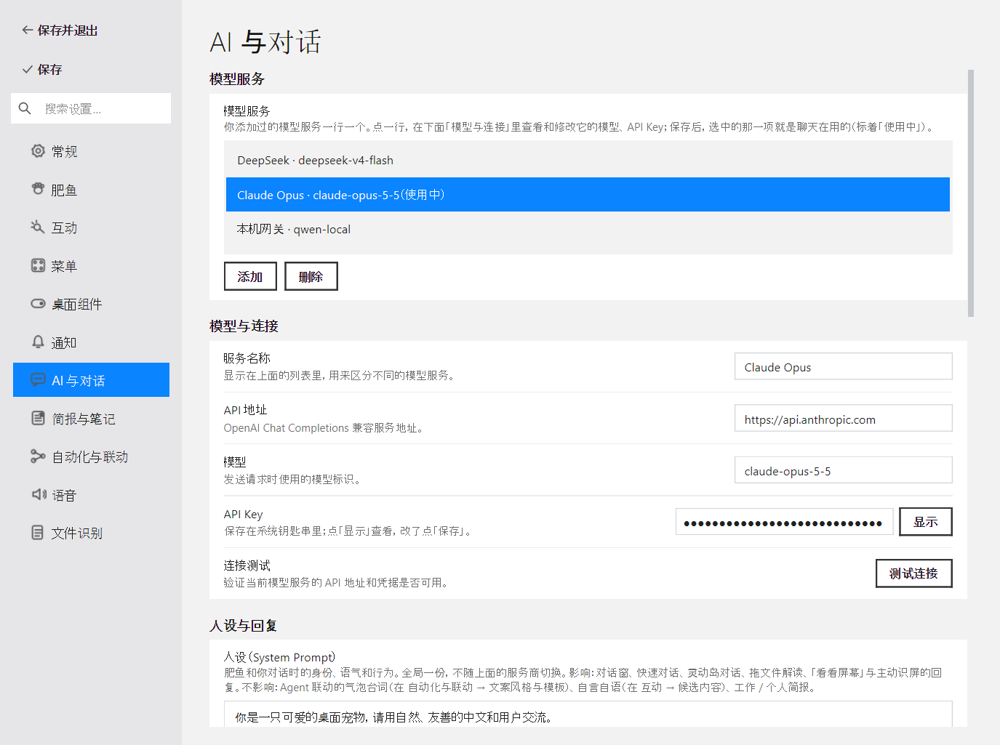
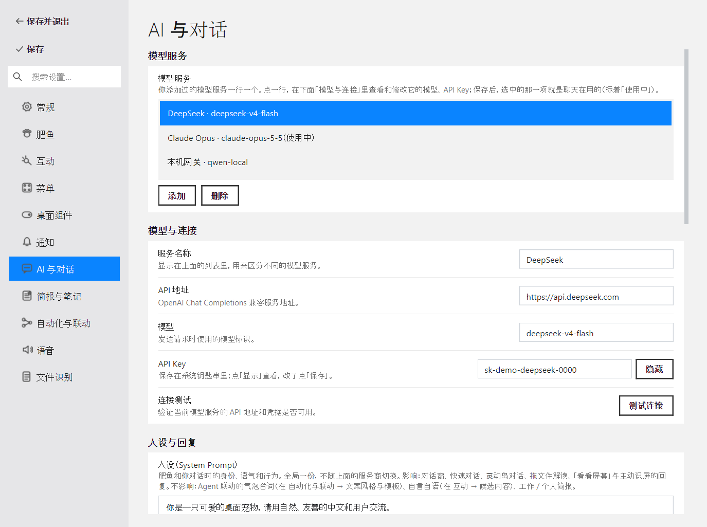
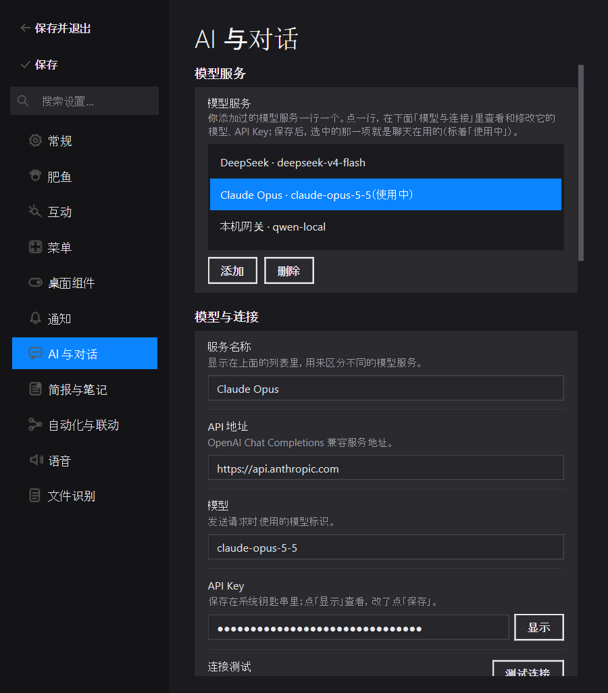
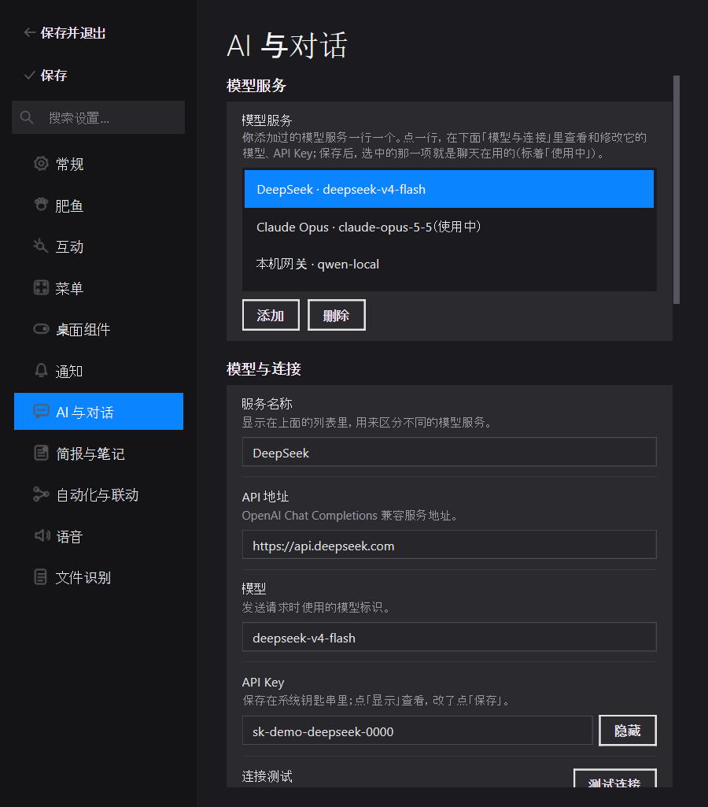

# PR 报告：模型服务一行一个，保存过的 API Key 看得见（2026-11-14）

> **基线**：`177b256c`（Island: show the character's display name…, #42）
> **分支**：`claude/model-service-list`　**日期**：`2026-11-14`
> **范围**：5 个实现文件（含两份语言文件）、1 个新测试文件、8 张截图、本报告与索引
> **关联**：`PR-REPORT-AI-PROVIDER-LIST-UX-2026-11-13.md`（#41，下拉框跟着编辑走、「使用中」）；
> 同批 `PR-REPORT-ISLAND-API-STATUS-2026-11-14.md`、`PR-REPORT-ISLAND-CONNECTIONS-PANEL-2026-11-14.md`

## 一、核心特性

用户：「模型服务保存的时候似乎 API key 在下次 load 时显示不出来，这样，我们每添加一个模型 API，都放在一个列表中，
在模型服务下面，点击可以查看 API key，更新模型和 API key。」

**查证：Key 没丢，只是不显示。** `_AiSettingsPage` 构造时 `self.key = _line_edit(password=True)` 不给初值，
`_load_provider_ui` 每次切换都 `self.key.clear()`——设计上「输入框为空 = 不改」，Key 一直在系统钥匙串
（`provider/<id>`）里。真机只读探针（第五节）确认用户钥匙串里那把 Key 在（106 字符，末 4 位与岛上 401 报错里的
`****XXXX` 一致）。用户看到的是「保存后再打开，Key 那一栏是空的」，以为没存上，于是又贴一遍。

| # | 能力 | 说明 |
|---|---|---|
| 1 | 一行一个服务 | 「模型服务」从下拉框换成列表 `ProviderList`（每个服务一行「名称 · 模型」，在用的标「（使用中）」，悬停显示地址；最多 6 行高、再多才滚动）；添加 / 删除按钮在列表下方 |
| 2 | 点一行就编辑它 | 点哪一行，下面「模型与连接」就是哪一项（名称、地址、模型、API Key……），改完点「保存」 |
| 3 | Key 看得见 | API Key 输入框打开时就填着这一项保存过的 Key（钥匙串优先，钥匙串不可用时是本次运行内存里那份），遮着；旁边「显示 / 隐藏」切换明文；换一行自动重新遮上 |
| 4 | 不白写钥匙串 | 输入框里还是原来那把 Key 时，保存不再重写钥匙串（以前空框不写；现在框里有字了，所以要显式跳过） |
| 5 | 文案 | 列表提示改成「你添加过的模型服务一行一个。点一行，在下面「模型与连接」里查看和修改它的模型、API Key；…」；Key 行提示「保存在系统钥匙串里；点「显示」查看，改了点「保存」。」；「服务名称」提示里的「下拉框」改「列表」 |

**红线 / 不变量**：保存语义不变——保存时选中的那一项成为 `active_provider`；草稿、删除集合、与磁盘快照合并的逻辑没动；
`setting_id`（`provider_list` / `api_key` 等）不变；没有新增或改名持久设置键；**清空 Key 输入框仍表示「不改」**（不会删 Key）。

## 二、修改文件说明

### 实现

| 文件 | 增删 | 改动意图 |
|---|---|---|
| `pet/settings_widgets.py` | +89 / −0 | 新增 `ProviderList(QListWidget)`：接口与 `ModernSelect` 同名同义（`addItem(文字, 数据)`、`currentData`、`setCurrentData`、`itemData`、`findData`、`setItemText`、`itemText`、`currentText`、`currentIndex`、`setCurrentIndex`、`currentIndexChanged`），外加 `setItemToolTip`；高度按行高 × min(行数, 6) 自适应，字体 / 样式变了重算 |
| `pet/chat/ai_settings_page.py` | +52 / −14 | `provider_combo` 换成 `ProviderList`，行改为 `stacked`（列表占满行宽，按钮在下）；`_add_provider_row`（文字 + 地址提示）替代三处 `addItem`；`_stored_key()`；Key 输入框带初值、`key_reveal` 按钮与 `_on_key_reveal_toggled`；`_load_provider_ui` 填草稿或已存 Key 并重新遮上；`_apply_draft_to_provider` 遇到原样 Key 跳过写钥匙串；去掉不再用的 `ResponsiveActionRow` 导入 |
| `pet/settings_theme_qss.py` | +4 / −0 | `QListWidget#providerList`：页面底色、方角、行高 30、悬停 `tile_hover`、选中实色 `selected`（与快捷启动列表同一套 Metro 令牌） |
| `pet/locale/zh.json` | +5 / −3 | 新增 `settings.ai.show_key` / `hide_key`；改 `credentials_are_stored_system_keychain`、`pick_model_service_edit_switch`、`tells_model_services_apart` |
| `pet/locale/en.json` | +4 / −2 | 同上（英文 `tells_model_services_apart` 原本就写 list，不用改） |

### 测试

| 文件 | 增删 | 覆盖 |
|---|---|---|
| `tests/test_model_service_list.py`（新增） | +109 / −0 | ① 列表是 `QListWidget`、两行都看得见，真实鼠标点第二行 → 下面编辑的就是它、Key 是它的；② 打开时 Key 遮着填好，「显示」切明文，换一行重新遮上；③ 改列表里某一项的模型和 Key 并保存 → 盘上模型、钥匙串 Key 更新，**只写了这一项的钥匙串**，重新打开设置还看得见新 Key |

测试放新文件而不是追加到 `tests/test_api_provider_list.py`：同批的岛状态 PR 也往那个文件末尾追加，两边放一起合并时 git 会把两段交错拼坏。

### 截图

`docs/screenshots/model-service-list-2026-11-14/`：打开（在用项选中、Key 遮着）与点 DeepSeek 一行并「显示」后，1100 / 720 宽 × 浅 / 深，虚构数据。

### 未改动（故意）

- 旧的「AI 设置」对话框 `pet/chat/settings_dialog.py`（`ChatSettingsDialog`）仍是下拉框、Key 框仍为空：用户用的是新设置窗口；旧对话框另做。
- 视觉 Key（`vision_key`）仍是「空 = 沿用聊天的」，不预填：它的空值有含义（复用聊天服务），预填会改变语义。
- `ModernSelect.setItemText` 等 #41 加的接口保留（别处仍在用 `ModernSelect`）。

## 三、实现要点

- **为什么做成「同名接口的 QListWidget」**：页面里添加 / 切换 / 删除 / 保存 / 「使用中」标记的逻辑都写在 `provider_combo`
  的那组方法上（#41 刚理顺）。换一个接口相同的控件，那些逻辑一行不动，风险最小；`QListWidget` 自带键盘上下选择、
  可访问性与选中态。
- **Key 预填与「空 = 不改」并存**：输入框有了初值，`_capture_current_draft` 收到的就是原 Key；`_apply_draft_to_provider`
  比对 `_stored_key()` 相同就不写。用户清空输入框仍按旧语义「不改」，不会误删钥匙串里的 Key。
- **安全面**：Key 只在设置窗口里、遮着显示；明文要用户点「显示」；换一行自动遮回。读钥匙串只发生在打开设置和切换行时，
  不进日志、不进配置文件。

## 四、性能分析

**方法**：`QT_QPA_PLATFORM=offscreen python scratch/perf.py <合并树>`（真实 `ModernSettingsDialog`，10 个服务，内存钥匙串；
真实钥匙串单独测）。环境：Windows 11 Pro 10.0.26300、Python 3.13.15、PySide6 6.12.0。

| 指标 | 实测 | 归属 |
|---|---|---|
| 点一行切换（载入表单 + 预填 Key，内存钥匙串） | 中位 24 µs，p95 42 µs，n=500 | 新增成本含在内，每次点行 |
| 真实 Windows 钥匙串读一次（未命中，含旧服务名回退） | 中位 207 µs，p95 400 µs，n=50 | 每次打开设置 / 点行多一次读 |
| 列表高度重算 | 每次增删一行一次 `sizeHintForRow` | 新增，次数 = 增删次数 |

**结论**：① 稳态零开销——只在设置窗口里、用户操作时运行；② 新增成本是每次打开 / 点行一次钥匙串读（真机 0.2–0.4 ms）；
③ 无新的网络、线程；钥匙串**写**反而变少（原样 Key 不重写）；④ 内存：每行一个 `QListWidgetItem`。

## 五、实机运行记录

**根因查证（本机真实环境，只读探针 `probe_real_key.py`）**：用户真实 `config.json` + 真实 Windows 钥匙串，打开新版 AI 页；
`Config.save` 与 `SecretStore.set` 在探针里替换成记录调用的空操作，Key 只打印长度和末 4 位：

```
config: %APPDATA%\big-fat-fish\config.json
row 0: DeepSeek 副本 · deepseek-v4-flash（使用中） | key field len=106 tail=…XXXX | echo=Password
writes during probe: []
```

钥匙串里那把 Key 一直在；新版页面打开就遮着填好。（基线代码上同一位置是空框：`_line_edit(password=True)` 不给初值，
聚焦测试 ② 在基线上的失败输出是 `assert '' == 'sk-deepseek-saved'`。）

**修后外观（Windows 平台插件、真实字体；虚构数据；脚本 `capture_service_list.py`）**：

```
1-open-1100-light.png | ['DeepSeek · deepseek-v4-flash', 'Claude Opus · claude-opus-5-5（使用中）', '本机网关 · qwen-local'] | key echo Password | list h 126
2-picked-revealed-1100-light.png | current DeepSeek · deepseek-v4-flash | key echo Normal
```

| 打开 1100 浅 | 点一行并显示 1100 浅 |
|---|---|
|  |  |

| 打开 720 深 | 点一行并显示 720 深 |
|---|---|
|  |  |

1100 与 720 宽、浅色与深色下无裁切；720 宽时 Key 行的输入框和「显示」按钮换到提示下方（`SettingRow` 既有响应式行为）。

**没在用户真实设置窗口里点**：用户自己的设置窗口开着、里面有未保存的改动，我没有操作它；新代码在合并、重启后、用户下次打开设置时生效。

## 六、测试与验证

| 门 | 命令 | 结果 |
|---|---|---|
| 静态检查 | `python -m ruff check pet tests` | All checks passed |
| 空白 | `git diff --check` | 通过 |
| 聚焦（先红） | `pytest -q tests/test_model_service_list.py` | 基线上 3 条全红（不是 `QListWidget`；Key 框为空 ×2），修后 3 passed |
| 相关 | 设置窗口、多语言、聊天子系统、提问回归、知识库 / 连接器等 11 个文件 | 419 passed，2 skipped |
| 全量 | 未跑完（按用户要求） | 2026-11-14 用户把测试范围改为「新测试 + 受影响的测试族」，覆盖 `AGENTS.md` 的全量门。同批三个 PR 合并树上的全量在约 72% 处按此要求停掉：停之前出现 2 个失败，`-q` 输出在汇总前中断，没有认出是哪两条（本机有 5 个已知环境基线失败，见上一份报告），未单独复核。只跑了上面的聚焦与相关族 |

## 七、设置变更门禁（`docs/SETTINGS-CHANGE-GATES.md`）

- **契约**：无新增 / 改名 / 删除持久设置；`setting_id` 不变（搜索照旧命中「模型服务」「API Key」）；保存语义不变；
  Key 仍只存系统钥匙串（不可用时仅本次运行内存，写盘前剔除，既有行为）。
- **TDD**：见第六节；Qt 行为从设置窗口 seam 测，列表点击用真实鼠标事件（`QTest.mouseClick`）。
- **布局与可访问性**：1100 / 720、浅 / 深截图无裁切；列表支持键盘上下选择；「显示 / 隐藏」按钮的 accessible name 跟着状态变；
  切行后明文自动遮回。放大字体：列表行高按字体度量（`fontMetrics().height() + 14` 与 `sizeHintForRow` 取大）。
- **跨平台**：纯 Qt 控件，无平台分支；钥匙串经 `keyring`（三端各自后端）；真实平台只验证了 Windows。
- **视觉与文档**：截图如上；Shared UX Contract 未变。

## 八、风险与回滚

无配置迁移。`git revert` 即可回滚；回滚后 Key 框回到「打开为空」，钥匙串内容不受影响。
