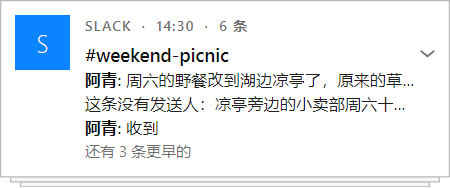
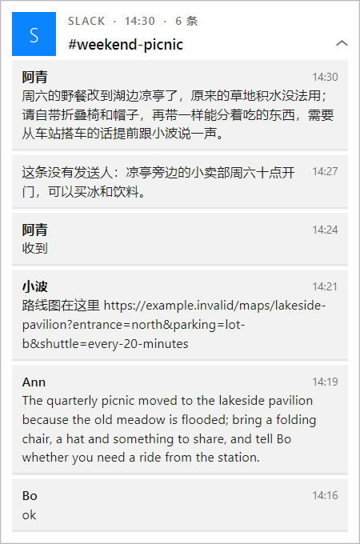
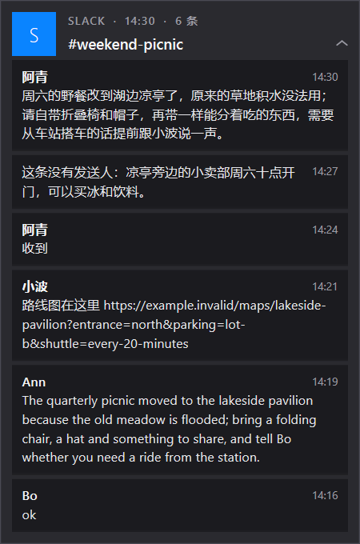
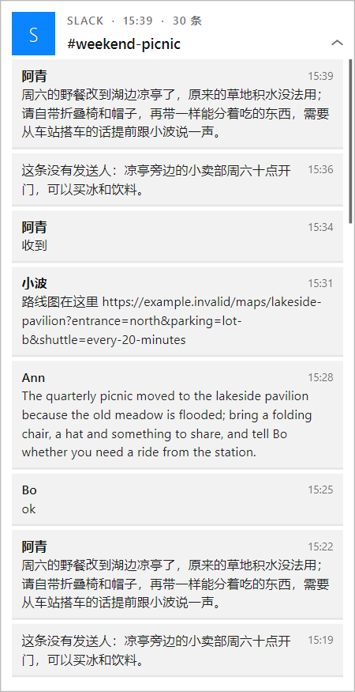
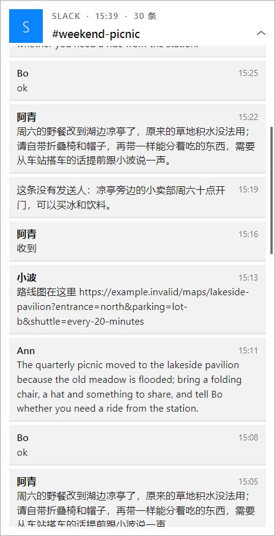

# PR 报告：通知卡片展开后每条消息显示全文

> **基线**：`42411560`（docs(memory-distill): 第三期报告追记，#37）
> **分支**：`claude/elated-mahavira-eab2bf`　**日期**：`2026-11-12`
> **范围**：4 个文件 + 5 张截图（实现 1、测试 1、文档 2）
> **关联**：[`PR-REPORT-NOTIFICATION-TOASTS-2026-10-28.md`](PR-REPORT-NOTIFICATION-TOASTS-2026-10-28.md)（自家通知弹窗的由来）、
> [`PR-REPORT-TOAST-TOPMOST-2026-11-02.md`](PR-REPORT-TOAST-TOPMOST-2026-11-02.md)（展开的一摞按展开高度摆位）

## 一、核心特性

同一来源的通知叠成一摞，点一下展开。展开后原来每条仍是**单行**「发送人: 正文开头…」，放不下的用省略号截掉，
最多列 8 条、再多写「还有 N 条更早的」——想看全文只能跳去原应用。现在展开后每条消息各占一张小卡片，正文折行
显示全文。

先确认了省略发生在哪一层（第五节有实测）：采集端 `notification_center._read_async` 把 toast 的文字元素原样拼起来，
**不截断**；本机通知中心里聊天应用的正文最长 1057 字、没有一条以省略号结尾。截断只发生在展开态的绘制
（`QFontMetrics.elidedText`）。所以只改绘制与排版，不动采集。

| # | 能力 | 说明 |
|---|---|---|
| 1 | 展开 = 每条一张全文小卡片 | 第一行发送人（加粗）+ 右侧时间，下面正文按宽度折行，全文、不省略；原文的换行保留成分段；没有空格的长串（网址）在任意字符处折开。没有发送人的消息正文从第一行起、第一行右边让出时间 |
| 2 | 卡片随内容长高 | 整张卡片高度 = 标题区 + 所有小卡片；下面的卡片照旧按新高度让位 |
| 3 | 不超出屏幕工作区 | 最高到「所在屏可用区高度 − 上下各 `MARGIN`(16)」；内容更高时卡片停在这个高度，标题区固定，小卡片区域用滚轮滚动，右边一条细滚动条表示还有内容 |
| 4 | 展开后全部列出 | 这一摞记着的全部消息（上限仍是 `_MAX_GROUP` = 30 条）都列出来，不再有「还有 N 条更早的」 |
| 5 | 点哪张跳哪条 | 沿用原语义：点某张小卡片跳到那条、只拿掉那一条；点标题区收起；滚动后点击命中的仍是视口里看到的那张，视口外的点不到 |

**红线 / 不变量**：

- 收起态（单条卡片、一摞的三行摘要 +「还有 N 条更早的」+ 纸边）的外观、高度、交互不变。
- 展开着不倒计时；收起后从头倒计时；来新消息这摞挪回最靠角——不变。
- 置顶看门狗、排队 / 补位、`max_visible`、划走 / 关闭——不变。
- 无新增配置键、无落盘格式变化、无文案键增删（`notices.toast.more` 仍用于收起态）。

## 二、修改文件说明

`git diff --numstat 42411560 HEAD`：

### 实现

| 文件 | 增删 | 改动意图 |
|---|---|---|
| `pet/notification_toast.py` | +210 / −40 | **纯函数**：新增 `wrap_full`（全文折行：按段落保留原文换行、`WrapAtWordBoundaryOrAnywhere`、可给第一行单独的宽度）、`MessageBlock` + `message_blocks`（一摞消息排成一列小卡片的位置 / 高度 / 发送人 / 时间 / 折好的行）、`_expanded_height`；`card_height` 多一个 `max_height` 参数，只对展开的一摞生效。**`ToastCard`**：构造参数 `max_height` 与 `set_max_height`（由叠放管理器给，不发 `resized`，避免重排中再触发重排）；`_message_blocks` 缓存排版，内容变了（`_resize`）才重算；`row_count` 展开后 = 全部条数、`more_count` 展开后 = 0；`row_rect` 展开后返回那张小卡片按滚动位置算的矩形；新增 `row_lines` / `viewport_rect` / `scroll_max` / `scroll_offset` / `scroll_to` / `wheelEvent`；`row_at` 展开后只认视口里的点；`_render` 展开后走新的 `_paint_blocks`（只画视口内的小卡片 + 滚动条），`_paint_rows` 只剩收起态的分支。**`ToastStack`**：`_height_limit`（屏幕可用区高 − 2×`MARGIN`），`_reflow` 先把上限交给每张卡、再用卡片**实际高度**摆位（原来每次重排对每张卡重新算一遍 `card_height`）。删掉 `_XROW_H` / `_EXPANDED_ROWS` / `_shown_rows`（展开态不再是定高行）。模块文档同步改写展开一段 |

### 测试

| 文件 | 增删 | 覆盖 |
|---|---|---|
| `tests/test_notification_toast.py` | +93 / −0 | 5 个新用例，全部用虚构内容：`wrap_full` 一字不少、长串折开、换行保留；展开后每条 `row_lines` 拼回去等于原文、无省略号、小卡片不重叠、高度随行数长、收起后高度复原；展开后 12 条全列且 `more_count` = 0；30 条长消息时卡高 = 工作区高 − 2×`MARGIN`、整卡在工作区内、最后一条起初点不到、滚轮滚动、滚到底后最后一条完整可见且点击跳到的是最旧那条、收起后滚动归零；`card_height` 的 `max_height` 只影响展开态 |

### 文档

| 文件 | 增删 | 内容 |
|---|---|---|
| `docs/PR-REPORT-TOAST-EXPANDED-FULL-TEXT-2026-11-12.md` | 新增 | 本报告 |
| `docs/INDEX.md` | +1 | 「PR 报告存档」登记 |
| `docs/screenshots/toast-expanded-full-text-2026-11-12/*.png` | 新增 5 张 | 虚构数据、真实字体的卡片渲染：收起、展开（明 / 暗）、封顶、封顶后滚动 |

### 未改动

- `pet/notification_center.py`：采集不截断（第五节），无需改。
- `pet/locale/*.json`：`notices.toast.more` 收起态仍在用，没有新文案。
- `pet/app.py`：`ToastStack` 的对外接口（`push` / `apply_settings` / `activated`）没变。
- `.agents/skills/desktop-pet-ui-style/references/visual-system.md`：沿用既有 `METRO_TOKENS`（`page` / `match` / `muted`），没有新令牌。

## 三、实现要点

**排版与绘制分开。** `message_blocks(notices)` 是纯函数，只依赖字体度量：给出每张小卡片在「内容区」里的 `top` /
`height` 和折好的行。卡片高度、点击命中（`row_rect`）、绘制（`_paint_blocks`）三处都读同一份结果，不会出现
「画在这里、点在那里」。`ToastCard` 把它缓存在 `_blocks`，只有 `_resize`（换内容 / 展开 / 收起 / 换上限）才作废；
滚动和悬停只作废位图缓存，不重新折行。

**限高在叠放管理器、不在卡片里猜屏幕。** 卡片不知道自己在哪块屏；`ToastStack._height_limit` 用目标屏的
`availableGeometry()`（已让开任务栏）减去上下 `MARGIN`，在每次 `_reflow` 开头交给所有卡片。`stack_positions`
本来就保证「第一张无论多高都给位置」，所以以前一张超高的卡会伸出屏幕；现在卡片自己不会超过上限，这条兜底不再
触发越界。靠下的角（`bottom_*`）卡片向上长，同一个上限同样成立。

**滚动。** 展开且内容高于视口时 `wheelEvent` 生效：一格（120）滚 3 行字（57 px），触控板的 `pixelDelta` 按像素走；
范围夹在 `[0, scroll_max]`。内容变少（点走一条）时 `_resize` 把滚动位置收回范围内，收起时归零。内容不超高时
滚轮事件原样交回基类（不吞）。卡片是不抢焦点的工具窗，没有键盘路径——与卡片其余交互（点 / 划）一致，
键盘用户走灵动岛的消息记录。

**视觉。** 延续 Metro 实色块：小卡片用 `page` 色（比卡面 `tile` 深一档：浅色 `#f2f2f2` 压在 `#ffffff` 上、
深色 `#1b1b1f` 压在 `#2a2a2f` 上），方角、无描边；底下 2 px 半透明黑（浅色 α26 / 深色 α70）当玻璃阴影给一点
厚度；鼠标下那张换成淡强调色 `match`（`#dcebff` / `#223a5c`），不用饱和的 accent。第一张小卡片从标题区下
6 px 起，让开左上角应用磁贴的下沿。

**取舍。**

- *展开后还要不要「还有 N 条更早的」*：不要。那行字原本是定高列表放不下的补偿；有了滚动，全列出来更直接，
  也不用再解释「更早的去哪看」。一摞最多记 30 条（`_MAX_GROUP`，未改）——更早的在 Windows 通知中心 / 原应用里。
- *超长单条*：不设行数上限，全文照排；本机见过的最长正文 1057 字，靠整卡的限高 + 滚动兜住。
  给单条再套一层「展开更多」会回到用户要去掉的那种截断。
- *为什么不用 `QScrollArea` / 子控件*：卡片是一张缓存位图再套进场 / 倾斜 / 划走的变换画出来的，子控件不跟着
  变换走；沿用自绘 + 命中矩形，改动面最小。
- *`_reflow` 改用卡片实际高度*：卡片高度现在取决于上限，重排时再用纯函数各算一遍就得把上限也传一遍，还要给每张
  展开的卡重新折行；直接读 `card.height()`（`_resize` 同步设好的）只有一个真相来源。

## 四、性能分析

**方法（可复现）**：下面的数字来自一次性的计时脚本（未入库，逻辑：虚构的 30 条 × 约 130 字的长消息 /
6 条长短混合的消息，`time.perf_counter` 包住被测调用，各 200 次取中位数与 p95；旧实现用
`git show 42411560:pet/notification_toast.py` 的副本在同一进程条件下测）。
环境：Windows 11 Pro 26300、Python 3.13、PySide6（仓库 `.venv`）、真实窗口平台（非 offscreen）、主屏 125 % 缩放
（位图按 1.25 倍像素画）。

| 指标 | 实测（中位数 / p95） | 归属 |
|---|---|---|
| 收起态一摞重画 `_render` | 0.43 ms / 0.58 ms（旧实现同一路径代码未变） | 既有热路径，未变 |
| 旧：展开态重画（8 行定高，卡高 293） | 0.91 ms / 1.16 ms | 既有（被替换） |
| 新：展开态重画（30 条长消息，卡高封顶 1000，视口内约 7 张） | 2.85 ms / 3.21 ms | 新增 |
| 新：滚轮一格（`scroll_to` + 重画） | 2.83 ms / 3.10 ms | 新增，只在用户滚动时 |
| 新：`message_blocks` 折行，30 条长消息 | 1.35 ms / 1.82 ms | 新增，只在展开 / 换内容时 |
| 新：`message_blocks` 折行，6 条混合 | 0.16 ms / 0.23 ms | 同上 |
| 旧：展开 + 收起一轮（不含绘制） | 1.60 ms / 2.82 ms（n=100） | 既有 |
| 新：展开 + 收起一轮（不含绘制，30 条长消息） | 2.96 ms / 4.26 ms（n=100） | 新增 |

**结论**：

1. **稳态开销**：没有展开的卡片时走的代码路径不变（收起态绘制 0.43 ms，与改前同一段代码）；`_reflow` 每次少算
   一遍 `card_height`（对在场的每张卡），多一次 `availableGeometry()` 读取和每张卡一次整数比较。没有新增定时器。
2. **新增路径**：展开一摞 30 条长消息，折行 1.35 ms + 首次绘制 2.85 ms ≈ 4.2 ms，一次点击触发一次；之后每个滚轮
   格 / 悬停换行各重画一次 ≈ 2.8 ms（低于 60 Hz 一帧的 16.7 ms）。来新消息并进一摞展开着的卡片时重新折行一次
   （≤ 1.35 ms）。绘制只画视口内的小卡片，成本随视口高度、不随总条数增长。
3. **系统调用 / 网络 / 磁盘 / 线程**：都没有新增。`set_max_height` 不触发窗口系统调用，除非高度真的变了
   （`setFixedSize`，与原来展开 / 收起同一个调用）。
4. **内存**：每张展开过的卡多缓存一份排版（30 条 × 每条几行字符串，量级为几 KB），收起 / 换内容时作废重建；
   位图缓存从最大 360×293 逻辑像素变为最大 360×(工作区高 − 32)：本机主屏封顶 1200 时，按 1.25 倍缩放 32 位色为
   450×1500×4 ≈ 2.7 MB（旧 0.66 MB），只在这张卡展开期间占用，卡片删除时释放。

## 五、实机运行记录

环境：本机 Windows 11，三屏 125 % 缩放，主屏可用区 3072×1232（逻辑像素）。所有截图入库的只有**虚构数据**；
真实通知的截图只在本地看过、不入库。

### 1. 前提的现场复现：省略发生在绘制，不在采集

对本机通知中心跑 `notification_center.read_toasts`，只统计正文长度（不输出内容）：

```text
chrome n=5  max=927  median=179 top5=[177, 178, 179, 179, 927] multi-line=1 ends-with-ellipsis=4
slack  n=20 max=1057 median=77  top5=[350, 381, 381, 530, 1057] multi-line=2 ends-with-ellipsis=0
```

- 聊天应用的 20 条里最长 1057 字、没有一条以省略号结尾——**采集端拿到的就是全文**，旧卡片上的「…」是我们自己画的。
- 浏览器网页通知 5 条里有 4 条在约 178 字处以省略号结尾：这是**发通知的网站自己截的**（通知载荷里就只有这么多），
  我们这边没有更多可取。见第七节。

### 2. 真实桌面上的叠放（虚构数据，真实窗口 / 真实屏幕）

在本机桌面上起一个真实的 `ToastStack`（非 offscreen，右上角、主屏），推入虚构消息，脚本输出：

```text
screen Dell AW3821DW geometry QRect(0, 0, 3072, 1280) available QRect(0, 0, 3072, 1232) dpr 1.25
collapsed: height 150 rows 3 more 3
expanded 6: height 544 rows 6 more 0 scroll_max 0 inside work area True
expanded 30: qt geometry QRect(2696, 16, 360, 1200) win32 rect (physical px) (3370, 20, 3820, 1520)
  content height 2448 limit 1200 card height 1200 scroll_max 1248 inside work area True
after 5 wheel notches: scroll_offset 285
scrolled to end: 1248 last row fully visible True
clicked last block -> activated uid [1] remaining 29
```

- 6 条：卡片从 150 长到 544，全部列出，无滚动，在工作区内。
- 30 条：内容本身 2448 px，卡片停在 1200（= 1232 − 2×16），`GetWindowRect` 给的物理像素矩形底边 1520 <
  工作区底 1540；滚 5 格走 285 px（5×57）；滚到底后最后一条完整可见，点它跳到的是最旧那条（uid 1）。

卡片渲染（`QWidget.grab()`，真实字体）：

| 收起（不变） | 展开·浅色 | 展开·深色 |
|---|---|---|
|  |  |  |

| 30 条·封顶 | 封顶后滚动（右侧滚动条） |
|---|---|
|  |  |

### 3. 真桌宠进程

桌宠从本工作区启动（`BigFish.exe -m pet`，工作目录 = 本 worktree；日志里的素材路径是本 worktree 的），
前后核对 `pet-overlay-gate.log` 最后一行的 pid 没变。探针不动真实光标：`EnumWindows` 找到该 pid 下宽 450 物理像素
（360 × 125 %）的卡片窗口，`PostMessage` 发 `WM_LBUTTONDOWN / UP`，用 `GetWindowRect` 量前后矩形，只输出几何。

- **第一次（pid 62608，只含本 PR 的代码）**：12:52 启动，日志无 ERROR / Traceback；13 分钟内到达的真实通知都来自
  不同来源，在场的是 3 张单条卡片（高 106 / 106 / 130 物理像素，与改前一致），没等到同一来源的一摞。
- **第二次（pid 71096，本 PR + 叠在上面的「其他应用按应用叠」）**：13:06 启动，13:08 一个聊天频道来了第二条，
  成了一摞：

```text
before          rect (3370, 20, 3820, 155) height 135 work (0, 0, 3840, 1540)
posted click    (卡片中部)
after-expand    rect (3370, 20, 3820, 203) height 183 work (0, 0, 3840, 1540)
posted click    (标题区)
after-collapse  rect (3370, 20, 3820, 155) height 135 work (0, 0, 3840, 1540)
```

  收起 135（= 108 逻辑像素，两行摘要 + 一层纸边）→ 展开 183（= 146 逻辑像素：标题区 60 + 两张单行小卡片各 33 + 间隔 6
  + 阴影 2 + 底边 12 + 取整）→ 点标题区收回 135。展开时抓了一张该窗口矩形的截图在本地看过：两条消息各一张小卡片、
  时间在右、无省略号（内容是真实通知，**不入库**）。前后 gate log 的 pid 都是 71096，日志无 ERROR / Traceback。
- **没在真桌宠上看到的**：超过工作区高度的一摞（需要同一来源攒到十几条长消息）。这条路径由第 2 步真实桌面上的
  虚构数据探针覆盖（同一份 `ToastStack` / `ToastCard` 代码、同一块屏、同样的窗口标志）。

### 4. 边界与失败路径

- **视口外点不到**：30 条封顶时，未滚动前对最后一条的矩形中心做命中测试返回 −1（测试断言 + 上面脚本的滚动前后对照）。
- **内容不超高时滚轮不被吞**：`scroll_max()` 为 0 时 `wheelEvent` 交回基类（6 条那次 `scroll_max 0`）。
- **真实屏幕抓图会带进别的卡片**：第 2 步最初用整屏区域抓图，真桌宠的卡片被看门狗重新置顶后盖在探针卡片上，
  抓到了真实通知——这些图已删除，入库的改用 `QWidget.grab()` 只渲染卡片本身。

## 六、测试与验证

| 门 | 命令 | 结果 |
|---|---|---|
| 静态检查 | `python -m ruff check pet tests` | All checks passed |
| 聚焦（改前） | `pytest -q tests/test_notification_toast.py` | 5 failed / 29 passed（5 个新用例：`wrap_full` 不存在、`row_lines` 不存在、展开后 `row_count` 8≠12、`card_height` 不认 `max_height` 等） |
| 聚焦（改后） | 同上 | 34 passed |
| 相关族 | `pytest -q tests/test_notification_toast.py tests/test_app_notification_toasts.py tests/test_notification_center.py tests/test_notification_service.py tests/test_settings_notifications.py` | 111 passed |
| 相关族 3 遍（第 1 遍与全量并行） | 同上 | 111 passed × 3（9.42 s / 3.35 s / 3.28 s） |
| 全量 | `python -m pytest -q -p no:cacheprovider`（本隔离 worktree，`QT_QPA_PLATFORM=offscreen`，APPDATA 重定向） | 7 failed / 6147 passed / 14 skipped，9 min 44 s。7 个失败与 [`PR-REPORT-ISLAND-COLLAPSE-RETURNS-2026-11-06.md`](PR-REPORT-ISLAND-COLLAPSE-RETURNS-2026-11-06.md) 第六节记录的既有失败逐个相同（image_directory_picker、festival_id_guard / catalog_animation_count_guard 的 `-O` 子进程、real_second_process_refused、capture_window_rect、host_icons_are_warmed、modern_context_menu_has_compact_semantic_groups），都不在通知相关文件里 |
| `git diff --check` | | 干净 |

新用例不含固定 sleep / 时序断言（动画关掉、滚轮事件同步投递）。

## 七、已知限制与后续

- **网页通知的正文在来源处就被截断**：浏览器网页通知多数在约 178 字处以「…」结尾（第五节实测），这是网站
  发通知时自己截的，通知中心 / 通知库里都只有这么多。要全文只能走各网站自己的接口（例如邮件走邮件 API），
  不属于通知读取这条链路；本 PR 不做。展开后这类消息显示的是「载荷里的全部」，末尾的「…」是原文自带的。
- **一摞最多记 30 条**（`_MAX_GROUP`，未改）：更早的不在卡片里，在通知中心 / 原应用里。
- **没有拖动滚动 / 键盘滚动**：只有滚轮（和触控板）。卡片横向拖是「划走」，纵向拖没有绑定。
- **单条通知的卡片**（不成摞）仍是正文最多两行 + 省略：本次只改「一摞展开后」，单条卡片点了就是跳转，没有展开态。
  如果也想看单条的全文，需要先定交互（点 = 跳转 与 点 = 展开 冲突）。

## 八、风险与回滚

- 影响面：只有 `pet/notification_toast.py` 的展开态排版 / 绘制 / 命中与 `ToastStack._reflow` 的高度来源；
  无配置键、无落盘数据、无文案变化。
- 回滚：`git revert` 即可，无残留状态。
