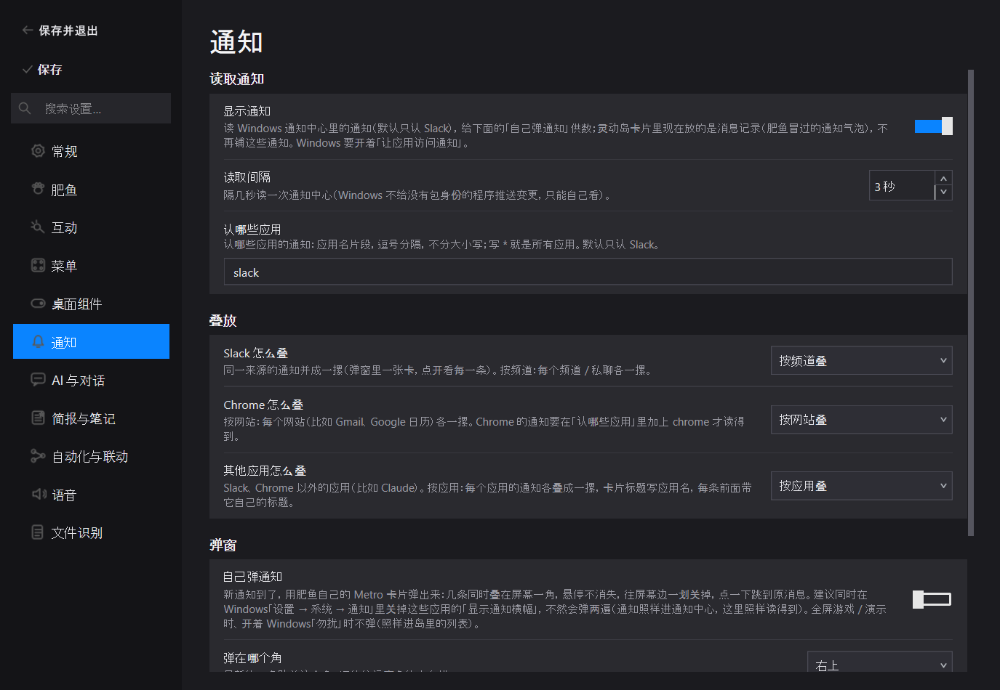
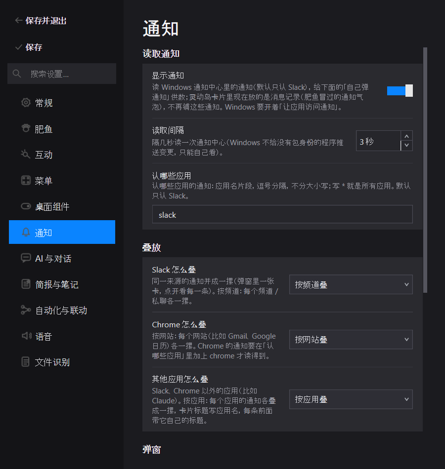
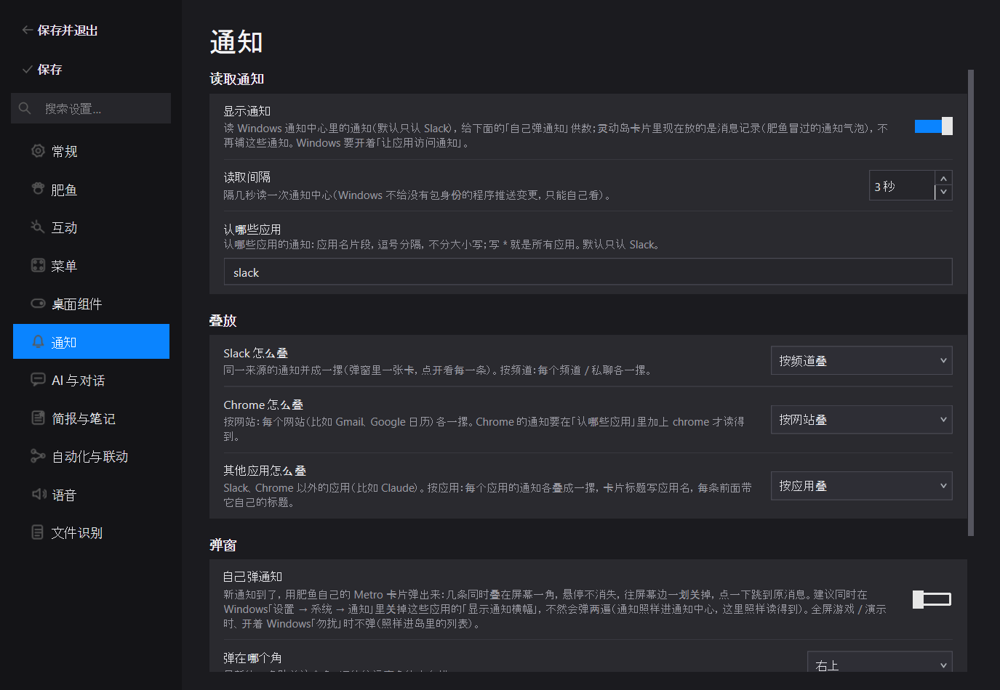
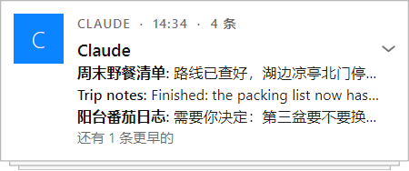
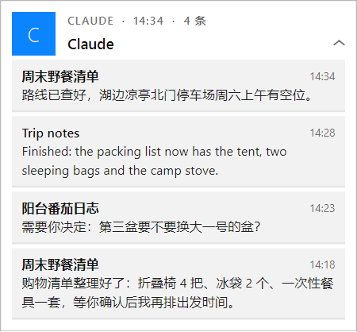

# PR 报告：其他应用的通知按应用叠成一摞

> **基线**：`417f012d`（展开的一摞每条消息一张全文小卡片；本 PR 叠在它上面）
> **分支**：`feature/toast-stack-other-apps`　**日期**：`2026-11-12`
> **范围**：10 个文件 + 5 张截图（实现 5、测试 4、文档 2）
> **关联**：[`PR-REPORT-TOAST-EXPANDED-FULL-TEXT-2026-11-12.md`](PR-REPORT-TOAST-EXPANDED-FULL-TEXT-2026-11-12.md)（下层 PR）、
> [`PR-REPORT-NOTIFICATION-TOASTS-2026-10-28.md`](PR-REPORT-NOTIFICATION-TOASTS-2026-10-28.md)（叠放规则的由来）、
> [`SETTINGS-CHANGE-GATES.md`](SETTINGS-CHANGE-GATES.md)

## 一、核心特性

设置「通知 → 叠放」原来只有 Slack（按频道）和 Chrome（按网站）两条规则，其他应用的通知每条各占一张卡片——
Claude 的几个会话接连发通知时，屏幕一角就是一排 Claude 卡片。现在加第三条规则「其他应用怎么叠」，默认
**按应用叠**：Slack、Chrome 以外的每个应用各叠成一摞（Claude 的所有通知一摞）。

| # | 能力 | 说明 |
|---|---|---|
| 1 | 叠放规则 `other` | `notifications.stack.other`：`app`（默认）/ `off`。归组键 `app:<AUMID 小写>`，没有 AUMID 用应用名；两样都没有的不归组 |
| 2 | 设置项 | 「通知 → 叠放」第三行「其他应用怎么叠」：按应用叠 / 不叠，每条单独。保存语义同另外两行（随设置窗口的保存） |
| 3 | 混合标题的一摞 | 按应用叠的一摞里每条的标题不一样（不同会话 / 不同邮件）：卡片标题写**应用名**，每条前面加粗的那截是它**自己的标题**，正文原样（发送人留在正文里）。标题都一样的一摞（一个 Slack 频道）照旧：频道名 +「发送人: 消息」。Slack / Chrome 设成「整个应用叠成一摞」时同样受益（以前只显示最新那条的标题） |

**红线 / 不变量**：

- Slack / Chrome 两条规则的选项、默认值、归组键不变。
- 旧配置（`stack` 里没有 `other`）读出来补默认 `app`，不需要迁移代码；写回时带上新键。
- 归组只影响自家弹窗的卡片；通知读取、灵动岛消息记录、跳转不变。
- 展开 / 收起 / 滚动 / 点哪条跳哪条沿用下层 PR 的语义。

**设置准入**（`SETTINGS-CHANGE-GATES.md`）：是偏好（以后一直这么叠）、低频、有可靠默认值、归属唯一
（`通知 / 叠放`，与另两条规则并列）、产品无法替用户推断（有人要一摞、有人要每条单独）；三端共用同一个
setting ID 与默认值，无平台分支（通知读取本身只在 Windows 可用，这一页的可见性规则未变）。

## 二、修改文件说明

`git diff --numstat 417f012d 39bca0fa`（实现与测试）：

### 实现

| 文件 | 增删 | 改动意图 |
|---|---|---|
| `pet/notification_center.py` | +11 / −5 | `STACK_CHOICES` / `STACK_DEFAULTS` 加 `other`（`off` / `app`，默认 `app`）；`source_key`：非 Slack / Chrome 的通知不再一律返回空，而是按 `other` 规则返回 `app:<AUMID 或应用名，小写>`，`off` 或两样都没有时返回空。`normalize_stack` 不用改（按 `STACK_CHOICES` 遍历，旧配置自动补默认） |
| `pet/notification_toast.py` | +33 / −8 | 新增纯函数 `mixed_titles`（一摞里标题是否不一样）、`label_and_message`（一条前面加粗的那截 + 正文：标题一样用 `split_body`，不一样用自己的标题 + 整段正文）；`message_blocks` 与 `_paint_rows` 改用它；`ToastCard.title_text()`（混合标题的一摞返回应用名）与 `row_label()`；`_paint_header` 用 `title_text()`。模块文档补一句 |
| `pet/settings_notifications.py` | +8 / −1 | `_STACK_KEYS` 加 `other` 两个选项的文案键；多建一个下拉框 `notifications_stack_other_select`、一行 `notifications_stack_other`，放进「叠放」一节；保存时写 `stack.other` |
| `pet/locale/zh.json` | +3 | `settings.notifications.stack_other` / `stack_other_hint` / `stack_app_other` |
| `pet/locale/en.json` | +3 | 同上的英文 |

### 测试

| 文件 | 增删 | 覆盖 |
|---|---|---|
| `tests/test_notification_center.py` | +15 / −5 | 默认规则下其他应用的键（AUMID / 只有应用名 / 都没有 → 空）、Claude 归 `other`；`other: off` 不归组；`other` 不影响 Slack 的键；旧配置补默认；不认识的值退回默认；`STACK_CHOICES["other"]` |
| `tests/test_notification_toast.py` | +31 / −2 | 夹具把 `other` 设成 `off`（摆放 / 排队那批用例要每条一张卡）；默认规则下同一应用并成一摞、别的应用各自一张；混合标题的一摞：`title_text()` 是应用名、`row_label` 是各自标题、正文原样；同一标题的 Slack 一摞照旧 |
| `tests/test_settings_notifications.py` | +8 / −2 | 新行在「通知」页；下拉选项 = `STACK_CHOICES["other"]`、默认 `app`；改成 `off` 保存后读回 |
| `tests/test_app_notification_toasts.py` | +1 / −1 | 配置里的叠放规则传到弹窗：期望值多了补出来的 `other: app` |

### 文档

| 文件 | 增删 | 内容 |
|---|---|---|
| `docs/PR-REPORT-TOAST-STACK-OTHER-APPS-2026-11-12.md` | 新增 | 本报告 |
| `docs/INDEX.md` | +1 | 登记 |
| `docs/screenshots/toast-stack-other-apps-2026-11-12/*.png` | 新增 5 张 | 设置页（1100 / 720 / 深色）、按应用叠的一摞收起 / 展开（虚构数据） |

### 未改动

- `pet/app.py`：`_sync_notification_toasts` 本来就把整个 `stack` 字典交给 `ToastStack`，新键自动带上。
- `pet/config.py`：没有针对 `notifications.stack` 的迁移 / 校验代码，规范化都在 `notification_center.normalize`。
- `notification_center.Notice.kind`：`claude` 这个种类仍保留（跳转退路按它分），只是叠放规则把它并进 `other`。

## 三、实现要点

**一条规则管「其余所有」，不是逐个应用加规则。** `STACK_CHOICES` 的键原本就是「应用种类」；新加的 `other`
覆盖 Slack / Chrome 以外的全部（含 `claude`、`other` 两个种类）。以后某个应用需要自己的归法（比如邮件按发件人），
再给它单独加一条，不影响 `other`。

**归组键取 AUMID。** 应用显示名会随语言 / 版本变，AUMID 稳定；同一应用的两个安装（稳定版 / 预览版）AUMID 不同，
各自一摞，这比按名字混在一起更符合「来源」的意思。键带 `app:` 前缀，不会和 `slack` / `chrome` 这两个整应用键撞。

**混合标题的一摞为什么改卡片标题。** 卡片标题原来取最新一条的 `title`。一个频道的一摞里每条 `title` 都是频道名，
没问题；按应用叠之后每条 `title` 是各自的会话名 / 邮件主题，只显示最新那条的标题会让下面几行看起来都属于它，
而且各条自己的标题无处可见。所以以「标题是否全相同」（`mixed_titles`）为界：不同就用应用名作卡片标题、各条
自己的标题放到行首。这是内容驱动的判断，不看叠放模式——Slack 设成「整个 Slack 一摞」时跨频道的一摞同样适用，
而一个应用恰好连发几条同标题的通知时仍按老样子显示。

**取舍。**

- *默认开还是关*：默认 `app`。提出这条需求的场景（Claude 多个会话的通知散成一排）在默认下就该解决；
  不喜欢的人一步改回「不叠，每条单独」。代价是升级后其他应用的卡片行为变了——写进第八节。
- *要不要给 Claude 单独一条规则（按会话叠）*：没做。通知载荷里会话只体现在标题上，按标题归组等于「标题相同才叠」，
  和这次要的「Claude 的都叠在一起」相反；真要按会话分，等有明确需求再加一条 `claude` 规则。
- *行首用标题后发送人怎么办*：留在正文里（「Ann: …」原样显示）。再拆一层会让行首变成「标题 · 发送人」，
  收起态一行放不下。

## 四、性能分析

**方法（可复现）**：一次性计时脚本（未入库）：`time.perf_counter` 包住被测调用 2000 次取中位数 / p95；旧实现用
`git show 42411560:pet/notification_center.py` 的副本。环境：Windows 11 Pro 26300、Python 3.13、仓库 `.venv`。

| 指标 | 实测（中位数 / p95） | 归属 |
|---|---|---|
| 旧：`source_key`（其他应用，直接返回空） | 0.20 µs / 0.20 µs | 既有 |
| 新：`source_key`（其他应用，规范化规则 + 拼键） | 0.50 µs / 0.60 µs | 每条新通知弹出时一次 |
| 新：`mixed_titles`（30 条的一摞） | 1.90 µs / 2.10 µs | 一摞重画 / 重新排版时一次 |

**结论**：

1. **稳态开销**：没有通知到达、卡片不重画时没有任何新增执行路径（没有定时器、没有轮询变化）。
2. **新增路径**：每条新弹出的其他应用通知多 0.3 µs 的键计算（本机通知到达频率是每分钟个位数）；一摞每次重画多一次
   `mixed_titles`（≤ 2 µs，相对展开态重画的 2.85 ms 约 0.07 %）。归组后同一应用的 N 条通知从 N 个置顶窗口
   变成 1 个：看门狗每 2 s 对每张在场的卡做一次 `SetWindowPos`，卡片数减少，这项系统调用随之减少。
3. **系统调用 / 网络 / 磁盘 / 线程**：没有新增。配置多一个键（`stack.other`，几个字节），随设置保存写盘。
4. **内存**：一摞最多记 30 条（`_MAX_GROUP`，未改）；原来这些通知各自一个窗口 + 位图缓存，归组后共用一个，
   占用不增。

## 五、实机运行记录

环境：本机 Windows 11，三屏 125 % 缩放。入库的截图全部是虚构数据；真实通知的截图只在本地看过、不入库。

### 1. 前提的现场复现

改动前的真桌宠截图里（本地看过，未入库）：屏幕右上角一排卡片里 Slack 的按频道叠成了摞，而 Claude 的通知是单独一张
普通卡片——与 `source_key` 对非 Slack / Chrome 一律返回空一致（旧实现实测见第四节第一行）。

### 2. 设置页（真实窗口平台，`scripts/capture_settings_pages.py`）

| 1100 px | 720 px | 深色 |
|---|---|---|
|  |  |  |

新行在「叠放」一节第三行，720 px 宽下说明文字换行、下拉框完整可见，无裁切。

### 3. 按应用叠的一摞（虚构数据，真实字体，`QWidget.grab()`）

真实桌面上的 `ToastStack`（默认规则）推入 4 条同一应用、3 种标题的通知和 1 条另一个应用的通知，脚本输出：

```text
cards: [('Mail', 1, 'Bo'), ('Claude', 4, 'Claude')]
labels: ['周末野餐清单', 'Trip notes', '阳台番茄日志', '周末野餐清单']
```

| 收起 | 展开 |
|---|---|
|  |  |

### 4. 真桌宠进程

桌宠从本工作区（本分支）启动：`BigFish.exe -m pet`，13:06 起 pid 71096，探针前后 `pet-overlay-gate.log` 最后一行
的 pid 未变，日志无 ERROR / Traceback。

**真实通知中心里的归组键**（用真实配置读一遍通知中心，只输出种类与键的条数，频道 / 网站 / 发布者 id 打码）：

```text
stack settings: {'slack': 'channel', 'chrome': 'site', 'other': 'app'} | notices read: 37
  kind=chrome  key='chrome:<site>'            x5
  kind=claude  key='app:claude_<pub>!claude'  x2
  kind=other   key='app:microsoft.wsl'        x1
  kind=other   key='app:{1ac14e77-…}\\windowspowershell\\v1.0\\powershell.exe' x11
  kind=slack   key='slack:<channel>'          x18
```

- 旧配置里没有 `other`，读出来是补上的默认 `app`。
- 通知中心里现有的 2 条 Claude 通知拿到同一个键（改前两条都是空键 = 各自一张卡）；另一个应用的 11 条也共用一个键。
- Slack / Chrome 的键与改前相同。

**真进程上的一摞**：13:08 一个聊天频道来了第二条、叠成一摞，用窗口消息点击（不动真实光标）展开 / 收起，
`GetWindowRect` 前后为 135 → 183 → 135 物理像素（详见下层 PR 报告第五节第 3 步）——归组、展开、收起在带着本 PR
代码的真进程上工作正常。

**没在真桌宠上看到的**：一摞 Claude 通知本身。弹窗只弹「刚到的」（120 s 内）通知，验证窗口的十来分钟里 Claude
只来了零星一条，没有第二条去叠。这条路径的证据是上面的真实归组键（同键 = `ToastStack.push` 并进同一张卡，
与 Slack 走同一段代码）加第 3 步真实桌面上的虚构数据。

### 5. 边界与失败路径

- **既没有 AUMID 也没有应用名的通知不归组**（键为空，自己一张卡）：单元测试覆盖；本机通知中心里没见到这样的通知。
- **设置窗口开着时重启了桌宠**：设置窗口是独立进程，仍是旧代码，看不到新的一行；关掉重开才有。它保存时写回的
  `stack` 没有 `other`，读出来补默认 `app`，不会把规则弄坏。

## 六、测试与验证

| 门 | 命令 | 结果 |
|---|---|---|
| 静态检查 | `python -m ruff check pet tests` | All checks passed |
| 聚焦（改前） | `pytest -q` 通知族 5 个文件 | 8 failed / 108 passed（新键 / 新行 / 新接口不存在） |
| 聚焦（改后） | 同上 | 116 passed |
| 全量 | `python -m pytest -q -p no:cacheprovider`（隔离 worktree，`QT_QPA_PLATFORM=offscreen`，APPDATA 重定向） | 7 failed / 6154 passed / 14 skipped，10 min 18 s。7 个失败与下层 PR 那次全量、以及 [`PR-REPORT-ISLAND-COLLAPSE-RETURNS-2026-11-06.md`](PR-REPORT-ISLAND-COLLAPSE-RETURNS-2026-11-06.md) 第六节记录的既有失败逐个相同，都不在通知 / 设置通知页相关文件里 |
| `git diff --check` | | 干净 |

设置准出里不适用的项：键盘 / 焦点 / 可访问名沿用 `SettingRow` + `ModernSelect`（与相邻两行同一组件，未新增控件类型）；
macOS / Linux 未实机验证（通知读取只在 Windows 实现，这一页在其他平台的可见性规则未改）。

## 七、已知限制与后续

- **只有「按应用」一种归法**：不能按会话 / 发件人 / 标题再细分。
- **卡片标题与小字应用名重复**：混合标题的一摞标题行写应用名，上面那行小字也是应用名（大写）。保留是为了
  版式与其他卡片一致（标题行不空着）。
- **灵动岛的消息记录不受影响**：那里没有归组概念。

## 八、风险与回滚

- **默认行为变了**：升级后 Slack / Chrome 以外的应用默认按应用叠成一摞（以前每条一张）。想恢复：
  设置「通知 → 叠放 → 其他应用怎么叠」选「不叠，每条单独」。
- 新增配置键 `notifications.stack.other`；回滚（`git revert`）后旧代码的 `normalize_stack` 只认 `slack` / `chrome`，
  多出来的键被忽略，下次保存时丢掉，无残留影响。
