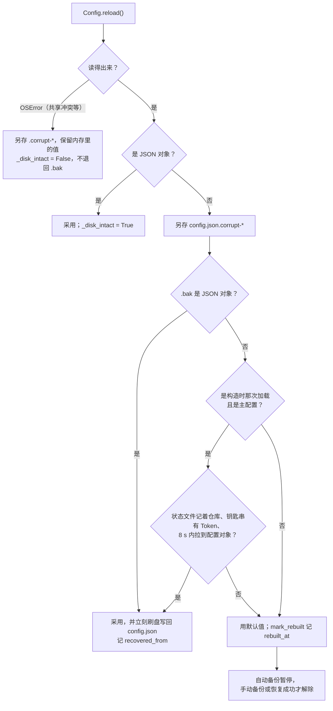

# 配置读写、数据目录与程序身份

> 用户的全部设置在数据目录的 `config.json` 里。这份文档讲它怎么写才不会被一次崩溃清零、坏了按什么顺序
> 找回、怎么备份到用户自己的 GitHub 私有仓库，以及程序在系统里叫什么（`big-fat-fish` / `BigFish`）、
> 从上游旧名字升级时哪些东西要跟着搬。

## 模块

| 文件 | 职责 |
|---|---|
| `pet/config.py` | `Config`（加载 / 归一化 / 保存）；`_write_durably`、`keep_last_good_copy`、`atomic_replace_with_retry`；名字常量 `APP_DIR_BASE` / `LEGACY_APP_DIR_BASE`；`migrate_legacy_app_dir` |
| `pet/slot_manager.py` | `backup_corrupt_config`：把损坏的文件另存为 `config.json.corrupt-<毫秒>-<pid>` |
| `pet/config_backup.py` | 不依赖 Qt 的备份核心：`backup` / `fetch` / `restore`、状态文件、`fingerprint`、`needs_backup`、`recover_at_startup` |
| `pet/config_backup_sync.py` | 主进程定时器 `ConfigBackupSync`：到点在 daemon 线程上传 |
| `pet/settings_config_backup.py` | 设置「常规 → 配置备份」这一节：开关、仓库、路径、「立即备份」「从 GitHub 恢复…」 |
| `pet/data_stores.py` | 存储表 `STORES`：每种落盘数据在哪、谁写、从哪恢复；`match` / `unregistered` / `gaps` / `validate` |
| `pet/autostart.py` | 开机自启（注册表 Run / LaunchAgents plist / XDG `.desktop`）；旧条目的收编与升级 |
| `pet/app_identity.py` | `APP_NAME = "BigFish"`、应用用户模型 ID、窗口图标 |
| `tools/make_launcher.py` | 生成 `.venv\Scripts\BigFish.exe`（改了版本资源和图标的解释器副本），`run.bat` 每次启动前调 |
| `pet/chat/models.py` | `SecretStore`：钥匙串读写，新服务名读不到时回旧服务名 |
| `pet/agent_link.py` | `_refresh_moved_hooks` / `ClaudeCodeMonitor.refresh_hooks`：数据目录搬家后改已注入钩子里的路径 |

## 机制与不变量

### 写盘：刷盘后再原子替换

`Config.save()` = （盘上那份完好时）先留 `.bak` → `_write_durably`：写带 PID 的临时文件 → `flush` + `os.fsync`
→ `atomic_replace_with_retry`；POSIX 上再 fsync 一次目录。任何出口都清临时文件。

- **不能去掉 fsync**。只「写临时文件 → `os.replace`」时，NTFS 把改名记进日志而数据还在缓存里，这时蓝屏 / 断电
  会留下**长度对、内容全零**的 `config.json`。刷盘后崩溃只会留下旧文件或新文件之一。
- 写盘内容是 `_redacted_data()`（剥掉 `api_key`，密钥只在钥匙串），文本按平台换行。
- `atomic_replace_with_retry` 只重试共享冲突（WinError 5 / 32 等）：主进程的配置 watcher 和独立的设置进程会
  撞在同一个文件上。其它 `OSError` 立即上抛，`save()` 返回 `False`。
- 保存全是事件触发（拖拽落点、开关、换形象、退出），没有定时或逐帧保存；不要加。

### `config.json.bak`：上一份已知完好的配置

每次保存前 `keep_last_good_copy` 用**硬链接**把盘上那份留作 `config.json.bak`（`os.link` 到临时名再
`replace`）：只加目录项，不复制、不再刷盘；随后替换掉的是 `config.json` 这个目录项，`.bak` 仍指旧内容。
不支持硬链接的文件系统退回复制 + fsync；留 `.bak` 失败只记 warning，不挡保存。slot 配置同理
（`config-slot-N.json.bak`）。

- **坏文件不许顶掉好的 `.bak`**。靠内存标志 `Config._disk_intact`：重载解析成功、或本进程刚安全写完才为真；
  读失败或解析失败为假，为假时 `save()` 跳过留 `.bak`。
- 主进程和设置进程各自维护自己的 `_disk_intact`。
- `.bak` 是**上一次保存之前**的那份：退回它会丢最后一次改动。

### 损坏恢复链

- 读文件时的 `OSError` **不**触发退回：文件可能是好的，只是暂时打不开。
- `.bak` 优先于 GitHub：`.bak` 能用就不发请求。
- 运行期的 `reload()`（GUI 线程上的配置 watcher）**绝不碰网络**；只有 `Config.__init__` 里那一次
  （`_startup_load` 包住）允许拉 GitHub，且只管主配置，`config-slot-*.json` 不参与。
- 启动兜底只认**成功备份过**的仓库：失败的备份不往状态文件写 `repo`；没配过备份时不碰网络也不碰钥匙串。
- 退回后立刻写回 `config.json`：免得下次重载又判一次损坏，也免得之后的保存把默认值写上去。
- **`rebuilt_at` 不能省**：网络不通 → 按默认值启动 → 第二天联网，没有这个标记自动备份就会把一份默认配置
  推上去顶掉好备份。

### 日志初始化顺序（恢复记录为什么要补记）

`pet/app.py` 先 `Config(...)` 再 `_setup_logging(config)`，后者是不带 `force` 的 `basicConfig`。在这之前
调**根 logger**（`logging.warning(...)`）会自动给它装一个控制台 handler，`basicConfig` 随即成了空操作，
**整个进程的日志都不进 `pet-<pid>.log`**。所以：

- 配置模块（`config.py`、`config_backup.py`）只用具名 logger（`logging.getLogger(__name__)`）；
- 恢复这件事记在 `Config.recovered_from`（`.bak` 路径，或「GitHub 仓库:路径」的说明文字），日志装好后由
  `_setup_logging` 补记一条 WARNING；
- 任何在 `Config` 构造期间可能执行到的代码都不许调根 logger。既有例外：`backup_corrupt_config` 复制失败时的
  `logging.error`，只在另存损坏文件本身失败时触发。

### 备份到用户自己的 GitHub 私有仓库

配置键 `config_backup`：`auto`（默认 `False`）、`repo`（默认空 = 用 `chat.knowledge_base_repo` 那个仓库）、
`path`（默认 `.big-fat-fish/config.json`）。脏值归一化：字符串布尔、网址形式的仓库、带 `..` 的路径回默认。
Token 与知识库同步 / GitHub 连接器共用（钥匙串 `connector/github`），设置页上刚填未保存的也算。

- **立即备份**：先把表单保存到盘上，再上传盘上那份；远端内容逐字节相同就不提交。
- **坏的本机文件绝不上传**：不是 JSON 对象就报错，远端不动。
- **自动备份**：`ConfigBackupSync` 启动后 60 秒查第一次，之后每 10 分钟查一次；`needs_backup` 要求距上次成功
  满 24 小时**且**指纹变了，失败后 30 分钟内不重试。开关关着时什么都不做。
- **只挪位置不算变化**：指纹先去掉 `VOLATILE_KEYS`（`rx` / `ry` / `screen_name` / `facing`）再求 sha256。
  这些键每次拖动都存盘，不排除就等于每天往用户知识库的 git log 里塞一次提交。
- **恢复**：确认框 → 拉回并校验是 JSON 对象 → 当前文件留作 `config.json.before-restore` → 刷盘写回。
  成功后设置窗口置 `_saved_via_button` **不保存直接关闭**：表单里还是恢复前的值，照常保存会把恢复冲回去；
  主进程的配置 watcher 自己应用。
- 状态在数据目录的 `config-backup-state.json`（`repo` / `path` / `backed_up_at` / `fingerprint` /
  `attempted_at` / `error` / `rebuilt_at`），同样走 `_write_durably`。
- 网络都在 daemon 线程，结果经 Qt 信号排队回 GUI 线程；窗口中途关闭时 emit 的 `RuntimeError` 吞掉。
- **公开仓库不放任何配置内容**，代码里也不写死任何仓库名。备份里没有密钥，但有本机路径、服务商地址、
  `api_key_ref` 名字，所以必须是用户自己的私有仓库。

### 存储表：每种落盘数据从哪恢复

`pet/data_stores.py` 把肥鱼往磁盘上写的、以及替用户照看的每一种东西登记一次（决定见
[ADR 0015](adr/0015-private-repos-are-home.md)）。它只有声明和几个纯函数，不 import Qt，不读写文件。

- 一项 = 标识、归哪个账号（个人 / 公司 / 混在一起）、在哪个根下（数据目录、两个 Claude Code 家目录、两个知识库、
  钥匙串、系统登记项）、路径模式、种类、谁写、里面是什么、**恢复来源**。
- 恢复来源只有六种：`git`（已有机制放进某个私有仓库，写明哪个仓库、哪个机制）、`rebuild`（能重算或重新下载）、
  `disposable`（丢了没有损失）、`secret`、`relogin`、`uncovered`（该留却还只在本机）。
- **`uncovered` 就是缺口清单**（`gaps()`）：必须写明原因和打算在[路线图](roadmap.md)哪一步补上。
- **人写的、AI 写的内容和用户的设置只能是 `git` 或 `uncovered`**，不许标成能重算或丢了无所谓。`validate()` 守着这条。
- 表声明的是**设计**：标成 `git` 表示有机制能备份，不表示用户此刻开着它。配置备份默认是关的。
- `match(根, 相对路径)` 认一个真实文件属于哪一项（几项都匹配时取写得最具体的模式）；`unregistered()` 列出表不认得的。
  同一个目录里该留的和不该留的靠这个分开：`projects/<项目>/memory/*.md` 是记忆，同一个项目目录下其余的是会话原文。
- 个人和公司的内容混在一个文件里的（蒸馏的提案、候选）标成 `mixed`：进任何仓库之前都得先分开。

**加一种落盘数据**：在 `STORES` 里加一项。守卫（`tests/test_data_stores.py`）扫 `pet/` 里所有像数据文件的文件名字面量
（`.json` / `.jsonl` / `.log` / `.lock` / `.pending` / `.db` / `.md`），没有着落的会点名。守卫有两个已知的漏洞：
只看文件名不看目录；带占位符的名字（如 `<编号>.json`）只要表里有任何 `*.json` 就算过。兜底是 `unregistered()`
——真机数据目录里出现表不认得的文件，配置全景会报出来（接上图的那一步做）。

### 数据目录与程序在系统里的名字

| 东西 | 现在的名字 | 定义处 |
|---|---|---|
| 数据目录 | `%APPDATA%/big-fat-fish`（macOS `~/Library/Application Support/`，Linux `~/.config/`） | `config.APP_DIR_NAME` |
| 钥匙串服务名 | `big-fat-fish` | `SecretStore.SERVICE_NAME` |
| 开机自启项 | Windows Run 值名 = `APP_DIR_NAME`；macOS / Linux 文件名 = `PLIST_LABEL` | `pet/autostart.py` |
| 日志器名 | `big-fat-fish` | 各模块 `getLogger("big-fat-fish")` |
| 进程 / 任务栏里的名字 | `BigFish` | `app_identity.APP_NAME`、`APP_USER_MODEL_ID` |

上游旧名 `dsh-pet-standalone`（`LEGACY_APP_DIR_BASE`）**只用于认旧数据**，新写入一律用新名字。
有意没改的是别的字符串：与 DSH 插件约定的桥目录 `dsh-pet-bridge`、环境变量 `DSH_PET_*`。
改 `APP_USER_MODEL_ID` 会让用户钉在任务栏上的图标失效。

### 从旧名字升级的迁移规则

名字写进了程序之外的四个地方，每处一条规则：

1. **数据目录**（`migrate_legacy_app_dir`）：只在「旧目录有 `config.json`、新目录还没有」时做，所以只发生一次。
   新目录不存在 → 整目录 `os.replace`（原子）；新目录已存在或整目录改名失败（旧目录里有文件被占用）→ 逐项搬，
   **新目录里已有的同名项保留，绝不覆盖新数据**，`config.json` 最后搬（它是「迁移完成」的标记，中途打断下次接着搬）。
2. **钥匙串**：按需抄。新服务名下为空 → 读旧服务名 → 有就写到新名字下。旧条目不删（回滚到旧版本还读得到）。
3. **开机自启项**（`adopt_legacy_entry`）：只收编**属于本程序**的旧项——Windows 看命令里有没有本检出的目录
   （打包版看 exe 所在目录）；新项已在时不覆盖，只删旧的。别的检出 / 变体写的旧项不碰。
4. **已注入的 Claude Code 钩子**：钩子命令里是事件文件的绝对路径。迁移成功时在新目录留待办标记
   `agent-hooks-refresh.pending`，`AgentLinkManager` 下次应用配置时看到标记才改路径：本机那份直接改；WSL 里
   那份要起 `wsl.exe`，放后台线程，没成功就留着标记下次再试。钩子本身见[会话小鱼](session-fish.md)。

不变量：

- **调用时机**：`app.main()` 必须在第一次往数据目录写东西（进程门锁文件、日志）**之前**调一次迁移，否则新目录
  先被建出来，整目录改名走不通；`Config.__init__` 里再调一次，覆盖设置进程等不经过 `main()` 的入口。
- **平时不读写用户的 `~/.claude/settings.json`**，只有待办标记在时才动；否则测试里一个临时配置目录就可能把
  真机钩子改到临时路径上。
- 钩子只**更新**已经注入过的，从不因为迁移而新装（注入要用户同意）。
- 外部角色目录的兜底列表里留着旧目录名（`catalog.external_character_dirs`），老用户放进旧目录的角色仍能找到。

### 源码运行的开机自启

系统里的自启项是唯一真相，菜单勾选状态直接查它；`config.json` 里的 `autostart_wanted` 只记「用户开过」，
用来在条目被清理后提醒。

- Windows 源码运行的命令：`cmd /c start "" /D "<项目根>" "<程序>" -m pet --slot 0`。`<程序>` 优先取
  解释器旁边的 `BigFish.exe`，没生成过才退回 `pythonw.exe`。任务管理器的进程名取自 exe 的版本资源，程序自己
  改不了，所以只能换一个 exe。
- **旧 `pythonw.exe` 条目的自动升级**（`_win_command_needs_upgrade`，在 `is_enabled()` 里触发）：仅当已有命令
  与「本检出的 `pythonw.exe` 命令」**逐字相同**（忽略大小写）且现在算出来的命令不同才重写。
  不能放宽成「不等于当前命令就重写」：源码运行的多个检出共用同一个值名，那样在检出 A 里打开一次设置页就会
  把检出 B 的自启抢过来。
- `cleanup_stale_entries()` 启动时删掉引用了不存在路径的已知自启项（新旧名字 × 各变体后缀）。
- 打包运行（`sys.frozen`）的命令与升级条件、macOS / Linux 的路径保持原样。

## 设计取舍

- **fsync 已经够防全零，仍然留 `.bak`**：防御纵深，别的原因弄坏的文件（磁盘、外部程序、今后哪处写法回退）
  也能退回，而不是静默落回默认值。
- **保存时不读盘校验 `config.json` 是否完好**。试过：保存从 0.7 ms 涨到 7 ms——在 Windows 上「先读目标文件、
  紧接着替换它」，替换要多等约 4 ms（读别的文件或只 `stat` 没有这个代价）。所以用内存标志；真实的损坏都会
  经过一次重载，标志覆盖得到。现在一次保存约 1.6 ms。
- **只给用户配置刷盘**。其它状态文件（`overlay_spawn_state`、`proactive_limiter`、会话历史等）仍是
  「写临时文件 → replace」不刷盘：丢了能自愈或代价小。
- **完整备份进私有仓库，而不是往公开仓库放脱敏默认值**：真实配置里有个人路径，用户要的是能直接拉回来的整份。
- **走 GitHub Contents API，不在本地克隆里 `git commit`**：最需要恢复的时候正是这台机器出了问题，本地克隆
  可能不在或有未提交改动；REST 只要 Token，也不碰用户克隆的工作区。
- **状态放独立文件而不是 `config.json`**：`config.json` 坏了的时候还得知道去哪儿拉。
- **默认路径以点开头**：Obsidian 不显示，知识库同步（`_safe_member` 跳过点开头目录）也不会把配置当笔记读进对话。
- **启动兜底超时 8 秒**：两层本地恢复都失败才走到，宁可多等几秒拿回全部设置；网络不通时立刻失败，不会等满。
- **恢复入口只在设置页一处**，不进右键菜单 / 托盘（低频命令，归属唯一）。
- **仓库解析规则抄了一份**（`config_backup._parse_repo` 与 `chat.knowledge_base.parse_repo` 同规则）：`Config`
  构造时就要归一化，而知识库模块顶层会拉起聊天 / SDK 依赖，不该进启动路径。改一处要同步另一处。
- **钥匙串不做一次性搬运**：钥匙串没有「列出某服务下所有条目」的通用接口。代价是没存过的 Key 每次读取都多查
  一次旧服务名（约 +0.17 ms），没有终止条件。
- **钩子刷新用待办标记而不是每次启动都检查**：见上面「平时不读写」那条不变量。
- **自启升级放在 `is_enabled()` 里**：菜单、设置页、启动自检都会调到它，不用另加启动钩子。代价是**查询函数
  带写副作用**——构造真实设置窗口的测试会读写真机注册表。要改应把「收编 / 升级」从查询里拆出来，还没做。

## 外部格式依赖

- **NTFS 的改名是日志化的元数据操作**：数据不先刷盘，崩溃后就是「改名已发生、内容全零」。
- **GitHub Contents API**：`GET` / `PUT /repos/<owner>/<repo>/contents/<path>`，内容 base64，更新已有文件必须带
  上一次的 `sha`；Token 需要该仓库的 Contents 读写权限。
- **Windows 自启**：`HKCU\Software\Microsoft\Windows\CurrentVersion\Run`。失效判断是把命令里所有双引号括起来的
  路径取出来逐个看存不存在——改命令格式要同时看 `_win_command_target_exists`。
- **任务管理器进程名**取 exe 版本资源的 FileDescription；任务栏分组取应用用户模型 ID。
- **Claude Code 的 `~/.claude/settings.json`**（含 WSL 里那份）`hooks` 段：钩子命令里写死事件文件
  `<数据目录>/agent-events/claude.jsonl` 的绝对路径，数据目录一动就要跟着改。

## 排障

| 症状 | 原因 / 先查什么 |
|---|---|
| 「界面回到最初版本」「设置全丢」「灵动岛样式变回去了」「小鱼全冻结」 | 多半不是代码回退，而是配置被按默认值重建（`agent_link.claude` 也跟着回默认）。先看数据目录有没有 `config.json.corrupt-*`（全零 = 崩溃时没落盘），再看 `pet-<pid>.log` 开头有没有「配置文件损坏，已退回…」（有 = 已自动退回，只丢最后一次改动）。没有这条就是 `.bak` 和 GitHub 兜底都没用上、落到了默认值：用设置「常规 → 配置备份 → 从 GitHub 恢复…」拉回 |
| 设置页显示自动备份已暂停 | 状态文件里 `rebuilt_at` 非零：配置曾按默认值重建。确认当前设置是想要的之后点「立即备份」，或直接「恢复」 |
| `test_every_filename_literal_in_the_code_is_accounted_for` 红了 | 代码里新出现了一个数据文件名：是肥鱼落盘的数据就在 `pet/data_stores.py` 的 `STORES` 登记并回答从哪恢复；不是就加进 `NOT_STORES` 写一句它是什么 |
| 备份 / 恢复报 HTTP 401 / 403 | Token 失效或没有该仓库的 Contents 读写权限；知识库同步用的是同一个 Token，会一起失败。404 = 仓库名不对或 Token 看不到这个私有仓库 |
| 配置坏了但启动时没去 GitHub 拉 | 从没成功备份过（状态文件没有 `repo`）、钥匙串没 Token，或坏的是运行期重载 / slot 配置——这几种按设计都不拉 |
| `pet-<pid>.log` 一直 0 字节 | 有代码在 `_setup_logging` 之前调了根 logger，`basicConfig` 成了空操作。查 `Config` 构造路径上新加的 `logging.xxx(...)` |
| 恢复之后设置又变回恢复前 | 恢复后有人保存了旧表单。设置窗口是独立进程、持有自己的快照；另一个还开着的旧设置窗口点保存同样会盖掉 |
| 升级后像全新安装（设置、会话、知识库副本都没了） | 迁移没发生，旧目录 `dsh-pet-standalone` 还在、数据没丢。常见原因：新目录里先有了 `config.json` |
| 改名后对话 401、GitHub Token 读不到 | 新服务名下没有、旧服务名下也读不到（钥匙串后端不可用或旧条目被删）；正常情况读一次就抄过来了 |
| 改名后会话小鱼收不到事件 | 钩子还指着旧目录。看数据目录里 `agent-hooks-refresh.pending` 还在不在（WSL 那份没改成会留着，下次启动再试） |
| 开机后肥鱼起了两只 / 自启项有新旧两条 | 旧项是别的检出或别的变体写的，不会被收编；手动删 Run 下的旧值 |
| 开机自启的进程在任务管理器里叫 Python | 自启项还是 `pythonw.exe`：这个检出没生成过 `BigFish.exe`（跑一次 `run.bat`），或条目是别的检出写的（不会自动升级） |
| 某次开机没自启，之后弹「之前开启过但已被清理」 | `BigFish.exe` 被删了（例如重建虚拟环境清空了 `Scripts`），失效条目被 `cleanup_stale_entries` 清掉。跑 `run.bat` 重新生成，再到设置里打开自启 |
| 跑完测试真机的自启项变了 | `is_enabled()` 的收编 / 升级写了真实注册表（见设计取舍最后一条） |
