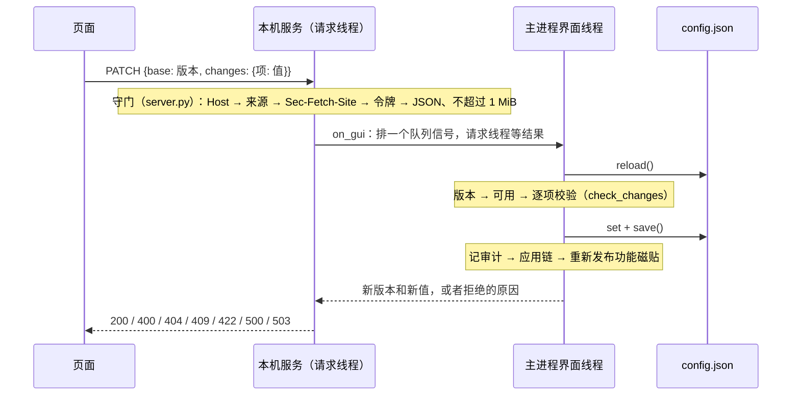
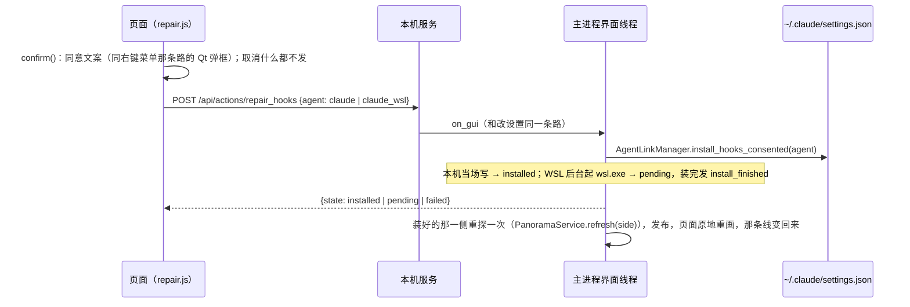

# 配置全景

> 把这台机器上和 AI 有关的配置（肥鱼的 `config.json`、钥匙串、Windows 与 WSL 两份 `~/.claude`、两个知识库克隆、connector）
> 采成一张图，画成一张地图页并用默认浏览器打开：两条账号带 × 两层，磁贴之间的线就是「谁用到谁、现在通不通」。
> 入口：右键菜单「配置全景」、岛的「模型连接」面板里的按钮、`python -m pet.panorama`。
>
> 从肥鱼里点开的页面由肥鱼进程里的**本机回环服务**提供（`http://127.0.0.1:<端口>/`），同时写一份自带数据的
> 离线快照。页面现在仍然只读；它接下来要长成能读能写的主控制台，决定见
> [ADR 0014](adr/0014-panorama-becomes-the-console.md)，步骤见[路线图](roadmap.md)。

## 模块

| 文件 | 职责 |
|---|---|
| `pet/panorama/claude_home_probe.py` | 探针：只读探一个 Claude Code 家目录（账号、模型、hooks、`CLAUDE.md` 受管块、项目记忆、插件、MCP）。**只用标准库** |
| `pet/panorama/probes.py` | 探针：模型服务（`secret_tail`）、知识库克隆（`repo_info`）、`windows_side`、`wsl_side` |
| `pet/panorama/storage_probe.py` | 存储探针：把数据目录和个人 Claude Code 家目录走一遍，每个文件归到[存储表](config-and-data.md)的哪一项；配置备份此刻的状态。只看文件名、大小、修改时间 |
| `pet/panorama/store_walk.py` | 走目录、按存储表数文件的那段代码（`survey_tree`）。**只用标准库、不 import 肥鱼的模块**：这台机器上和 WSL 里跑的是同一段 |
| `pet/panorama/wsl_file_agent.py` | 在 WSL 里替页面列文件、读文件的那一小段（`agent_main`）。**只用标准库**，由 `files.Reader` 喂给发行版里的 `python3 -` |
| `pet/panorama/features.py` | 肥鱼的 AI 功能表 `FEATURES`，一行一项：走哪条线、生效的设置、写到哪 |
| `pet/panorama/memory_scope.py` | 记忆按作用域：`analyse` 把两台机器的记忆索引摊平比对，给每条标上 `dup` / `to_global` / `in_global` / `both_sides`。纯函数 |
| `pet/panorama/places.py` | 存储画在图上哪里：`PLACES`（一个地方 = 几个根 + 分区 + 列 + 谁往这里写）、`OWN_TILE`、`ALSO_ON` |
| `pet/panorama/model.py` | 图模型 `Graph`：账号带 `ZONES`、层 `TIERS`、分区、列、节点、连线、待处理；状态取值校验。没有坐标 |
| `pet/panorama/sources.py` | 来源：若干 `@source` 纯函数，把事实翻译成节点 / 连线 / 待处理；`build(facts)` |
| `pet/panorama/page/` | 页面代码，两种交付方式共用：`shell.html`（外壳）、`app.css`，和一组原生模块——`util.js`（转义、图标、颜色）、`layout.js`（版面）、`roads.js`（走线）、`draw.js`（画）、`viewer.js`（文件查看面板）、`memory.js`（记忆一览面板）、`form.js`（设置表单）、`settings.js`（设置面板：开、关、跨重画存活）、`repair.js`（待处理里的「修复」）、`interact.js`（追踪、详情、搜索、筛选）、`app.js`（`start(G)` 把四步串起来）、`client.js`（取令牌、带令牌的 fetch，两张页共用）、`boot.js`（入口：数据从哪来、等新数据、连接断了）；报告页自己的 `report.html` / `report.css` / `report.js` |
| `pet/panorama/render.py` | 把图变成页面要的那份数据（`page_data` / `payload`）；`shell()` / `asset()` 给本机服务；`render()` / `write()` 出离线快照 |
| `pet/panorama/service.py` | `PanoramaService`：应用里的后台两段采集与发布；持有本机服务 |
| `pet/panorama/server.py` | 本机回环服务 `PanoramaServer` + 路由表 `Router`：生命周期、守门检查、分发。**只用标准库、不碰 Qt** |
| `pet/panorama/feed.py` | 发布台 `Feed`：存最近一次发布的数据和它的编号，让「等新数据」的请求等到有为止。**只用标准库** |
| `pet/panorama/routes.py` | `build_router`：登记有哪些网址（外壳、静态文件、`/api/ping`、`/api/graph` 及它的「等更新的」用法、`/api/files`、`/api/file`、`/api/settings/<组>`、`/api/audit`、`/api/actions/<动作>`、`/report/<名字>` + `/api/report/<名字>`） |
| `pet/panorama/actions.py` | 页面动作的处理器：`repair_hooks`（装 hooks）、`generate_report`（报告页的「重新生成」） |
| `pet/panorama/reports.py` | 报告页的数据：`work_briefing` / `personal_briefing(service_of, config)` 把各自服务的最近一份翻成页面要摆的字典；`split_sections`、`trace_sections` / `personal_details`、`generate_briefing`、`open_inspiration` |
| `pet/panorama/notes.py` | 笔记页的数据与动作：`work_notes(service_of, config)` / `slack_watch(notes_of, watch_of, config)` 把 `WorkNotesService`（和 Slack 关注的检查状态）翻成页面字典（provider 带 `page = "notes"`）；`note_action` 把页面的 `add / done / snooze / delete / resummarize / open_link / obsidian / folder / push` 分发到服务；`check_slack` 是 Slack 页「现在检查」的分发项 |
| `pet/panorama/markdown.py` | 简报那一小块 Markdown → HTML（零依赖，只认简报会写出来的子集；★ / bug 记号变成类名） |
| `pet/panorama/settings_api.py` | 读、改一组设置的那段逻辑（`read` / `write`）：先重读、对版本、校验、落盘、记审计。不碰 Qt，拿活的 `Config` 干活 |
| `pet/panorama/files.py` | 文件查看的那道门：`VIEWABLE` 名单、`Reader.listing` / `Reader.read`。**只用标准库、不碰 Qt** |
| `pet/panorama/__main__.py` | 命令行入口 `[--no-wsl] [--no-mcp] [--no-open]` |

## 机制与不变量

### 探针 → 来源 → 渲染

- **页面只认图的结构，对具体功能一无所知。** 加一项肥鱼功能 = `features.FEATURES` 加一行 + `panorama.feature.<id>` 两条文字；
  加一类东西 = 加一个 `@source` 函数；加一台机器或一个账号 = `model.ZONES` 多一项。页面和走线都不用动。
- 来源声明的线可以指向别的来源的节点；目标这次没出现（比如没装 WSL）时 `Graph.to_dict` 把线丢掉。
- **图上显示生效值**：功能表读设置走各功能自己的 `normalize`（如 `memory_distill.side_settings`），所以总开关关着时
  「公司侧蒸馏」显示未启用，而不是照着子开关显示成开。
- WSL 一侧和 Windows 一侧是同一份探针：`wsl_side` 把一份源码从标准输入喂给发行版里的 `python3 -`。这份源码
  （`probes.wsl_source()`）是三个文件按顺序拼成的：存储表 `data_stores.py`、走目录的 `store_walk.py`、家目录探针
  `claude_home_probe.py`。探针的入口看到另外两样在同一个作用域里，就顺手把 `~/.claude` 走一遍，按存储表数出每一项
  （结果里的 `storage`）。所以**这三个文件都不能 import 标准库以外的东西，也不能定义同名的顶层名字**（拼在一起后一个会
  悄悄顶掉另一个）——`tests/test_panorama_wsl_side.py` 两条都查，并且把拼出来的源码用本机 Python 在假家目录上原样跑一遍。没有 WSL（`absent`）、跑失败（`error`）、还在探（`pending`）三种分开返回。

### 图与版面

- 结构：账号带（个人 / 公司）× 层（云端 / 本机）的格子里放分区，分区里是列，节点在列里从上往下排。
- **版面和走线由页面脚本按图的结构算，哪里都不写坐标。** 连线走列之间的通道和层之间的横槽，同一束（同种线、同一个枢纽）
  共用一条车道。
- 线的画法就是状态：流动 = 通着（`live` 是这次亲自探到的，流得快）；琥珀闪 = 待处理；红线中间断开 = 坏了；灰点线 = 本机探测不到；
  很淡 = 功能没启用。节点 / 连线状态只能取 `NODE_STATES` / `EDGE_STATES` 里的值。
- 一组 connector 按状态拆成「已连」和「待处理」两块磁贴，线才能一条流动、一条琥珀。

### 页面脚本是原生模块，离线快照把它们拼起来

- 本机服务的外壳只引用入口 `boot.js`（`` 截断页面。
- **不要令牌就能拿到的东西里没有数据**：外壳和静态文件只有结构、代码和界面文字；采到的一切只在 `/api/graph` 里，
  文件内容只在 `/api/file` 里，都要令牌。
- 页面是自用的，**不脱敏**：里面有账号邮箱、组织名、机器名、connector 名，以及两边每条记忆的名字和说明（公司侧的也在）。生成的 `%APPDATA%/big-fat-fish/panorama/panorama.html`
  不要提交或贴出去；测试样例（`tests/panorama_samples.py`）必须全是虚构的事实。

### 两段采集（`PanoramaService.open()`）

- 第一段只采 Windows 一侧（约 0.16 s）就发布、开浏览器；第二段去 WSL 探测（约 6.7 s，几乎全是 `claude mcp list`
  逐个体检 connector）后再发布一次。等全部采完再开，用户点完要干等 7 秒。
- **发布 = 两件事**（`_publish`，在后台线程上）：先写离线快照，再把 `/api/graph` 的正文整个换成新的，`revision` 加一。
  本机服务的线程只读这一个引用，从不原地改。
- **浏览器打开的是本机服务的网址**（`_page_target`，在 GUI 线程上，第一次点才创建并启动服务）；服务起不来
  （端口绑不上之类）就退回打开快照文件。网址里 `#` 后面是令牌，日志里只记 `#` 之前的部分。
- **页面等新数据是「挂一个请求」，不是隔几秒问一次**：拿到第一份之后，`boot.js` 带着它的 `revision` 请求
  `/api/graph?after=<revision>`。服务端（`Feed.wait_newer`）把请求挂住，发布的那一刻就回（实测 0.7 毫秒内）；
  挂满 25 秒还没有新的就回 204，页面隔 1 秒再来。拿到新数据后页面**原地重画**，保留选中的节点、线路筛选和搜索词，
  磁贴不重放入场动画。所以第二段探完、或者页面开着时再点一次「配置全景」，开着的那个标签页会自己换成新的。
- **标签页藏起来时不挂请求**，回到前台才接着等（期间发布过的新数据会立刻拿到）。所以服务的「空闲」实际是
  「没有看得见的页面，并且 15 分钟没动」；挂着的请求每 25 秒回一次，正好当探活用，不另设心跳。
- 请求失败（肥鱼退出、服务已自停、令牌作废）时页面亮出「连接断了」，图和选中状态留着，之后不再去敲。
- 令牌从地址栏抹掉后存在 `sessionStorage` 里，所以手动刷新也还拿得到数据。
- `aboutToQuit` 时先 `Feed.close()`：挂着的请求立刻以 204 放回去，服务才停得干净；页面随后那次请求失败，亮出「连接断了」。
- 离线快照自己的等待方式没变：`meta.pending` 为真时每 3 秒重读文件，次数记在 `location.hash`；`render.write`
  先写临时文件再替换，浏览器读不到半个文件。
- 同一次运行里再次打开：WSL 一侧先用上一轮结果垫着（`facts["refreshing"]`，也算 `pending`），新的探完再换上。
  垫底结果只在内存里（`_last_wsl`），且必须来自一轮完整跑完的结果——被作废的那一轮不留。
- **不卡界面、线程不碰活的 `Config`**：GUI 线程只做三件事——`deepcopy` 一份配置、起 daemon 线程、收 `_stage` 信号后开浏览器。
- **不点就不跑**：没有定时器、启动时工作、新设置项；服务对象第一次点时才创建，`pet.panorama` 包也是那时才 import。
- 忙时再点只把现有页面再打开一次。`aboutToQuit` → `stop()` 让 `_generation` 前进并停掉本机服务：在跑的那一轮照常
  写完文件，但不再开浏览器、不报完成。（这里每次 `open()` 也递增 `_generation`，因为有 `_busy` 保证同时只有一轮；和会话记忆蒸馏那种多任务交叠的服务不同。）

### 本机回环服务（`server.py`）

页面今后经它读写肥鱼。「只听本机」不是边界：浏览器里任何网页都能往回环地址发请求，而页面能改的东西里有会交给
带工具的 AI 执行的提示词。所以每个请求按固定顺序过一串检查，任何一步不过就拒，**被拒的响应也带全套加固头**：

| 顺序 | 检查 | 不过时 | 挡的是什么 |
|---|---|---|---|
| 1 | Host 正好是 `127.0.0.1:<端口>`（`localhost:<端口>` 也不行） | 421 | DNS 重绑定 |
| 2 | 方法在 `METHODS` 里；路径整条匹配路由表里的一个模板 | 405 / 404 / 400 | 预检（`OPTIONS` 一律 405）、路径穿越 |
| 3 | 带了 Origin 就必须是自己；写请求必须带 Origin | 403 | 跨站请求 |
| 4 | 浏览器标了 `Sec-Fetch-Site`：接口只认 `same-origin`，静态外壳还认 `none` | 403 | 别的站嵌入、别的站发起的调用 |
| 5 | 非公开路由要自定义请求头 `X-Panorama-Token`（常数时间比较）；放在查询串里不算 | 401 | 没拿到令牌的一切调用方 |
| 6 | 写请求：`Content-Type` 是 JSON、有 `Content-Length`、不超过 1 MiB | 415 / 411 / 413 | 跨站表单提交、超大正文 |

- **只绑 `127.0.0.1`、端口由系统随机给**；Windows 上设 `SO_EXCLUSIVEADDRUSE`，别的进程不能再绑同一个端口顶替。
- **每次启动换令牌**（`secrets.token_urlsafe(32)`）。令牌放在页面网址的 `#` 片段里交给页面（`page_url()`）：
  片段不发给服务器、不进 Referer。页面读到后应立刻从地址栏抹掉，之后只放在请求头里。
- **不发任何 `Access-Control-*` 头**；响应带只许同源的内容策略（因此页面不能有内联脚本；唯一放开的是内联 `style`
  属性，页面脚本靠它给磁贴定位——样式属性执行不了代码，外部资源又被挡着，带不走数据）、
  `Cross-Origin-Resource-Policy: same-origin`（别的源连 no-cors 的不透明响应也拿不到）、`no-store`、`nosniff`、禁止被嵌入。
- **路由表不映射文件系统**：路径只按登记的模板整条匹配；路径参数是一段、不含 `/ % \`、不以点开头。
  公开路由（`Router.static`）只放不含用户数据的外壳、脚本、样式，数据一律走要令牌的接口。
- **空闲自停**：`IDLE_SECONDS`（15 分钟）没有一次**放行的**请求就停。被拒的请求不算数——坏页面一直敲门不能让服务一直开着。
  停了再启动是新端口、新令牌，旧标签页作废。
- **`stop()` 不等轮询**：服务线程睡在「等下一个连接」里，`stop()` 敲一下门把它叫醒。退出应用时它在 GUI 线程上。
- **处理函数的异常不外泄**：页面只拿到 `{"error": "internal_error"}`，细节进日志。日志只记请求行和状态码，不记请求头。
- `on_stop` 回调在服务线程或调用 `stop()` 的线程上，里面不能碰 Qt 对象，要通知界面就发信号。

### 入口与体检结论

- 右键菜单动作 `config_panorama`（`pet/context_menus/registry.py`，默认布局 `modern-default-v1.json` 的 tools 段）；宿主有
  `on_open_config_panorama` 才显示，两种渲染拓扑都接到 `AppShell.open_config_panorama`。用户已保存的菜单布局会自动并入新动作。
- 岛的连接面板按钮（`pet/island_connections_ui.py` 的 `panorama_btn`）：单独一行（英文下并排会把面板撑宽），点了先收起面板。
- 设置窗口里已经搬走的那一组原处的按钮：打开配置全景并直接翻到那一组（见「改设置：页面上的入口」）。
- 「使用中的模型服务」那条线通不通，取[灵动岛](island.md)上 API 体检器**最近一次**的结论（`AppShell._panorama_health`），
  不是点击那一刻现查；没开岛或走命令行入口时是 `unknown`。

### 测试

- `tests/test_panorama_page.py` 用 Qt 自带的 JS 引擎（`QJSEngine`）加一个极简假 DOM **真跑页面脚本**：每个节点一块磁贴、
  每条线一条路径、坐标没有 NaN、磁贴不出界不重叠，四种 WSL 状态各跑一遍。脚本里写坏一处正则整页就是空白，靠它拦。
  页面脚本用到新的 DOM / BOM 接口时要给假 DOM 补上。`boot.js` 也在这里跑：假 `fetch` 同步返回、假定时器由测试触发，
  所以 `boot.js` 只用 `.then`，不用 `async` / `await`。同一个文件里还有一条用例让 JS 引擎按真正的模块规则加载 `app.js`
  （`importModule`），并要求它和拼出来的脚本画出同一张图：哪个模块导入了别人没导出的名字，或者两条交付路径分了叉，都在这里红。
  重画也在这里测：按页面的顺序 `capture → dispose → start(新, kept)` 跑两张图，看选中的节点带过去了、不存在了就放下、
  监听摘掉又挂上同样多（只差设置面板那一个整页的监听）。
- `tests/test_panorama_form.py` 跑表单本身；`tests/test_panorama_settings_panel.py` 跑入口：哪块磁贴有按钮、离线快照里是灰的、
  面板和没保存的字跨重画还在、关面板的提醒、网址里带组名就直接翻过去、`api.patch` 的请求长什么样、4xx 原样交给表单。
- `tests/test_panorama_feed.py`、`test_panorama_routes.py` 测「等新数据」：用线程加 `join` 断言结果，不赌先后——
  先发布再等、先等再发布，等的人拿到的都该是同一份。
- `tests/test_panorama_render.py` 守两条：离线快照不向任何地方要东西；外壳和静态文件里没有采到的数据、没有内联脚本。
- 页面文字全部来自 `pet/locale/*.json` 的 `panorama.*`（存储的名字和说明在 `stores.*`）；两种语言 × 四种 WSL 状态下
  建出来的图不许有缺的文字。
- `tests/test_panorama_files.py`：读临时目录里的真文件，接口那一半走真实的本机服务。拒绝矩阵是重点——名单外的存储、
  十几种不规矩的路径、属于别的存储的路径、指到根外面的链接和目录联接，各自回什么代码；密钥字样不许出现在任何回答里。
  这里**不查内容里有没有密钥**（原样给是定下的做法），查的是范围。**往 `VIEWABLE` 加一项，先在这里补它不该读到的邻居。** 查看面板在 `tests/test_panorama_page.py` 里单独跑
  （假的「向服务要东西」同步返回）：问了哪两个网址、内容被转义、受管块的行带标记、读不到时说什么。
- `tests/test_panorama_storage.py`：探针读临时目录里的真文件（归类、不认得的只报名字、封顶、缺目录）；图那一半喂虚构事实
  （三块磁贴怎么分、每一项恰好列一次、配置备份五种状态各自的磁贴和线、没登记的文件、WSL 一侧没核对时怎么画）。
- `tests/test_panorama_server.py` 用真实的回环套接字测服务：`http.client` 能随意改 Host / Origin，正好冒充浏览器里的坏页面。
  上表每一行至少一条用例；空闲自停靠注入的假时钟推进后等事件，不用固定 sleep。往路由表加接口不用重测守门，
  但**改 `_check` 的顺序或条件必须先改这里的拒绝矩阵**。

## 设计取舍

- **设置的版本用值的指纹，不用计数器**：不用落盘，两个进程算出来一样，别的组变了不影响这一组。代价是它挡的是
  「值不一样」，不是「有人动过」——动过又改回去的不算过期。
- **写接口比读配置严**：读的时候不合法的值换成默认值，写的时候同样的值直接拒。两套口径是有意的。
- **界面线程没空就拒，不排队等很久**：一次落盘是毫秒级的，等 10 秒还等不到说明界面卡住了，这时候再悄悄补写更糟。
- **起本机服务，而不是只写文件**（推翻了第一期的取舍，见 [ADR 0014](adr/0014-panorama-becomes-the-console.md)）：
  `file://` 页面不能回传，改不了任何东西。代价是多一个只在用的时候开着的回环端口，和上面那一串守门检查。
- **一份页面代码、两种交付**：离线快照把外壳、样式、脚本和数据内联成一个文件，本机服务把它们分开发。
  不维护两套页面；`boot.js` 靠有没有嵌入的数据分辨自己在哪一种里。
- **用挂起的普通请求等新数据，而不是 `EventSource` 或 WebSocket**：令牌在自定义请求头里，`EventSource` 带不了请求头
  （放进网址就进了日志和历史记录）；WebSocket 要自己实现握手和帧，标准库没有。挂起的 `fetch` 两样都不需要，
  守门检查也原样适用。代价是每个看得见的页面占一条处理线程（挂着时不占 CPU）。
- **重画是整张图重新生成，而不是比对后只改变化的部分**：图小（几十块磁贴），
  换来不需要一套差异算法；要保留的只有「用户正看着什么」这三样。
- **藏起来的标签页不等新数据**：否则一个忘了关的标签页会让服务永远不自停。代价是回到标签页时要多等一个来回。
- 垫底结果不落盘：肥鱼重启后第一次打开，WSL 一侧显示「正在探测…」。
- 自动走线**不做交叉最小化**，节点明显变多后局部可能变乱。
- **存储按「硬盘没了会怎样」分块，而不是一项一块、也不是按种类分**：这张图要回答的是「哪些东西丢了就没了」，
  按这个分，一眼看得到琥珀色的那块有多大。代价是想找某一项要点开磁贴或用搜索（搜索会搜到清单里每一项的说明）。
- **记忆的重复只按字面判，不叫模型**：便宜、每次打开都能算、不会把两条不相干的记忆说成重复。代价是漏判；
  真要语义去重，是蒸馏那边的事，不是打开一张图时该花的钱。
- **记忆的名字和说明直接放进图里**，没有做成点开再向服务要：面板要一次看全两台机器才能比对。代价是页面数据变大
  （本机实测 41 KB → 129 KB），离线快照里也多了这些内容。
- **WSL 一侧数存储，靠把三个文件的源码拼成一份喂过去**，而不是让那边只报文件清单、这边来归类：那边可能有几万个文件，
  清单要过管道，归类结果只有几十个数。代价是三个文件得守「只用标准库、顶层名字不相撞」这两条，由测试守着。
- **读 WSL 里的文件每次起一个 `wsl.exe`**，没有做常驻的代理：点「查看」是偶尔的事，0.1 秒可以接受，常驻进程要管生命周期。
- 菜单项放根菜单 tools 段而不是子菜单：一次右键就点得到，代价是根菜单又长一项（「工具与帮助」子菜单 2026-11-18 已删，ADR 0017）。旧版菜单模板
  （`pet/context_menus/legacy.py`）有意没加。
- 个人账号的 connector 只能画成「探测不到」：它们挂在 claude.ai 账号上，磁盘上只有「连过哪些」，Windows 上
  `claude mcp list` 返回空。如实画成灰点线并写进待处理，不猜。

## 外部格式依赖

「在 VS Code 打开」靠 VS Code 的链接格式（`interact.js` 里拼）：

- Windows 上的路径：`vscode://file/<路径>`。文件和目录都行，VS Code 自己去看它是哪一种。
- WSL 里的路径：`vscode://vscode-remote/wsl+<发行版>/<路径>`，在连着 WSL 的窗口里打开（要装 WSL 扩展）。
  **VS Code 对远程路径分不出文件和目录，默认当文件夹开；结尾带 `:行号` 才当文件。** 所以文件的链接拼成 `…/CLAUDE.md:1`，
  目录（来源里带 `dir`，由 `sources._src(folder=True)` 标）不带。发行版名字没探到时不给链接，只留「复制路径」。
- 两种链接结尾都带 `?windowId=_blank`：VS Code 看到它就**开一个新窗口**，否则文件会开进最近用的那个窗口，
  和手头的项目混在一起。VS Code 打开之前会把这个参数摘掉，不会变成路径的一部分。
- 依据是 VS Code 源码 `src/vs/code/electron-main/app.ts` 里处理协议链接的那两个函数（`handleProtocolUrl`、
  `getWindowOpenableFromProtocolUrl`）；VS Code 改了这些规则就要跟着改。

Claude Code 升级后先核对 `claude_home_probe.py` 读的这些：

- `~/.claude/settings.json`：`hooks`（事件 → 组 → `hooks` 列表，逐条命令计数，含 `big-fat-fish` 字样的算肥鱼的）、`model`、
  `effortLevel`、`permissions.allow`、`enabledPlugins`。
- `~/.claude.json`：`oauthAccount.emailAddress` / `organizationName`、`mcpServers`、`claudeAiMcpEverConnected`。
- `~/.claude/plugins/installed_plugins.json` 的 `plugins`；`~/.claude/.credentials.json`（只看在不在）。
- `~/.claude/projects/<目录名>/`：目录名 = 项目绝对路径里非字母数字的字符全换成 `-`；里面每个 `*.jsonl` 是一次会话，
  开头几行带 `"cwd"`。`~/.claude.json` 的 `projects.<路径>` 下有 `lastCost`、`lastDuration`（毫秒）、`lastLinesAdded`、
  `lastLinesRemoved`。
- `claude mcp list` 的输出行 `名字: 地址或命令 - 状态`：按首个 `: ` 和末个 ` - ` 切（命令里可以有空格）；状态含 `Connected` = 通，
  含 `authentication` = 待授权，其余 = 坏。中间那一段以 `http://` / `https://` 开头算远程服务，否则算本地命令。
- `~/.claude.json` 的 `mcpServers` 和 `projects.<路径>.mcpServers`：每个服务器的 `type`、`url` 或 `command` + `args`、`env`、`headers`。
- `CLAUDE.md` 受管块的起止标记与 `<!-- 更新：… -->`（由[会话记忆蒸馏](memory-distill.md)写入）。

## 排障

| 症状 | 原因 / 先查什么 |
|---|---|
| 页面整个空白 | 页面脚本有语法错误（跑 `tests/test_panorama_page.py`）；或者有内联脚本 / `on*` 属性被内容策略挡了（看浏览器控制台） |
| 从肥鱼点开是空白、离线快照却正常 | 某个模块没在 `render.MODULES` 里登记（服务发不出去，浏览器控制台有 404），或 import 的名字对不上 |
| 生成页面时报 `uses an import/export form the bundler does not handle` | 模块里用了拼不了的写法（默认导出、改名、`import *`、跨行）；改回整行具名导入 |
| 磁贴全挤在左上角 | 内联 `style` 属性被挡了：内容策略里的 `style-src-attr 'unsafe-inline'` 被改掉了 |
| 页面顶上红条「连接断了」 | 肥鱼退出了，或服务空闲自停了（页面藏着超过 15 分钟）；从肥鱼里再点一次「配置全景」 |
| 点了之后打开的是 `file://` 的页面 | 本机服务没起来，退回了离线快照；看日志里「本机服务起不来」后面的异常 |
| WSL 一侧一直「正在探测…」 | 第二段没发布：看日志里「配置全景：WSL 一侧探完」；发行版冷启动 + connector 多时会更久（上限 150 s）。标签页在后台时不会更新，切回来就换 |
| 数据换了页面没跟着变 | 标签页是藏着的（切回来才接着等）；或页面顶上已有红条「连接断了」（那之后不再问）。浏览器开发者工具的网络面板里应当有一个挂着的 `graph?after=…` |
| 重画一次，点一下磁贴触发两次 | `interact` 里新加的监听没带中止信号 `on`，旧的那套没被摘掉 |
| WSL 一侧显示失败 | 探针在发行版里退出码非 0 或输出不是 JSON（那边要有 `python3`）；`python -m pet.panorama --no-mcp --no-open` 复现 |
| 模型服务的线是灰点线 | 没开岛（没有体检器）或走的命令行入口；正常 |
| hooks 的线是红色断线 | 如实反映：联动开着，但那一侧 `settings.json` 里没有肥鱼的 hook（被卸掉过），去重新安装 hooks |
| 功能明明开了却显示未启用 | 显示的是生效值：看该功能的总开关 |
| 点「在 VS Code 打开」开出一个空白窗口 | WSL 里的文件被当成文件夹开了：链接结尾少了 `:1`（来源被错标成了目录），或 VS Code 改了规则。见「外部格式依赖」 |
| 「在 VS Code 打开」把文件开进了现有的窗口 | 链接结尾少了 `?windowId=_blank`，或 VS Code 改了规则。见「外部格式依赖」 |
| WSL 一侧的磁贴没有「在 VS Code 打开」 | 发行版名字没探到（探针读的是 `WSL_DISTRO_NAME`）；路径仍然可以复制 |
| 「项目与会话」里很多项目的路径是「不知道」 | 那些项目没在 `~/.claude.json` 里登记，会话记录里的目录又和文件夹对不上（常见于在工作区里开的会话）。不猜 |
| 「项目与会话」说有上千个空的项目目录 | 如实反映：`~/.claude/projects` 下攒了很多既没有会话也没有记忆的目录。它们不占多少地方，但会拖慢按目录找东西的工具 |
| 连接器那一行下面没有「连到哪」 | 那是个人账号在 claude.ai 上的连接器（本机只知道连过），或者这一轮没有跑 `claude mcp list` |
| 「上次探测」后面一直挂着「正在重新探测」 | WSL 那一半的新结果还没到：标签页在后台时不更新，切回来就换；一直不换看日志里「WSL 一侧探完」 |
| 连接器的命令行里露出了一段像密钥的东西 | 它是当位置参数写的，没有 `--token` 这样的名字可认。把它挪到环境变量里，或者告诉我加规则 |
| 「记忆一览」里某个项目重复出现、几乎每条都标着「像是全局的」 | 同一个仓库的多个工作区各有一个项目目录，各带一份记忆：如实反映，不是误判 |
| 「记忆一览」里明显重复的两条没被标出来 | 标题和说明的字面都不一样。这里只按字面判 |
| 「记忆一览」里 WSL 那一栏没有 | WSL 那半张图还没探完或探失败了；探完会原地补上 |
| WSL 一侧的文件点「查看」说读不到 | 浏览器网络面板里看 `/api/file` 的回答：503 `unavailable` 是 `wsl.exe` 没回话（发行版没起来、超时）；400 `bad_path` 多半是路径上有符号链接 |
| WSL 一侧的存储磁贴没有数目 | 图上垫着的是肥鱼升级前那一轮的 WSL 结果；等这一轮探完会补上 |
| 生成 WSL 探针源码后那边报语法错或 `NameError` | 三个拼在一起的文件里有人 import 了标准库以外的东西，或者定义了同名的顶层名字；跑 `tests/test_panorama_wsl_side.py` |
| 改设置得到 409 `stale` | 这一组的值在页面读过之后变了（设置窗口、另一个标签页、或者别的写入）。回答里带着现在的值，重读再改 |
| 改设置得到 422 `invalid` | 回答的 `errors` 里是哪几项：`rejected` = 功能自己的校验不认（时间要写成 `HH:MM`，模型名只认字母数字和 `. _ -`）；`out_of_range` = 数字超出设置表里声明的上下限；`not_a_choice` = 不在可选值里；`unknown` = 表里没有这一项 |
| 改设置得到 503 `busy` | 界面线程 10 秒没空。这次写入已经作废，没有存；等肥鱼缓过来再试 |
| 表单里打的字点了保存却没交出去 | 那一项依赖的开关关着（变灰了），或者上一次保存还没回来（整张表单是灰的） |
| 改设置得到 409 `unavailable` | 这一组在这台机器上用不了（工作简报要 WSL） |
| 设置窗口里点「到配置全景里改」，浏览器没打开 | 主进程要在跑（它三秒内取走 `overlay-settings-command.json`）；日志里找「收到设置进程指令 → 打开配置全景」。没有这行就看配置目录里那个文件还在不在、是不是超过两分钟作废了 |
| 页面上改好的工作简报设置又变回去了 | 多半是升级前就开着的设置窗口（旧代码，里面还有这一组）保存了一次。关掉重开；肥鱼启动时发现它开着会弹通知提醒 |
| 磁贴上没有「设置」按钮 | 那项功能的设置还没搬过来（还在设置窗口，磁贴上写着哪一页）；或者这是离线快照，按钮是灰的 |
| 「查看」按钮是灰的 | 打开的是离线快照（地址栏是 `file://`）：没有服务可问。从肥鱼里点「配置全景」打开 |
| 该有「查看」的地方没有按钮 | 存储不在 `files.VIEWABLE` 里（登录凭据、钥匙串永远不在）；或存储探针没数到这台机器上有它的文件；或它在 WSL 一侧 |
| 查看面板说「读不到」 | 文件刚被删了 / 改名了，或服务停了（页面顶上会有红条）；浏览器网络面板里看 `/api/file` 回的代码 |
| 多出一块「没登记的文件」 | 数据目录里有存储表不认得的文件：新功能忘了登记就去 `pet/data_stores.py` 加一项；别的程序或早先版本留下的，确认后删掉文件 |
| 存储磁贴上各项都不显示数目 | 那个地方没逐个文件核对（WSL 一侧），或者 `facts` 里没有 `storage` 这一段（探针抛了异常，看日志） |
| 「有备份机制」是琥珀色 | 如实反映：配置备份没开、没填仓库且没配知识库仓库、没有 GitHub Token、上次失败、或暂停了；点开看是哪一种 |
| 页面调接口得到 421 | Host 不是 `127.0.0.1:<端口>`：用 `localhost` 打开的，或者经过了代理 / 端口转发。只能用 `page_url()` 给的网址 |
| 页面调接口得到 401 | 令牌不对：服务空闲自停后重启过（新令牌），这个标签页是旧的；重新点一次「配置全景」 |
| 页面调接口得到 403 | 请求不是页面自己发的（Origin 或 `Sec-Fetch-Site` 不对），或写请求没带 Origin（非浏览器的调用方要自己带上） |
| 加了探测目录后全仓库守卫变红 | `TOOL_DIRS` 或样例里的名字撞了 `test_product_copy_has_no_external_brand_reference` 禁用的词 |
