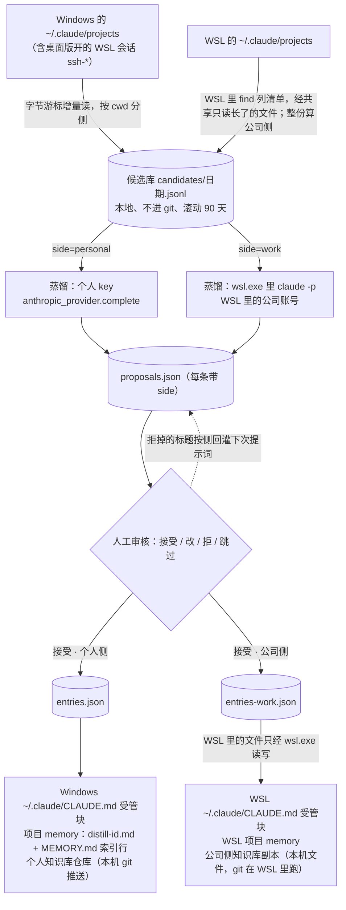

# 会话记忆蒸馏

> 从 Claude Code 的会话记录里抽出「我说过的话」（决定、偏好、纠正），每天让模型蒸馏成对记忆的
> 增 / 改 / 废提案，逐条人工审核后写进 Claude Code 会读的地方。入口：右键菜单根菜单的「会话记忆蒸馏」（2026-11-21 起和
> AI 对话 / 待办一组，之前在 Agent 联动里；托盘也有），四页：流程 / 候选 / 提案 / 统计。默认关。

## 模块

| 文件 | 职责 |
|---|---|
| `pet/memory_distill.py` | 纯函数：分侧 `classify_side`、清洗 `clean_text` / `is_noise` / `is_human_turn`、打标 `tag_for`、`extract`、`CandidateStore`（游标 + 候选库）、配置 `normalize` / `side_settings`、提示词模板 |
| `pet/memory_distill_run.py` | 蒸馏：`is_due`、`select_candidates`、`memory_context`、`parse_array` / `parse_proposals`、`ProposalStore`、`run_once`；目录编码 `encode_project_dir` / `project_dir` |
| `pet/memory_distill_sink.py` | 个人侧落盘：`EntriesStore`、受管块 `render_block` / `splice_block` / `write_claude_md`、项目 memory 文件与索引、知识库那篇 |
| `pet/memory_distill_wsl.py` | 要进 WSL 才能做的事：`default_distro_running`、`list_transcripts`、`claude_command` / `make_complete`、WSL 里的 `memory_context` |
| `pet/memory_distill_wsl_sink.py` | 公司侧落盘：经 `wsl.exe` 的 `read_text` / `write_text` / `remove`、`apply_proposal`（失败回滚条目库） |
| `pet/memory_distill_service.py` | `MemoryDistillService(QObject)`：定时、后台线程、信号回 GUI、`review()`、两侧镜像推送 |
| `pet/memory_distill_ui.py` | 流程页窗口与控制器（流程图、入口磁贴、提案页） |
| `pet/settings_memory_distill.py` | 设置窗口「简报与笔记」里的一节：只剩两行「到配置全景里改」和流程说明（设置本身在 `settings_table` 的 `distill_personal` / `distill_work` 两组） |

## 机制与不变量

### 抽取

- **数据源只有 transcript**：`~/.claude/projects/<目录编码>/<会话>.jsonl`，不另做记录。`~/.claude/history.jsonl`
  桌面版 / VS Code 不写，不能当源。
- **只抽主链上人敲的 user 记录**（`is_human_turn`：非 `isSidechain`，`origin.kind` / `turnOrigin` 是 human）。剥掉系统注入块
  （`<system-reminder>`、`<ide_opened_file>`、`<task-notification>` 等）、图片 / 粘贴占位行；丢掉斜杠命令、方括号标签打头的
  监视器消息、压缩摘要（「This session is being continued…」，里面满是 always / never，会被误判成规则）、只是一声「好 / ok」的。
- 每条带上 Claude 上一条正文（截 500 字）作为「当时问了什么」；`AskUserQuestion` 的回答直接取 tool_result 记录的
  `toolUseResult.answers`，算「决定」。去重键是 user 记录的 `uuid`（一次问多题后缀 `#1`、`#2`）。
- **打标不用模型**，按词表：规则 > 决定 > 纠正 > 任务。标签不过滤候选，只决定超预算时先丢谁。
- **游标**（`cursors.json`）：每个文件记字节偏移 + 前 256 字节指纹 + 上一条 assistant 正文。只处理以 `\n` 结尾的整行；
  文件变短或指纹变了 = 被整个重写，从头重扫（靠 `uuid` 去重，不会存两遍）。
- **个人 / 公司只按会话的 cwd 分，不看入口、不看内容**：POSIX 路径（`/home/...`）一律公司侧；Windows 路径落在设置的
  「公司目录」（`work_roots`，按路径段比较）下也算；其余个人侧。不能按 `entrypoint` 分：桌面版开的 WSL 会话存在 Windows 这边的
  `projects/ssh-*`，入口写的是 `claude-desktop`。后果：在 Windows 路径下聊公司的事会进个人 key，要靠「公司目录」划过去。

### 读 WSL 里的会话

- 先在 WSL 里一次 `find` 列出 (字节数, 相对路径)（`LIST_COMMAND`），再经 `\\wsl.localhost` 共享只读**大小变了**的文件。
  把 UNC 目录直接当第二个根实测无变化的一趟要 2.6 s（`glob` 0.9 s + 逐个打开验指纹），列清单只要 0.13 s；
  而且发行版没起来时一碰共享就会把它拉起来或卡住。
- **绝不 stat UNC**（`Path.exists()` 在发行版没起来时卡几秒甚至报权限错）。所以 WSL 文件的游标键是 `wsl:<相对路径>`，
  只凭清单判断去留：这一轮列过清单且清单里没有它才删；没列 / 没问到（`list_transcripts` 返回 `None`）时原样保留。
- WSL 来的文件**整份强制公司侧**，不逐条看 cwd：缺 cwd 的记录否则会落到个人侧、之后被发给个人 key。
- 定时那趟先问 `wsl -l -v`（不会拉起发行版），默认发行版没在跑就跳过；手动「现在抽取」一定去。WSL 那半失败不影响
  Windows 这半。只扫默认发行版。
- 放弃了什么：WSL 文件只在大小变了时验指纹，被重写成恰好同样大小认不出来（transcript 只追加，可以接受）。

### 候选库

`%APPDATA%/big-fat-fish/memory-distill/candidates/<本地日期>.jsonl`，**本地、不进 git**，滚动保留 `keep_days`（默认 90）天。
不进 git 的原因：git 里「滚动删除」删不掉历史，而且原话含公司内容和路径。候选页会显示公司侧原话（本机页面），
但它们不进个人 key 的任何调用。

### 蒸馏

- `run_once` 对两侧是同一段代码；隔离放在「谁来 complete」而不是「过滤内容」。调用方按侧注入 `complete`、`memory_fn`、
  `side_settings(settings, side)`；公司侧 `provider=None`，分支里没有任何拿到个人服务商的路径。
- **红线：公司侧的任何文字（候选、现有记忆、拒过的标题、提案）不出现在发给个人 key 的提示词里。**
  `tests/test_memory_distill_work.py::test_work_distill_goes_through_wsl_and_never_reaches_the_personal_key`
  对个人 key 替身收到的每份提示词逐字断言。拒过的标题、已落盘条目、状态文件（`distill-state.json` /
  `distill-state-work.json`）都按侧分；提案 id 公司侧多掺侧名。
- 公司侧命令：`wsl.exe -e bash -lc "claude -p …"`，提示词走标准输入。`--tools ''` + `--max-turns 1`（只要它读提示词写 JSON）；
  **`--no-session-persistence` 不能去掉**：否则这次调用在 WSL 留一份 transcript，「用户消息」就是整份提示词，
  下一轮抽取会把 150 条候选原话当成「我说过的话」抽回来。模型名 / 强度会拼进 shell，必须先过
  `work_briefing.normalize_model` / `normalize_effort`。现有记忆也在 WSL 里读（一次 `wsl.exe`）。
- 送什么：上次蒸馏之后本侧的候选，最多 150 条（超了先丢「任务」再丢最老的）+ 全局 `CLAUDE.md` 全文 + 已落盘条目 +
  涉及项目的 `MEMORY.md` 索引 + 拒过的标题。**超预算被丢的候选不会再送**（游标推到最新一条的时间）。
- `MAX_TOKENS=32000`、超时 300 s：high 强度下 16000 个输出 token 几乎全花在思考上，正文在第 6 项中间断掉过。
- **输出到顶**（`stop_reason=max_tokens`）：留下已完整的项，结果标 `truncated`，游标只推到这批的一半，后一半下次重送。
- **单项 JSON 坏了**（见过字符串里没转义的直引号）：整段解析失败时逐项 `raw_decode`，只丢坏的那一项，`dropped` 记数并显示
  在状态行；这批候选不推游标、下次整批重送**一次**（状态 `dropped_streak`），连着两次都丢就放行。只重送一次是因为同一批
  候选可能稳定诱发同样的坏输出，无限重送会永远卡住。不去猜哪个引号该转义（猜错会改内容）。一项都解不出 = 失败、游标不动。
- 重送无害的前提：提案按 id（动作 + 作用域 + 项目 + 标题的哈希）去重。
- 定时：`is_due` = 过了 `daily_at`、今天没做过、失败后歇 20 分钟、一天最多 3 次。检查挂在每小时一次的 `check()` 上，
  所以实际触发最晚比设定时刻晚一小时。两侧各按各的时刻，可以同时跑。

### 提案与审核

- 提案是 JSON 数组的项：`add` / `change` / `retire` × `global` / `project`，带一句话、为什么、怎么用、原话证据、`replaces`。
  字段不合法的项直接丢（不算 `dropped`）；模型写的项目名对回候选里的完整路径。
- **全人工审核，没有任何自动接受**；要改成自动时先提醒用户。接受 / 拒绝（标题进「别再提」）/ 跳过（下次还在）；
  一句话 / 为什么 / 怎么用可改后再接受。
- `change` / `retire` 按 `replaces or title` 在条目库里找旧条目。审核时改了标题而模型没写 `replaces`，`review()` 先把原标题记进
  `replaces` 再覆盖标题——这个信息只在标题被覆盖之前还在，所以修在服务层而不是落盘层。
- 蒸馏只管自己写进去的条目：`retire` 指向手写的记忆 → 报错并留在待审；`change` 找不到旧条目 → 按新增处理，不改手写文件。
- 落盘报错的提案状态回到待审，页面看得到原因。

### 落盘

- **条目库是唯一真相**：`entries.json`（个人侧）/ `entries-work.json`（公司侧）。受管块和知识库那篇都从它整体渲染，
  所以 `change` / `retire` 是真的改掉旧内容。两份必须分开：公司侧条目混进 `entries.json` 就会被渲染进个人侧文件。
- **`~/.claude/CLAUDE.md` 受管块**：起止标记 `<!-- big-fat-fish:memory-distill:start/end -->`，`splice_block` 原位替换，
  找不到就追加到末尾；**块外逐字不动**；改前整文件备份到 `memory-distill/backups/CLAUDE.md.<时间>.bak`
  （WSL 那份是 `CLAUDE.md.wsl.<时间>.bak`，也放本机）；内容没变不写。`backups/` 目前不清理。
- **项目 memory**：`~/.claude/projects/<编码>/memory/distill-<id>.md`（和手写记忆同一种 frontmatter）+ `MEMORY.md` 一行索引；
  只动 `distill-` 开头的文件和对应索引行。worktree（`<仓库>/.claude/worktrees/<名>`）的会话归主仓库。
- **知识库镜像**（可关）：个人侧在个人知识库仓库里整篇重生成一篇笔记（`sink.VAULT_NOTE`），走 `personal_vault.sync_path`
  （add → 有变化才 commit → pull --rebase → push）；公司侧写公司侧知识库副本里的 `sink.WORK_VAULT_NOTE`，目录取工作笔记的
  `repo_dir`，git 经 `work_notes.sync(paths=("memory",))` 在 WSL 里跑（公司仓库的 SSH 密钥只在 WSL），与工作笔记共用一把
  进程级锁，只 `git add` `memory/`。**提交说明只写时间戳**，条目标题可能含公司内容。推送失败只提示，提交留在本地下次一并推。
- **公司侧读写全部经 `wsl.exe`，不走 `\\wsl.localhost` 共享写**：经共享做原子替换会把文件权限重置（实测 600 → 644），
  发行版没起来时共享会卡；`wsl.exe` 的标准输入 / 输出实测逐字节保真。写 = 同目录临时文件 → `chmod --reference` → `mv`。
- 公司侧的保险：路径白名单（只许 `$HOME/.claude/` 之下、限定字符、无 `..`——提案里的 `project` 来自模型输出）；读分清
  「不存在」（空串）与「问不到」（`None`，不能当空文件写回去）；读结果里有替代字符就拒收（`run_wsl` 解码会替换非法字节，
  写回去就改了原文）；任一步失败把条目库退回（否则重试会多出重复条目），已写成的文件不回滚（下次整块重写）。
- 个人侧接受在 GUI 线程写文件（约 14 ms），推送另起线程；公司侧接受要 2–3 次 `wsl.exe`，放后台线程，`review()` 立刻返回
  `None`，结果从 `reviewed` 信号来。公司侧接受不碰个人侧的 `CLAUDE.md` / 项目 memory / 知识库 / Token。

### 后台任务与信号

- **`_generation` 只在 `stop()` 时递增**。抽取、两侧蒸馏、落盘、推送可以交叠；每次启动任务都递增的话，先起的任务结果会被当成
  过期丢掉、它的「忙」标记永远不清。「忙」按任务分（`_busy`、`_distilling` 按侧、`_applying` 按提案 id）。
  `test_both_sides_and_an_extraction_can_overlap_without_losing_anyones_result` 钉住。
- 信号顺序：`changed`（页面重摆、清状态行）先于 `refreshed` / `distilled`；先发 `reviewed` 再起推送——否则结果行被盖掉。
- 流程页文案在构造时定死，控制器缓存窗口；切界面语言后再开要重建窗口（`_window_language`）。

### 设置（`config.json` → `memory_distill`）

`enabled`（默认关，只管自动抽取与每日蒸馏）、`keep_days`、`work_roots`（列表；写成字符串算写错、退回默认）、`scan_wsl`、
`daily_at`（21:30）、`model`（空 = 跟 AI 对话一致）、`effort`、`prompt_zh` / `prompt_en`、`mirror_to_vault`；公司侧另存一套
`work_distill`、`work_daily_at`、`work_model`（Claude Code 别名，默认同工作简报）、`work_effort`、`work_prompt_*`、
`work_mirror_to_vault`。提示词明文可改，占位符 `{candidates}` / `{memory}` / `{dismissed}` 由 `work_briefing.render_template`
填（只换白名单里的名字，模板里的 JSON 花括号不会炸）。

**在配置全景上改**（2026-11-18 起，设置窗口那一节只剩跳转）：一个配置键分成两组，对应两块磁贴的「设置」按钮。

- 「抽取与个人侧」（`distill_personal`）：总开关、扫不扫 WSL、候选保留天数（1–3650）、公司目录（一行一个）、个人侧的时刻 / 模型 / 强度 /
  镜像 / 两份提示词。总开关放这一组，因为它首先管抽取，抽取在 Windows 这边跑，不靠 WSL。
- 「公司侧」（`distill_work`）：`work_*` 那几项。这台电脑上找不到 WSL 时这一组整组不能改。
- 两组的版本号都按整个 `memory_distill` 算：一边刚存过，另一边开着的面板再交会得到「值已经变了」，换成现在的值再改。
- 公司目录一行都不剩会被拒（功能会悄悄退回默认目录）；保留天数带小数也拒（功能会取整）。

## 设计取舍

- **通道隔离的代价**：`claude -p` 每次带上 Claude Code 自己的系统提示词和 WSL 的 `CLAUDE.md`（实测约 9 万 token 缓存写入，
  最小调用也要 5.6 s），换来凭证不出 WSL、公司内容不进个人账号。
- 没用结构化输出：服务商接口差异大，`claude -p` 没有这个能力。没让模型重写坏项：多一轮调用。
- 没在 WSL 里跑抽取脚本：要求那边有 python，两份规则实现会漂。
- WSL 备份放本机而不是 WSL：和个人侧备份、候选库同处，都是本地不进 git 的数据。
- 镜像目录复用工作笔记的 `repo_dir`，不另加设置项——指的是同一个仓库。
- 模型原始输出不落盘：会把候选原话再写进一个本地文件。
- 同一批候选两次蒸馏给出的提案集合和措辞都不同（实测 6 条 vs 8 条）。提案按标题哈希去重，所以对同一批重跑会留下内容相近的
  待审提案；「一条规矩有没有被提出来」不是确定的，要提高稳定性只能改提示词。

## 外部格式依赖

- **transcript**（Claude Code 内部格式）：记录字段 `type`、`isSidechain`、`origin.kind`、`turnOrigin`、`uuid`、`timestamp`、`cwd`、
  `sessionId`、`toolUseResult.answers`；注入块的标签名清单（`_INJECTED_BLOCK_RE`）；压缩摘要的开头句；占位行
  `[Image: …]` / `[Pasted text #1 +12 lines]`。
- **目录编码**：`~/.claude/projects/<cwd 里所有非字母数字换成 ->`；同一仓库出现过 `C--` 和 `c--` 两个目录，所以按大小写不敏感
  匹配已有目录；worktree 的 memory 归主仓库（Claude Code 自己也这么归）。
- **记忆文件**：frontmatter `name` / `description` / `metadata.type`；`MEMORY.md` 索引行 `- [标题](distill-<id>.md) …`。
- **`claude -p`**：`--output-format json`、`--no-session-persistence`、`--max-turns`、`--tools`、`--model`、`--effort`、环境变量
  `CLAUDE_CODE_MAX_OUTPUT_TOKENS`；结果 JSON 的 `result` / `is_error` / `subtype` / `stop_reason` 与用量字段。
- **WSL**：`wsl.exe -l -v` 里带 `*` 的那行写 `Running` / `Stopped`；`wslpath -w`；GNU `find -printf "%s\t%P\n"`、`chmod --reference`。

## 排障

| 症状 | 原因 / 先查什么 |
|---|---|
| 公司侧候选为 0 或很少 | WSL 终端 / VS Code Remote 的会话在 WSL 自己的 `~/.claude/projects`；看 `scan_wsl`、流程页「会话记录」格的 WSL 文件数、`wsl_scan_state`（`asleep` = 定时那趟发行版没在跑，手动抽一次） |
| 「没按约定输出 JSON」 | 一项都解不出。若 `stop_reason=max_tokens` 看是不是思考吃光了输出预算 |
| 状态行写「丢了 N 项」 | 模型某项 JSON 不合法；这批会重送一次，不用处理 |
| 接受时报「没找到要作废 / 修改的条目」 | 提案指向的不是蒸馏写的条目（手写记忆），或 `replaces` 对不上条目库里的标题 |
| 公司侧接受后镜像没推上去、原因是空的 | 知识库副本里有已跟踪文件的未提交修改，`pull --rebase` 拒绝；同步命令只并了最后一条 git 的 stderr。见 [公司侧](work-assistant.md) |
| 流程页 WSL 入口灰着 | `wslpath` 没问到（没装 WSL / 发行版起不来）；开窗时 `probe_wsl()` 只问一次 |
| 「用 VS Code 打开」WSL 目录没反应 | 必须在 WSL 里跑 `code .`；Windows 侧 `code --remote wsl+<发行版> <路径>` 返回 0 却不开窗 |
| 切英文后流程页还有中文 | 看到的是切换前缓存的窗口；候选原话和提案标题是数据本身的语言，不翻 |
| 待审里有内容相近的公司侧提案 | 同一批候选被蒸馏了两次（游标被退回或重送），措辞不同所以没去重 |
| 测试往真实知识库副本里写 | 测试服务没把工作笔记的 `repo_dir` 指到临时路径（默认值是本机真实目录） |
