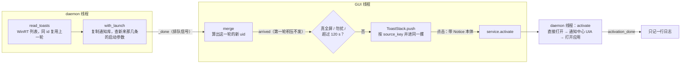

# 通知

> 读 Windows 通知中心里别的应用（Slack、Chrome、Claude……）的通知，用自家的 Metro 卡片在屏幕一角**几条同时叠出**；
> 同一来源叠成一摞，点一条直接跳到原消息。默认关（设置「通知 → 弹窗 → 自己弹通知」）。

起因：Windows 的横幅一次只显示一条，后面的排队；停留时间又是系统全局设置，设长了后面的要等几分钟才出来。

灵动岛卡片里原来铺这些通知的「通知」折叠框已换成**消息记录**（肥鱼自己冒过的气泡，见 [灵动岛](island.md)），铃铛是消息记录的入口。
现在通知服务**只给弹窗供数**：`NotificationService` 上的未读数 / `dismiss` / `clear` / `mark_all_seen` / `changed` 是那个折叠框留下的，已没有调用方。

## 模块

| 文件 | 职责 |
|---|---|
| `pet/notification_center.py` | 不碰 Qt：配置归一化、`Notice`、`merge`、WinRT 读取、从通知库副本查启动参数、`source_key`（归组键）、`activate`（跳转链） |
| `pet/notification_service.py` | `NotificationService`：定时器 + daemon 线程轮询，结果经排队信号回 GUI 线程合并；发 `arrived`；`activate(uid 或 Notice)` |
| `pet/notification_toast.py` | `ToastCard`（一条或一摞）、`ToastStack`（摆位、排队、并组、限高、置顶看门狗）；排版纯函数 `stack_positions` / `wrap_full` / `message_blocks` |
| `pet/platform_win.py` | `quiet_hours_profile()`（勿扰）、`_fs_user_busy_state()`（真全屏）、`_set_windows_topmost()` |
| `pet/app.py` | `_sync_notification_center` / `_sync_notification_toasts`（接线）、`_on_notifications_arrived`（什么时候不弹） |
| `pet/settings_notifications.py` | 设置一级域「通知」三节：读取 / 叠放 / 弹窗 |
| `tools/notification_toast_demo.py` | 不开肥鱼单独看弹窗：`--sample N`、`--replay N`、`--live` |

配置都在顶层键 `notifications` 下，归一化只有一处（`notification_center.normalize`，缺键补默认，所以加键不用迁移）：
`enabled`、`poll_seconds`（2–60，默认 3）、`keep`（名单留几条，默认 50）、`apps`（应用名 / AUMID 片段，默认只有 `slack`，`*` = 所有应用）、
`toast.{enabled, corner, screen, seconds, max_visible}`、`stack.{slack, chrome, other}`。

## 机制与不变量

### 读

- WinRT `UserNotificationListener.get_notifications_async(TOAST)` 只给：应用名、AUMID、文字元素（第一段当标题，其余拼成正文）、创建时间、一个整数 id。**不给启动参数、频道 id**。
- **只能轮询**：没有包身份的进程订阅 `NotificationChanged` 直接报 `Element not found`。做了包身份（MSIX / sparse package）才可能改事件驱动。
- 每轮把上一轮的 `Notice` 传回去按 id 复用：列表本身几十毫秒，贵的是逐条取应用信息（约 10 ms 一条）。20 条冷读约 220 ms、全部复用约 50 ms，所以 3 秒一轮可以接受。
- 读取开关和弹窗开关**都开着**才建服务、才轮询；关掉就停表，不白读。非 Windows / 没装 `winrt-*` 包时 `available()` 为假，什么都不建。
- 停表 / 改配置后轮次号 `_generation` 加一，晚到的旧结果作废；上一轮没回来就跳过这一轮。
- **通知内容只在进程内存里**：不落盘、不进日志（日志只有条数和跳转结果）、不进任何网络请求。
- 采集不截断正文。网页通知常在约 178 字处以「…」结尾，那是发通知的网站自己截的，这边没有更多可取。

### 什么时候不弹

`arrived` 只带这一轮新出现的（旧到新）。下面几种不弹，每批记一行 INFO（`通知弹窗：…`）：

- 开始读之后的**第一轮**算积压；
- 创建时间超过 120 秒（`NOTIFICATION_TOAST_FRESH_S`：读取失败几轮后一下子补上来的那批）；
- 真全屏应用：`_fs_user_busy_state()` 只认 `QUNS_RUNNING_D3D_FULL_SCREEN`(3) / `QUNS_PRESENTATION_MODE`(4)。`QUNS_BUSY`(2) **不算**——最大化的 Electron 窗口和本进程的 overlay 都会让它报 2；
- 开着 Windows「勿扰」：`quiet_hours_profile()` 非 0。只要开着就一律不弹，不读「优先通知」名单。读失败当 0：宁可照常弹，不吞通知。

### 叠放（`source_key` + `notifications.stack.*`）

| 规则 | 归组键 |
|---|---|
| `stack.slack = channel`（默认） | `slack:<team>:<频道 id>`，取自深链接的查询参数；没有深链接退回频道名（通知标题），再没有就整个 Slack 一摞 |
| `stack.chrome = site`（默认） | `chrome:<主机名>`，取自启动参数里的来源网址；扩展发的取扩展 id；取不到就整个 Chrome 一摞 |
| `stack.other = app`（默认） | `app:<AUMID 小写>`，没有 AUMID 用应用名，两样都没有不归组 |
| 任一项 `app` / `off` | 整个应用一摞 / 空键（每条一张卡） |

- `other` 一条规则管 Slack、Chrome 以外的**所有**应用（含 Claude）。`Notice.kind` 里的 `claude` 只用于跳转。要给某个应用单独的归法，在 `STACK_CHOICES` 和 `source_key` 里加一条，不要改 `other`。
- 归组键用 AUMID 而不是显示名：显示名随语言 / 版本变；同一应用的稳定版和预览版 AUMID 不同，各自一摞。
- `apps` 默认只认 Slack：`chrome` / `other` 规则要等 `apps` 里加了那个应用（或 `*`）才有东西可叠。
- 一摞最多记 30 条（`_MAX_GROUP`）。收起态列最近 3 条 +「还有 N 条」+ 两层纸边。这个来源再来新消息：更新内容、挪回最靠角、重新倒计时。
- **混合标题**（`mixed_titles`）：一摞里标题不全相同时，卡片标题写应用名，每条行首加粗的是它自己的标题、正文原样；标题全相同（一个频道）时标题是来源名、行首是发送人。这是看内容判断的，不看叠放模式。

### 卡片与展开态

- 每张卡是一个无父、置顶、不抢焦点的无边框工具窗；内容先画到一张缓存位图，再按进场 / 倾斜 / 划走的变换贴出来。所以**不能用子控件**（`QScrollArea` 不跟着变换走），滚动和点击都是自绘 + 命中矩形。
- 最新的贴着角；超过 `max_visible` 或放不下的排队（`park()` 藏起来、保留剩余时间），前面走一张就补上。排队上限 50（`_MAX_PENDING`），溢出的那批必须连窗口一起 `deleteLater`——只从列表里删会留下隐藏的顶层窗口。
- 同一 uid 只弹一次。悬停暂停倒计时；`toast.seconds = 0` 一直留着。
- 单条卡片：正文两行 + 省略，点一下就是跳转，没有展开态。
- **点一摞 = 展开**（展开着不倒计时）：每条消息一张小卡片，发送人 + 时间一行，正文折行显示全文（保留原文换行，没空格的长串在任意字符处折），全部列出。点某张小卡片跳到那条、只拿掉那一条；点标题区收起；关掉 / 划走是整摞。
- **限高**：卡片最高到「所在屏可用区高度 − 上下各 `MARGIN`」，再多就标题区固定、下面用滚轮滚；视口外的点不到。上限由 `ToastStack._height_limit` 在每次 `_reflow` 开头交给卡片（卡片自己不知道在哪块屏）。
- 不变量：`message_blocks` 是展开态排版的唯一来源，卡片高度、点击命中、绘制都读它；`_reflow` 摆位读卡片**实际高度** `card.height()`，不另算一遍；`set_max_height` 不发 `resized`（否则重排里再触发重排）。

### 置顶要自己守

Qt 只在建窗时写一次 `WS_EX_TOPMOST`，置顶带内的先后由「谁最近被激活 / 显示」决定。卡片从不激活，被激活的最大化窗口压下去之后**不会自己回来**：窗口在、位置对、内容也画了，屏幕上就是缺一块，而且缺哪几张看起来是随机的。

- `ToastStack._assert_topmost`：每次 `_reflow` 末尾 + 在场期间每 2 秒（`_TOPMOST_EVERY_MS`）一次看门狗，把在场的卡按**老 → 新**重新 `SetWindowPos(HWND_TOPMOST)`（最新的最后插、在最上）。没有卡片时看门狗停着；正在退场的不插。
- 真全屏（QUNS 3 / 4）时不插，别压在游戏上；`QUNS_BUSY`(2) 不拦——它正是触发条件，拦了等于没修。
- 这个压制在测试进程里用 `SetForegroundWindow` 复现不出来，只在长时间运行的肥鱼里见过。验证办法是从外部把卡片压到 `HWND_BOTTOM`，看它 2 秒内回来。

### 点击跳转（`notification_center.activate`）

卡片点击把 **`Notice` 本体**交给 `service.activate`，不查名单：名单只留最近 `keep` 条，卡片却可以一直留着，只带 uid 的话旧卡片点了就没反应。只给 uid 而名单里没有时返回 False 并记一行 `通知跳转：名单里已经没有这条`。

启动参数在新通知到的那一轮查好、记在 `Notice.launch` / `.activation` 上（查不到记 `none`，不再查），所以通知中心里没了也还能跳。跳转链按顺序：

1. **协议型启动参数**（`activation == "protocol"`，且过 `launchable_uri`：`file` / `javascript` / `vbscript` / `data` 不开）：直接打开。Slack 是带频道和消息的 `slack://channel?…`；Claude 的会话链接也归这类。
2. **Chrome**（启动参数过 `_CHROME_LAUNCH_RE`）：照它的 COM 激活组件那样起 `chrome.exe --notification-launch-id=<launch>`，Chrome 再触发网页（Gmail 打开那封邮件）或扩展自己的点击处理。起进程前先 `AllowSetForegroundWindow(ASFW_ANY)`：系统的激活组件也是这样给前台权限的，不给的话 Chrome 收到了点击、窗口却出不来。参数以列表传，不经 shell。
3. 上面两步成功后像系统一样把那条从通知中心拿掉，结果 `launched`。
4. **没带会话的 Claude 通知**：打开 `claude://code/needs-input`，不开通知中心，结果 `activated`。
5. **还在通知中心里**：`ms-actioncenter:` 打开通知中心，UI 自动化找到那条并 `Invoke`（约 0.3 秒，通知中心会闪一下），结果 `activated`。
6. 都不行：Slack 退到 `slack://open?team=<id>`（`opened_app`）；其他应用 `gone`。

跳转在 daemon 线程里跑（UIA 的 COM 在线程里成对初始化），结果只记一行 `通知跳转：<结果>（<kind> / <activation>）`。

## 设计取舍

- **读通知库副本，而不是只靠 UIA**：监听接口不给启动参数，但 `wpndatabase.db` 里有，且库里的 `Notification.Id` 就是监听接口的 id。库被系统服务一直开着写，所以只把三个文件（含 `-wal` / `-shm`）复制到临时目录读，约 20 ms，读完删；只在有新通知的那一轮做。**从不写活文件**。
- **不改 Windows 的任何设置**：用户要自己在「设置 → 系统 → 通知」里按应用关掉「显示通知横幅」，否则同一条弹两遍。
- **勿扰读未公开的 WNF 状态**：没有公开 API；`SHQueryUserNotificationState` 不反映勿扰（勿扰开着它仍报 2），注册表里是二进制 blob。失败方向选「照常弹」。
- **周期重插，而不是挂 `EVENT_SYSTEM_FOREGROUND` 钩子**：不赌触发条件；满 10 张卡每轮约 1.5 ms。代价是被盖住后最多 2 秒才回来，以及卡片会压住同一角落的其他置顶窗口。
- **展开后全部列出、不设单条行数上限**：靠整卡限高 + 滚动兜住；再套一层「展开更多」就回到了要去掉的那种截断。
- **`other` 默认按应用叠**，没给 Claude 做「按会话叠」：会话只体现在标题上，按标题归组等于「标题相同才叠」，和要的效果相反。
- **走不通的路**（不要再试）：用频道名拼 `slack://channel?team=…&id=<名字>`——只认频道 id，给名字不跳，还把 Slack 弄成「Something went wrong」报错页；从 Slack 本地缓存找「频道名 → id」——IndexedDB 是压缩的，`root-state.json` 只有工作区信息；Slack API——要公司 token，不进个人机器的配置。
- **Chrome 已撤掉的通知不处理**：网页撤掉通知（邮件读过、回复完成）后 Chrome 自己的记录就删了，再派点击是空操作，从外面没有干净的办法知道。读 Chrome 的 leveldb 能判断，但依赖它的内部格式，不进产品。

## 外部格式依赖

| 依赖 | 具体内容（升级后先核对） |
|---|---|
| 通知库 | `%LOCALAPPDATA%\Microsoft\Windows\Notifications\wpndatabase.db`，表 `Notification` 的 `Id` / `Payload` / `Tag` / `"Group"`；`Payload` 是 toast XML，根上的 `launch` 与 `activationType`（缺省 `foreground`） |
| Slack | `activationType="protocol"`，`launch="slack://channel?id=…&message=…&team=…"`；工作区 id 读 `root-state.json` 的 `workspaces`（Store 版在 `%LOCALAPPDATA%\Packages\91750D7E.Slack_8she8kybcnzg4\LocalCache\Roaming\Slack\storage\`，安装版在 `%APPDATA%\Slack\storage\`） |
| Chrome | 启动参数 `数字\|数字\|…\|来源\|通知 id`，中间几段随版本变（155 版比旧版多一段），所以正则只认「开头两段数字 + 1–4 段 + 来源」；来源是 `https?://` 或 `chrome-extension://<id>/`（邮件提醒类扩展）。`chrome.exe` 从注册表 `App Paths` 或三个常见安装位置找 |
| Claude 桌面版 | toast 没有 `launch`；会话 id 在 `Group`（`session-<id>`）/ `Tag`（`idle-<id>`）里，形状 `local_…` 或 `session_…` / `cse_…`；打开用应用自己的外链 `claude://claude.ai/epitaxy/<id>`。汇总提醒（`Tag` 是 `hub-awaiting-…`）不带会话。**不要**用 `code/continue?session=`（只认本地会话）或 `code/needs-input?session=`（会退到第一个等待中的会话，可能跳错） |
| 通知中心 UIA | 顶层窗口类 `Windows.UI.Core.CoreWindow`，列表 AutomationId `MainListView`，条目类 `ListViewItem`，条目 `Name` 是它所有文字拼起来的；用「标题 + 空白归一后的正文前 30 字」认 |
| 勿扰 | WNF 状态 `WNF_SHEL_QUIETHOURS_ACTIVE_PROFILE_CHANGED`（`0x0D83063EA3BF1C75`），`ntdll.NtQueryWnfStateData`，前 4 字节小端：0 关 / 1 仅优先 / 2 仅闹钟 |

## 排障

| 症状 | 原因 / 先查什么 |
|---|---|
| 完全不弹 | `notifications.enabled` 和 `toast.enabled` 都要开；Windows「让应用访问通知」；`apps` 默认只认 Slack；日志里的 `通知弹窗：fullscreen / do_not_disturb，N 条不弹` 或「太旧不弹」 |
| 同一条弹两遍 | 系统横幅没关（见设计取舍） |
| 系统横幅一条停几分钟、后面的迟迟不出 | `HKCU\Control Panel\Accessibility\MessageDuration`（秒）被设大了 |
| 叠放中间空一块、某几张看不见 | 被最大化窗口压到置顶带下面。枚举本进程顶层窗口看卡片是否都在、`WindowFromPoint` 在卡片中心返回的是谁；看门狗是否在跑 |
| 点了没反应，日志里也没有 | 调用方只传了 uid 而名单已挤掉那条；卡片这条路必须传 `Notice` 本体 |
| 日志 `launched（chrome / …）`，Chrome 没动静 | 网页已撤掉那条通知，Chrome 不认了；无解 |
| 日志 `gone（chrome / foreground）` | 启动参数没过 `_CHROME_LAUNCH_RE`：Chrome 升级改了格式，或来源是新的协议。从通知库抓一条 `launch` 对正则 |
| Chrome 收到点击但窗口不到前台 | 起 `chrome.exe` 前没放行前台权限（`_spawn_detached`） |
| 点通知弹出了 Windows 通知中心 | 那个应用没有可直接打开的启动参数（走 COM 激活），走的是 UIA 退路，日志是 `activated（other / foreground）` |
| Slack 变成「Something went wrong」 | 有代码用频道名拼了 `slack://channel` |
| 开着勿扰还弹 | `quiet_hours_profile()` 读失败返回 0：Windows 更新后 WNF 状态名或格式变了 |
| 展开后正文末尾有「…」 | 网页通知在来源处就被截断 |
| 长时间运行后窗口句柄 / 内存涨 | 排队溢出的卡片窗口没删（`_MAX_PENDING` 那段） |
