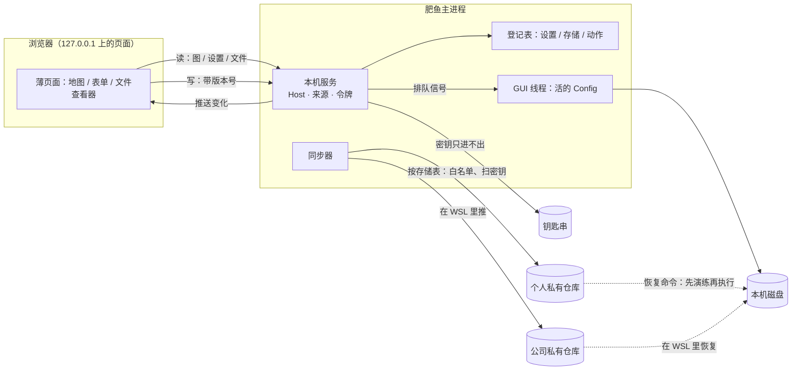

# 路线图

> 这份文档和别的不一样：别的文档写**现在**的机制，这一份写**要去哪、走到哪了**。
> 一步做完，机制写进对应的主题文档，这里只打勾。决定本身在 ADR
> [0014](adr/0014-panorama-becomes-the-console.md)（配置全景成为主控制台）和
> [0015](adr/0015-private-repos-are-home.md)（私有仓库是数据的家）。

## 目标

肥鱼是一个自用的平台：协调各个 AI 和使用者的工作，减少不必要的管理消耗。往后以 GitHub 上的记忆库为基础，
接入各个 AI，在这里管理工具和数据。

## 原则

| # | 原则 | 落到设计上 |
|---|---|---|
| P1 | 看得见 | 每种数据在全景上有磁贴：在哪、谁写的、里面是什么 |
| P2 | 能配置 | 看到的地方就能改；一项设置只有一个编辑入口 |
| P3 | 私有仓库是家，本机是缓存 | 每种落盘数据登记恢复来源，答不上来就是缺口 |
| P4 | 公司 / 个人分开 | 账号带贯穿图、存储、同步、恢复 |
| P5 | 搭框架，不写死 | 三张声明式登记表；页面不认识任何具体功能 |
| P6 | 中英文 | 文案全走文案库；守卫测试查两种语言齐全 |
| P7 | 小步 | 每个勾选项是一个可以单独合并、单独回退的小 PR |
| P8 | 不点不跑、不卡界面 | 服务懒启动、空闲自停；GUI 线程只收信号 |

## 目标架构

- **设置表**：每项设置声明一次——所属域、控件种类、可选值、默认值、校验、文案键、披露层级、平台条件。
- **存储表**：每种落盘数据声明一次——位置、账号、种类、谁写、恢复来源。
- **动作表**：重新探测、测试连接、修复 hooks、立即备份这类操作。
- **守卫测试**：配置白名单里的键都在设置表里；代码写到的数据目录路径都在存储表里。漏登记就红。
- **迁移规则**：搬一组设置的 PR 同时做完——设置表加声明、Qt 窗口删掉这组并留跳转、搜索别名与深链改指、测试搬家。

## 里程碑

顺序即计划。开工时在 `.scratch/` 下建对应的单子；做完在这里打勾。

### M0 定稿

- [x] 设计定稿，四项待定问题有了答案（见两份 ADR）
- [x] 决定与路线图进仓库

### M1 回传通道（页面功能不变，仍然只读）

- [x] 本机服务骨架：回环地址、随机端口、空闲自停、路由表（懒启动和退出时关在接入口那一步）
- [x] 安全：Host 白名单、来源检查、每次启动的令牌、同源内容策略；拒绝矩阵测试
- [x] 页面改由服务提供；模板拆成外壳 / 样式 / 脚本文件；页面测试跟着改；懒启动、退出时关
- [x] 保留离线快照（肥鱼没开时还能看），与服务共用一份页面代码
- [x] 事件推送替换「每 3 秒问一次」，数据变了原地重画、不丢选中状态
- [x] 页面脚本拆成原生模块（工具、版面、走线、画、交互、入口）；离线快照按顺序拼接同一组模块
- [x] 网页样式令牌与 Qt 共用一张表（控件用令牌；地图配色保持自己的一套，浅色待地图有浅色配色后启用）

### M2 看得见：存储表与只读查看

- [x] 存储表与守卫测试
- [x] 每个存储磁贴显示：在哪、谁写、恢复来源、多久前备份
- [x] 文件查看器：记忆文件、全局规矩文件、受管块、蒸馏条目（只读）
- [ ] WSL 一侧补齐：存储数文件、文件查看（都要经 `wsl.exe`）
- [ ] 记忆按作用域展示（全局 / 项目 / 机器），标出重复和放错作用域的
- [ ] 连接器详情：每个 AI 连了什么、状态、上次探测时间
- [ ] 工作空间：每个 AI 的项目目录与最近会话

### M3 能配置：设置表与第一组设置

- [ ] 设置表与守卫测试
- [ ] 写入链路：版本号、GUI 线程落盘、审计记录
- [ ] 通用表单控件：开关、下拉、数字、文本、长文本
- [ ] 第一组走通全程：工作简报
- [ ] 审计记录查看

### M4 AI 类设置搬完

- [ ] Slack 关注
- [ ] 工作笔记
- [ ] 个人助理
- [ ] 会话记忆蒸馏（个人侧与公司侧）
- [ ] 文件解读、看屏幕
- [ ] Claude Code 联动与 hooks 修复动作
- [ ] 模型服务列表与密钥、连接测试

### M5 能编辑：记忆与知识

- [ ] 文件编辑器：记忆文件、全局规矩文件的非受管部分
- [ ] 冲突处理：版本不对时显示差异，不无声覆盖
- [ ] 属于知识库的文件，保存即提交
- [ ] 来源记录：每条记忆是谁、何时、依据什么写的

### M6 恢复

- [ ] 现有配置备份纳入存储表；补上分身配置
- [ ] 同步器：个人侧 AI 工具的记忆、设置、技能、脚本
- [ ] 同步器：蒸馏条目库与待审提案
- [ ] 公司侧：WSL 里的设置与记忆同步到公司仓库
- [ ] 密钥的加密备份与恢复
- [ ] 恢复清单：要装的东西、仓库克隆位置、路径映射、只能手动做的事
- [ ] 恢复命令：演练模式与执行模式
- [ ] 定期演练，结果上图
- [ ] 在一个干净环境上真的恢复一次

### M7 其余设置按域搬

- [ ] 常规
- [ ] 通知
- [ ] 文件识别
- [ ] 语音
- [ ] 桌面组件
- [ ] 互动
- [ ] 肥鱼
- [ ] 自动化与联动余下的项
- [ ] 菜单编排器
- [ ] 下线 Qt 设置窗口

### M8 知识库工作流平台（方向，未细化）

- [ ] 知识库的 MCP 入口：让别的 AI 读同一份记忆
- [ ] 把更多 AI 工具接上图
- [ ] 知识库的流向图：谁写入、何时、经过什么审核
- [ ] 定期调研同类做法，把值得借的记到这里

## 借鉴过的做法

- 本机网页控制台的安全：Host 白名单防 DNS 重绑定，来源检查防跨站请求，令牌放自定义请求头，只绑回环地址。
- 同类的 AI 配置仪表盘：按作用域层级列出记忆、技能、连接器，能发现重复和放错位置的。
- AI 工具配置的同步工具：白名单同步、推送前扫密钥、覆盖前留底。
- 多个 AI 共用记忆：git 里的 Markdown 是唯一真相，MCP 是访问层；多个 AI 直接改同一份文稿会无声覆盖，要有审核门。
- 新机器恢复：一份声明式清单、一条引导命令、密钥用一把主钥解密。
