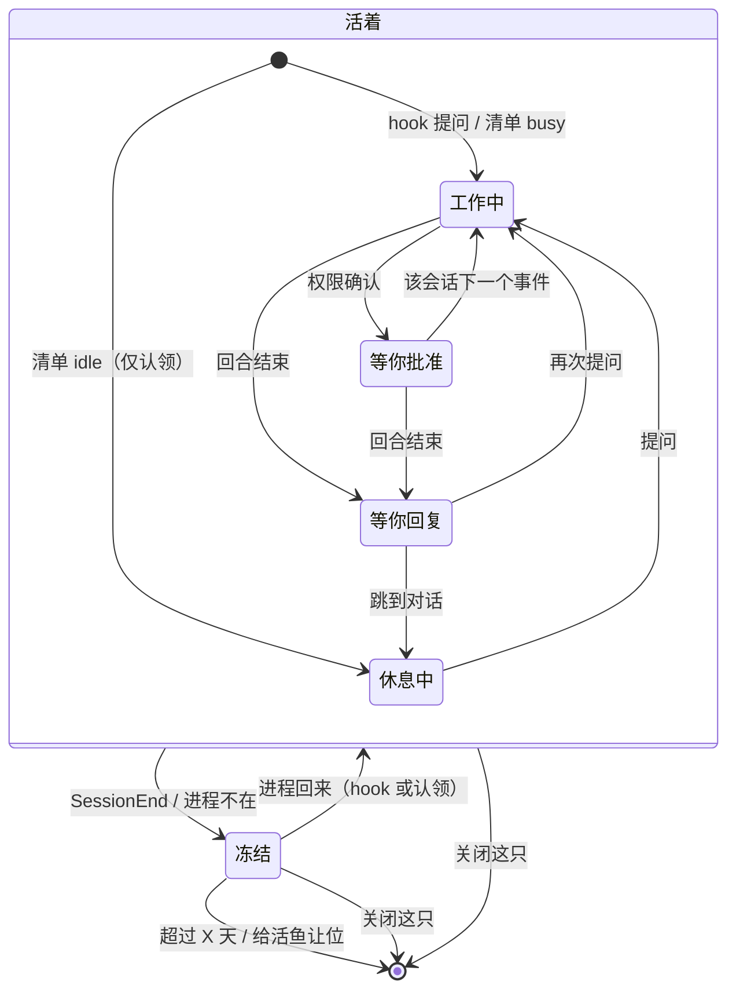

# 会话小鱼

> 每个开着的 Claude Code 会话（本机 + WSL）在桌面上有一只小肥鱼：头顶常驻「来源图标 · 桂冠 · 名字 · 状态」，
> 单击弹详情卡，右键是它自己的精简菜单。鱼 = 一个开着的对话；最近几天开过、进程已不在的对话是一只灰色的冻结鱼。
> 只在 overlay 拓扑下有。

## 模块

| 文件 | 职责 |
|---|---|
| `pet/claude_hooks.py` | hook 脚本（回合边界追加 `SessionMeta`：标题、模型、cwd、transcript）；`ClaudeSessionTracker` 逐会话阶段、`adopt` / `note_registry` / `registry_vanished`；`missing_hook_events` |
| `pet/agent_link.py` | `ClaudeCodeMonitor`：发 `session_update`，每 60 s 认领（`_adopt_registry_sessions`）与存活核对（`_reap_dead_sessions`）；`AgentLinkManager`：hooks 缺失检查、`repair_hooks` |
| `pet/claude_session_info.py` | 读运行清单与会话记录尾部：详情、存活、可认领会话、`host_kind`、模型名、上下文用量；WSL 侧经一次 `wsl.exe` 跑 `WSL_SCRIPT` |
| `pet/overlay_session_pets.py` | `SessionPetController`（GUI 线程）：会话 ↔ sprite、派生阶段、冻结层与名册核对、桂冠 / 来源、列队排序键 |
| `pet/session_fish_decisions.py` | 「关闭这只」的决定，落盘 `session-fish.json` |
| `pet/session_pet_ui.py` | 详情卡 `SessionDetailCard`、会话小鱼右键菜单与动作（读取 / 跳转在后台线程，信号回 GUI） |
| `pet/session_card_themes.py` | 详情卡配色方案、文字大小档位、WCAG 对比度函数 |
| `pet/session_crown.py` | 桂冠的匹配规则与菜单候选（不碰 Qt） |
| `pet/host_icons.py` | 来源程序图标：外壳取真图标或手绘单色记号，带缓存与预热 |
| `pet/pet_sprite.py` | 头顶标签胶囊的排版、省略、绘制与贴图缓存 |
| `pet/sprite_rally.py` | `escort_spots` / `lineup_spots` 落点纯函数、`SpriteRallyWorld` 飞行段 |
| `pet/overlay_shell.py` | 接线：生 / 退会话小鱼、`set_session_pet_caption`（标签唯一写入口）、`rally_pets` / `lineup_pets`、`_local_run_list` |
| `pet/claude_session_history.py`、`pet/session_history_service.py` | 「最近的对话」`claude-session-history.json`：冻结层的名册来源 |

设置全部在 `agent_link.*`。开关 `session_pets` 在右键菜单「Agent 联动」里；其余在配置全景「会话小鱼」那组里改
（`pet/settings_table.py` 的 `session_fish`，2026-11-19 起；菜单里只剩一条「会话小鱼设置…」跳过去，会话小鱼自己的菜单同一条）：
`session_pets_max`（默认 6，1–40）、`session_fish_keep_days`（默认 3，1–30）、`crown_models`（默认 `["fable"]`，页面上一行一个片段）、
`session_card_theme`（默认 `sea`）、`session_card_text_size`（85 / 100 / 115 / 130）。
别处改了（页面、设置进程）由 `OverlayShell._sync_session_settings` 当场生效：关开关小鱼离场、保留天数核对名册、桂冠换记号。

## 机制与不变量

### 两个数据来源，一个会话只归一个管

数据流：hook → 事件文件 → `ClaudeSessionTracker`（监视器 worker 线程）→ `session_update` 信号 → `SessionPetController`（GUI 线程）。
主肥鱼的 Agent 级状态管线是另一条，互不影响。会话身份是 `(通道, sessionId)`，通道为 `claude` / `claude_wsl`；
sessionId 跨肥鱼重启、跨 `--resume` 稳定（pid 会变），所以所有落盘的东西都按它记。

- **hook 事件**：收敛器只报 `working / waiting / resting / gone`。第一次见到就是 `resting` 的会话**不生鱼**（没赶上它干活）。
- **运行清单认领**（`~/.claude/sessions/<pid>.json`，Claude Code 自己按进程写）：
  - 联动开着：监视器第一轮 + 每 60 s 读清单，把活着、还没出场的会话 `adopt` 进收敛器，更新带 `adopted="1"`，
    呈现层据此允许以「休息中」出场；阶段按清单 `status`（`REGISTRY_PHASES`：idle / busy / waiting）。已出场的会话顺便补入口和桌面版会话 id。
    认领只管呈现，不进收敛器的「忙」集合：Agent 级状态仍只由事件决定。
  - 没有通道在喂的会话（联动关着）：控制器自己在 `reconcile` 里读**本机**清单认领（`_sync_registry`），跟着清单换阶段，清单里没了发 `gone`。
    通道一旦为某会话发过更新，它就从 `_self_adopted` 移出，清单从此不碰它的阶段和离场。这一路不读 WSL（要起 `wsl.exe`，不能放 GUI 线程）。
- 认领途中历史服务的 `changed` 是同步信号，会重入 `reconcile`：`_syncing` 标志挡住，认领完统一核对一次名册。清单项没变就不写、不触发历史保存。

### 离场

- `SessionEnd` → `gone`。被直接杀掉的 Claude Code 不发 `SessionEnd`，所以每 60 s 拿清单核对进程（pid + 进程启动时间都对上才算活，pid 被复用也认得出）：明确已死的按 `SessionEnd` 处理。
- 清单里**查不到**（None）不等于死了：从没在清单里见过的会话不动。但在清单里见过的（认领、补事实、核对给过活 / 死都算见到），
  连着 2 轮（`_REGISTRY_MISSES`，约 2 分钟）查不到就按已关闭收——进程退出时清单文件会被删，认领来的会话没有 hook 给它送终。两轮是为了吸收清单重写瞬间读不到的抖动。
- `wsl_liveness` 失败必须**抛异常**（这一轮核对作废），不能返回全 None：否则一次 `wsl.exe` 起不来会被当成所有 WSL 会话都没了。
- 到上限（`session_pets_max`）的会话没有鱼，只体现在灵动岛汇总里；每只鱼约 9% 单核、3–4 MB（冻结的停了播放节拍，更低）。

### 肥鱼自己的无界面运行不认领

Slack 关注、工作简报、公司侧记忆蒸馏在 WSL 里起 `claude -p`，命令行都带 `BIG_FAT_FISH_HEADLESS=1`（`claude_hooks.HEADLESS_ENV`）：
hook 脚本见到它直接返回；`WSL_SCRIPT` 对每个活着的清单进程看 `/proc/<pid>/environ`，带这个变量的输出 `@@headless <pid>`，认领时跳过。
不按 session id 过滤，是因为 `--no-session-persistence` 的 id 肥鱼拿不到。用户自己的 SDK 脚本（`sdk-cli`、没有这个变量）照认。
**新增任何由肥鱼起的 `claude` 运行都要带这个变量**；本机侧没有对应过滤（肥鱼不在 Windows 侧起 `claude -p`），哪天起了要补。

### 阶段

- 「等你回复」（`review`）是**呈现层派生**的：收敛器只知道回合结束（`resting`），`_presented_phase` 把刚从 `working / waiting` 转入 `resting` 的会话记进 `_unseen`。
  `sessions()` 里的阶段是显示阶段，灵动岛计数也分得出。收敛器不变。
- 什么算看过：点「跳到对话」（三个入口都经 `jump_key` → `acknowledge`，点击那一刻就算，不等跳转结果），或那个会话又开始干活。点开详情卡不算（卡上看不到回答）。
- 肥鱼启动时就已经停着的会话是「休息中」，不是「等你回复」；`_unseen` 只在内存。`review → resting` 不重置阶段起点 `since`（「已 N 分钟」从回合结束算）。
- 阶段没变不重启动画；干活途中转入等批准只换标签。各阶段的动画段名在 `WORK_CLIPS / REVIEW_CLIPS / REST_CLIPS / FROZEN_CLIPS`，素材库里没有就退回随机行为（冻结则停在休息姿势并暂停播放，放进「冻结」素材即生效）。
- `retitle` / `acknowledge` 把登记表里的内容回放进 `on_session_update`，其中可能带着 `review`；`_presented_phase` 先把它还原成 `resting` 再判定，两种来源走同一条路。

### 冻结与「关闭这只」

- 名册 = 在用的会话 ∪「最近的对话」里最近 `session_fish_keep_days` 天的行。名册里不在用的 → 冻结鱼（最近的优先）；超期且进程仍不在 → 离场。
  每次会话更新后、每 60 s、历史变化时核对。活的会话要出场而上限满了，最旧的冻结鱼让位。
- 冻结只表示「进程不在了」。清单说还开着的会话不能冻结（见上面的认领）。
- 「关闭这只」落盘到 `session-fish.json`（与历史同目录，只存会话 ID、通道、时间、标题）。决定在会话**再活跃**时作废，活跃只指 `working / waiting`；
  认领来的休息中、冻结都不算，否则一重启全回来。离开名册的决定被 `prune` 忘掉，新会话不会继承旧决定。
- 第一次核对延后 `FIRST_RECONCILE_MS`（1.5 s）：`attach_history` 在壳的 `__init__` 里调用，那时屏幕路由还没建好，立刻生鱼会让壳起不来。生冻结鱼出错要兜住，不能带倒壳。
- 点冻结鱼、它菜单里的「在 … 重开这个对话」都是按入口恢复；活鱼是跳到对话。细节见 [跳到对话](session-jump.md)。

### 名字

- 标签文字取标题 → 项目名 → 会话 ID 前 8 位。标题有两种，Claude Code 分开记：自动标题（`ai-title`）和用户改的名字（`custom-title`）。
  **改名之后自动标题照样继续追加**，两种记录交替出现，所以「取最后一条标题」永远拿到自动的。规则是：有用户改的名字就用它的最后一个，没有才用最后一个自动标题；不比较谁靠后。
- hook 脚本在回合边界从记录尾部 128 KB 里按这个规则取；万一改名记录滚出尾部就退回自动标题。详情读取另有兜底：运行清单里 `nameSource == "user"` 的 `name`。
  `nameSource` 为 `derived` 的 `name`（「目录名-两位十六进制」）不当标题。
- 会话空闲时改的名字 hook 要下一轮才报；点开详情卡读到不一致时用 `retitle` 回写头顶。不为此定时读清单（WSL 每次要起 `wsl.exe`，为低频事件付常驻开销）。
- hook 脚本落在数据目录，监视器每次启动重写，本机与 WSL 共用一份：改脚本不需要重新注入 hooks。

### 头顶标签胶囊

- 顺序：来源图标 → 桂冠 → 「名字 · 状态」。整条是 sprite 自己画的一张缓存贴图，键为（文字、尺寸、DPR、色调、桂冠、来源），每帧只贴图。胶囊始终落在 sprite 画布矩形内。
- 色调：工作中淡绿、等你回复天蓝、冻结灰，其余（等你批准、休息中）深灰。
- 放不下时**只省略名字**（按最后一个 ` · ` 拆开），状态词完整保留。
- 来源：`host_kind(entrypoint, 是否 WSL 通道)` → `vscode / desktop / terminal / wsl / script`，与详情卡页头同一份规则；WSL 里的 VS Code 仍算 VS Code。
  入口还不知道时不画，清单补上后那一帧就有；冻结鱼用历史行里记的入口。真图标取不到（没装、`sdk-cli`、非 Windows）用手绘记号，记号颜色跟胶囊字色。
- 桂冠：模型 id 含 `crown_models` 里任一片段就戴。用片段不用精确 id，是为了新版本不用改配置（想精确就勾菜单里在场的具体型号）。
  模型由 hook 在回合边界从记录尾部捎带（只认 `claude-` 开头、字母数字点横线的串）。没桂冠、没来源的胶囊与原来逐像素相同。
- hook 报的模型滞后一轮（会话中途 `/model` 后的那次提问报的还是旧模型）；详情卡当场读记录，读到不同就 `remodel` 纠正，回合结束的 `SessionMeta` 也会纠正。

### 详情卡

- 复用一个窗口；每次取卡片时按配置核对配色与字号（`_ensure_card`），所以从哪条路径改的配置都一样生效，已开着的卡要下次打开才变。
- 详情在点开时由后台线程读（会话记录尾部 512 KB + 运行清单；VS Code 会话再认一次工作区）。提问正文只进内存不落盘。读不到的块整块不显示，不留空框。
- **模型 / effort**：取主对话最近一轮 `assistant` 记录（跳过 `isSidechain`）；`perTurnEffort` 优先于 `effort`，`message.model` 没有才用 `requestedModel`。
  显示名由正则从 id 推出（`claude-fable-5-1` → `Fable 5.1`），认不出原样显示，不维护对照表。
- **上下文用量**：同一轮的 `usage` 里 `input_tokens + cache_creation_input_tokens + cache_read_input_tokens`；压缩之后、回复之前用 `compact_boundary` 的 `compactMetadata.postTokens`。
  窗口大小哪里都没记，按模型 id 查（`context_window`）；认不出的模型只写用量、不画比例。
- **配色**：五个写死的方案，每个方案逐项写明颜色，全部过同一组对比度门槛（正文、按钮字、悬停字、强调色上的字 ≥ 7，次要文字 ≥ 4.5，按钮描边与卡片边 ≥ 2），
  由 `tests/test_session_card_themes.py` 把关。按钮底只比卡片底深一点，靠描边框出来。强调色单独定义，不复用悬停色。配色不跟气泡样式、字号不跟气泡文字大小。
- **字体只点一个族**（`ui_fonts.metro_font_family` / `mono_font_family`）：给 Qt 一串族名会把整个字体库映射进进程，首次打开多花约 250 ms。
- **来源图标要预热**：第一次向 Windows 外壳取程序图标要 200–360 ms，并一次性加载约 15 MB 的外壳组件；放在启动 4 s 后的预热里（卡片尺寸和胶囊尺寸各一份），不在点击或生鱼那一帧付。

### 护驾与列队

主肥鱼右键菜单的两个动作，都是一次性的：落地后照常游走、被碰撞推开。别的屏上的小肥鱼先搬回主屏。

- **飞行段**共用 `SpriteRallyWorld`：飞行中的鱼处于拖拽态（播悬空动画）并整只退出碰撞世界——拖拽态是无限质量，不退出会一路把别的鱼撞开；到位后还回去。
- **护驾**（`escort_spots`）：全按身体框算，落点之间、与主肥鱼和灵动岛之间至少留 12 px，落地后才不会被碰撞世界当成重叠推开。
  候选点是贴着主肥鱼的一张格子，按离它中心的远近逐个试（头两只一左一右，再往外往上补），格子满了退回全屏找空位。落点记成相对主肥鱼的偏移，飞行途中它走开落点跟着走。
- **列队**（`lineup_spots`）：主屏可用区底边从左到右，按**占位框**（身体框 ∪ 标签胶囊）留 12 px——身体框约 50 px 宽而标签有 110–180 px，只按身体框排标签会互相压住。
  撞到主肥鱼或灵动岛只往右让；一排满了往上加一排（上一排脚底在这一排占位框最高处上方 12 px）；排到屏顶还放不下的留在原地。
  返回的仍是身体框左上角（飞行段和碰撞体按身体框）；不传 `halos` 时结果与只按身体框排逐点相同。锚是原点不动的 `FixedAnchor`，偏移即绝对落点。
- 列队排序（`lineup_rank`）：等你批准 / 等你回复 → 工作中 → 休息中 → 冻结 → 手动生的小肥鱼；同档里最近更新的在前（活会话看 `since`，冻结鱼看历史行的最后活动时间）。

### 联动开着、hooks 却不在

两个 Claude Code 联动默认是开的（WSL 那个仅 Windows），但默认只启动监视器；写 `~/.claude/settings.json` 只有 `AgentLinkManager.set_enabled` 的同意弹窗之后那一条路，`apply_config` 从不写。
所以「开着但没注入」是全新安装的常态：鱼靠清单认领还在，但阶段停在认领那一刻，没有等批准提醒和收工气泡。

- 一个通道的监视器从「没在跑」变成「在跑」时查一次：延迟 5 s，后台线程只读（WSL 是一次 `wsl.exe`），结果经 `hooks_checked` 信号回 GUI 线程。
  延迟是因为气泡只发给可见的窗，本机检查不到 1 ms 就有结论，那时鱼还没出场。已经在跑的通道、别的设置变化引起的 `apply_config` 不再查。
- 缺任何一个事件就冒一条气泡（也进灵动岛的消息记录），并在右键 → Agent 联动里那个通道下面多一条修复项。
  修复项 = `repair_hooks` = `set_enabled(通道, True)`：弹的是同一个同意框，点「否」什么都不写、联动也不会被关。
- 判断不了就不说：那一侧没有 `~/.claude`、WSL 没响应、`settings.json` 不是合法 JSON。
- 每个通道一个轮次计数，装好或通道停下时加一；迟到的检查结论对不上轮次就丢，避免装好之后又冒一条过期提示。
- 只看有没有肥鱼的条目，不核对条目指向的路径。旧 `PetWindow` 的菜单没有修复项（只修崩溃的约定），气泡有。

## 设计取舍

- **鱼 = 开着的对话，而不是「在干活的对话」**：所以重启后要从清单把空闲的会话认领回来，联动关着也要认领。没有选「只把活会话从冻结名册里排除」，那样活着的对话会没有鱼。
- **「等你回复」放呈现层**：「看过没有」来自 GUI 线程上的一次点击，放进 worker 线程里的收敛器要跨线程回写。不落盘、不靠前台窗口自动判定（要常驻轮询，且 VS Code 一个窗口里有多个对话）；
  回合结束不再逐鱼弹气泡（主肥鱼的管线已经提醒过）。代价：用户自己切过去看了但没回复，鱼会一直是「等你回复」。
- **模型走两条路**：桂冠要常驻头顶，所以从 hook 捎带（回合边界本来就读一次尾部，没有新的文件读取）；effort 和用量只在点开详情卡时读。不让每个工具事件都去读记录尾部。
- **详情卡只给固定方案，不开放自定义颜色**：原先卡片借用气泡样式的颜色，有一种组合按钮字与底的对比度只有 1.32。固定方案才能逐项被测试验证。加方案就改 `session_card_themes.py` 并过门槛。
- **hooks 缺失只在通道启动时查，不周期查**：周期查 WSL 每次要起一个 `wsl.exe`。代价：运行中被卸掉要到下次启动肥鱼（或关掉再打开联动）才提示。绝不代用户注入。
- **不读 Claude 桌面版的私有会话库**（`cliSessionId` → 桌面版会话 id 的映射）：没有文档、单文件几百 KB、随应用更新可能变形。桌面版会话 id 改为趁进程活着时从运行清单记进历史。
- **护驾不按标签留距**：围在主肥鱼身边本来就是挤着站。
- 「等你批准」的标签仍是深灰（灵动岛里是橙字），留着没做。灵动岛的会话清单上没有桂冠。

## 外部格式依赖

都是 Claude Code 的内部格式（按 2.1.283 / 2.1.296 / 2.1.309 核对过），读取一律「读不到就留空」，存活判定查不到返回「不知道」。升级后先核对：

- **运行清单** `~/.claude/sessions/<pid>.json`（没有文档；进程退出即删；老版本不写）：`sessionId`、`status`（`idle / busy / waiting`）、
  `entrypoint`（`cli` / `claude-vscode` / `claude-desktop` / `sdk-cli`）、`hostSessionId`（桌面版会话 id，只在进程活着时拿得到）、`name` + `nameSource`（`user` / `derived`）、`cwd`、进程启动时间。
- **会话记录** `~/.claude/projects/*/<sessionId>.jsonl`（官方说明条目格式会变）：`{"type":"ai-title","aiTitle"}`、`{"type":"custom-title","customTitle"}`；
  `assistant` 记录的 `message.model`、`requestedModel`、`effort`、`perTurnEffort`、`isSidechain`、`message.usage` 三个 token 字段；`compact_boundary` 的 `compactMetadata.postTokens`。
  hook 脚本是对尾部做字符串匹配（`"customTitle":"`、`"aiTitle":"`、`"model":"claude-`），值截到第一个反斜杠为止。
- **上下文窗口大小**：`claude_session_info._WINDOW_1M_RE` 里按模型家族和版本写死（带 `[1m]` 后缀也算 1M，其余 Claude 算 200K）。出新模型要更新。
- **WSL**：`/proc/<pid>/environ`（无界面标记、终端类型）。
- **商店版 Claude 桌面版的安装位置**：`WindowsApps` 目录列不出来，从注册表 `HKCU\…\AppModel\Repository\Packages\Claude_*__pzs8sxrjxfjjc` 的 `PackageRootFolder` 查。
- **`~/.claude/settings.json` 的 `hooks`**：`missing_hook_events` 按 `HOOK_EVENTS` 逐事件找肥鱼的条目（认标记，也认没有标记的旧条目）。`HOOK_EVENTS` 加了事件，老用户会看到缺失提示，重新同意一次才装上。

## 排障

| 症状 | 原因 / 先查什么 |
|---|---|
| 重启后正在用的对话显示「冻结」，日志只有「冻结的会话小鱼出场」 | 没人喂活会话。先看 `agent_link.claude` / `claude_wsl` 是否被关（配置被重置过？）。WSL 联动关着时 WSL 的活会话一定显示冻结：控制器只读本机清单 |
| 鱼在，但状态不动、没有等批准提醒 | 联动开着、hooks 不在。日志搜「缺肥鱼的 hooks」，右键 → Agent 联动 → 修复项 |
| 一只鱼一直「工作中」不走 | 认领来的会话没有 `SessionEnd`，应在清单消失后两轮（约 2 分钟）收走。若是肥鱼自己起的 `claude -p`，查命令行有没有带 `BIG_FAT_FISH_HEADLESS` |
| 头顶名字是改名前的 | 空闲时改的名，hook 下一轮才报；点开详情卡会回写。若一直不对，看记录尾部是否还有 `custom-title`、清单 `nameSource` 是否为 `user` |
| 详情卡写着某模型，头顶没有桂冠 | hook 报的模型滞后一轮；点开详情卡或等回合结束即纠正。还没有第一轮回复的会话没有模型 |
| 标签上没有来源图标 | 入口还不知道（hook 事件先到、清单没补上），一个认领周期（60 s）内补上；手动生的小肥鱼本来没有 |
| 开着的会话没有鱼 | 超过 `session_pets_max`（只在灵动岛汇总里）；或用户关过它（`session-fish.json`），要它再提问 / 等批准才回来；或 Claude Code 版本太老不写清单 |
| Esc 打断后约一分钟才变「等你回复」 | 打断不发 `Stop`，要等 Claude Code 60 s 后的 `idle_prompt` |
| 启动时冻结鱼先出场又立刻退场 | 第一次名册核对（1.5 s）早于第一轮认领，活的进来后冻结的让位；无害 |
| 被杀掉的会话过一两分钟才变冻结 / 刚恢复的冻结鱼过一会儿才变活 | 存活核对和认领都是 60 s 一轮；正常关闭有 `SessionEnd`、恢复出来的进程发了第一条 hook 事件，都会更快 |
| 列队后灵动岛左边空着一段 | 占位框放不下就整只让到障碍右侧，只往右让 |
| 详情卡的上下文只有用量没有比例 | 模型 id 不在窗口大小的规则里，更新 `_WINDOW_1M_RE` |
