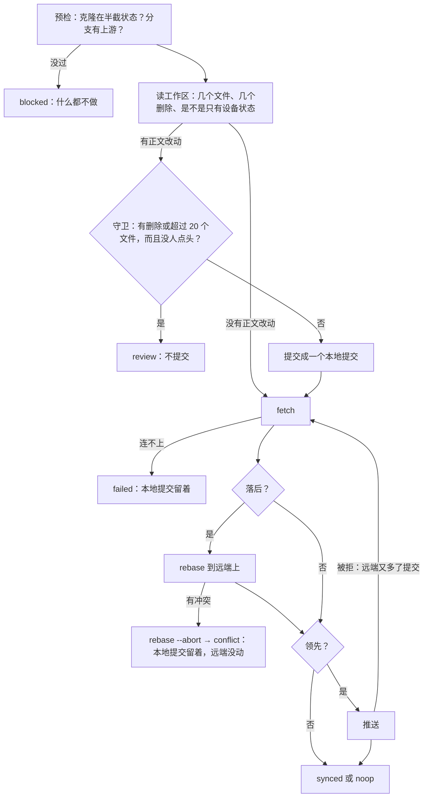

# 知识库同步

> 把个人知识库的本地克隆和它在 GitHub 上的远端对齐：提交本地改动、拉取远端的新提交、推送。知识库是「家」
> （[路线图](roadmap.md) P3），所以同步器的每一步都以「不丢内容、不替人做决定」为先。
> 决定见 [ADR 0019](adr/0019-run-journal-and-git-are-the-timeline.md)（时间轴两本账）和
> [ADR 0020](adr/0020-vault-sync-never-picks-a-side.md)（不自动选边、没人点头不提交大动作）。

现在做到的：手动的「现在核对」和「现在同步」、一张时间轴页（都从[配置全景](config-panorama.md)的知识库克隆磁贴进），
和默认关着的定时同步（「知识库定时同步」磁贴）。还没做的看路线图 M4c。

## 模块

| 文件 | 职责 |
|---|---|
| `pet/vault_sync.py` | 同步器 `VaultSync`：一次同步的全过程、预检、守卫、读 `git status`；定时的设置（`normalize`）、什么时候该跑（`decide`）、看工作区（`probe`）。零 Qt |
| `pet/vault_sync_service.py` | 定时同步的 Qt 侧：每分钟的定时器、后台线程、结果排回界面线程 |
| `pet/personal_vault.py` | git 的执行器（Windows 的 git.exe + 钥匙串里的 GitHub Token）、`fetch`、`upstream_state` |
| `pet/run_journal.py` | 运行记录：每次核对 / 同步记一行（见[配置与数据](config-and-data.md)） |
| `pet/panorama/actions.py` | 页面的动作 `check_remote`、`sync_vault`、`open_report`（开时间轴页） |
| `pet/panorama/activity.py` | 时间轴页：读提交、和运行记录合并对账、渲染、provider |
| `pet/panorama/probes.py` | `repo_info`（差距、没提交的文件数、上次核对）、`last_sync`（运行记录里最近一次同步） |

## 机制与不变量

### 一次同步

- **先提交再 fetch**：提交是本地操作，断网也做得成——停笔的内容先存下来，推不推得上去是后一步的事。
- **预检**（`_HALFWAY`）：`.git` 下有 `rebase-merge` / `rebase-apply` / `MERGE_HEAD` / `CHERRY_PICK_HEAD` / `REVERT_HEAD` = 半截状态；
  有 `index.lock` = 别的 git 正在动它；工作区有没解决的冲突；`@{upstream}` 解不出来（游离的 HEAD、分支没有上游）。
  任何一条都是 `blocked`，一个 git 写命令都不跑。
- **冲突**：`git rebase @{upstream}` 失败且有冲突文件 → `rebase --abort`。之后的样子：工作区是用户的版本、干净；那次改动是一个
  本地提交；克隆「领先 1、落后 N」；远端一个字没动。**同步器永远不传 `-X ours` / `-X theirs`。** 用户在 VS Code 里
  `git pull --rebase` 解决后再同步。再点一次同步会再撞一次同样的冲突、再撤回，不会更糟。
- **守卫**：调用方没带 `approved`、而要提交的改动里有删除或超过 `REVIEW_ABOVE_FILES`（20）个文件 → `review`，不提交。
  页面上的「现在同步」发之前已经 `confirm()` 过，所以带 `approved=True`；以后的定时同步不带。
- **设备状态**（`NOISE`，现在是 `.obsidian/*`）：只有它变了不提交（`noop`）；有正文改动时随车提交；远端有新提交要 rebase 时
  也提交掉，让 rebase 从干净的工作区开始。
- **推送输了**（被拒且报错里有 `rejected` / `fetch first` / `non-fast-forward`）：再 fetch、rebase、推一轮，最多 `MAX_ROUNDS`（2）轮。
- **提交说明**只有时间和文件数：`vault: 2026-11-22 16:05 · 2 files`。
- **一次只跑一个**：`VaultSync.lock`，拿不到就是 `busy`。「现在核对」用同一把锁。整个进程只有一个同步器（`AppShell._vault_sync()`）。
  灵感记录和蒸馏镜像的 git 还没走这把锁（路线图 M4c 最后一项）。
- 现在只接得了个人侧的克隆：公司侧的 git 在 WSL 里。

### 结果与运行记录

| `Outcome.state` | 运行记录的 `result` | 意思 |
|---|---|---|
| `synced` | `ok` | 提交了、拉了或推了至少一样 |
| `noop` | `noop` | 没事可做 |
| `conflict` / `blocked` / `review` | `needs_you` | 停下来等用户；效果里分别带 `conflicts`（几个文件）/ `blocked`（原因）/ `review`（原因：`deletions`、`many_files`，或「提交前问我」模式的 `ask`） |
| `failed` | `failed` | git 没办成；`error` 是报错的末 200 个字符 |
| `missing` / `busy` | 不记 | 目录不是克隆 / 上一次还没回来：什么都没跑 |

每次真的跑了记一行（任务 `vault_sync`），`git` 效果里是：同步前后远端分支的提交号、`files` / `deletions`、`committed`
（这次新建的本地提交号）、`pulled`、`pushed`、`pushed_ids`（真正到了远端的那几个提交号，最多 50 个；时间轴页靠它对账）。
**没有文件名，没有提交说明**（ADR 0019）。

### 页面

- 知识库克隆的磁贴自带两个动作（`node.actions`）：「现在核对」（只 fetch，不问）和「现在同步」（先 `confirm()`）。
  详情里两个按钮一直都在。待处理里：「太久没核对」那条挂核对；落后 / 领先 / 没提交的改动里最要紧的一条挂同步。
- 没提交的改动那条待处理写明几个文件、其中删除几个——「现在同步」会把它们提交掉，点之前得看得到。
- 磁贴详情里有「上次同步」一行（`probes.last_sync` 从运行记录读）。上次同步撞了冲突、而克隆仍然两边各多提交时，
  待处理里多一条说明该怎么办；用户解决并推上去之后自己消失。
- 动作不占界面线程（`off_gui`）；跑过之后重探本机一侧，页面原地重画。

### 定时同步

`pet/vault_sync_service.py`（Qt 侧：时钟和线程）+ `vault_sync.decide` / `probe`（纯逻辑）。**默认关**：它会替用户提交和推送，
开关在配置全景「知识库定时同步」磁贴的「设置」里（设置组 `vault_sync`，配置键 `vault_sync`）。

- **每分钟看一眼该不该跑**（界面线程，开关关着时约 1.4 微秒）。该跑的四种情况，也是运行记录里的触发原因：
  - `schedule`：距上一次运行满了一个周期（默认 60 分钟）。没有改动也去问一次远端，才知道云端有没有新提交；
  - `idle`：有正文改动，而且最后一次改动已经过了「停笔多久」（默认 5 分钟，0 = 不看）。为了知道这个，开着时每分钟在后台线程上
    跑一条本地 `git status`（实测 30 毫秒），再看改动文件的修改时间；只删了文件时看它所在目录的修改时间；
  - `startup`：肥鱼启动后的第一次检查，而且上一次运行已经过期。刚跑过又重启的不再跑；
  - `wake`：两次检查之间隔了 5 分钟以上 = 电脑中间睡过。醒来只补一次，不是每个错过的钟点各补一次。
- 「上一次运行」启动时从运行记录里取（核对和同步都算，手点的也算），之后自己记；页面上手点一次，周期从那一刻重新算。
- **同一批改动不每分钟重试**：带着某批改动跑过一次（撞了冲突、等审核、没连上），工作区没再变之前，`idle` 不再触发；
  每个周期的那一次照常。判断靠一个指纹：`git status` 的输出加上最近一次改动的时间。
- **三种模式**（`VaultSync.run_scheduled`），都不带 `approved`——没人点头：
  - `auto` 自动提交：`sync()`，守卫拦大动作（有删除、超过 20 个文件 → `review`）；
  - `ask` 提交前问我：`sync(commit=False)`，从不替用户提交；工作区干净时照常拉取、推送，有改动就只问一次远端然后停下
    （`review`，原因 `ask`）；
  - `watch` 只看不动：`check()`，只 fetch。它不提交，所以不看工作区、没有 `idle`。
- 跑完之后（`AppShell._on_vault_sync_finished`）：配置全景开着就重探本机一侧，时间轴页开着就重画；结果是冲突 / 等审核 /
  半截状态 / 没办成时肥鱼冒一句气泡——**同一种结果只说一次**，不每小时念一遍。
- **磁贴**（`sources.vault_schedule`）：定时不是一种新东西，是功能磁贴的属性。副标题「每 N 分钟 · 模式」，下一行「上次 HH:MM」，
  磁贴上一排色块是最近 12 次运行（核对和同步都算；绿 = 有变化、灰 = 没事、琥珀 = 等你、红 = 没办成），详情里是每一次的时间和做了什么。
  **开着却超过两个周期没跑过 = 迟了**：磁贴和它到克隆的线变琥珀，待处理里多一条。该跑没跑要有人看得见。
- 服务随主进程起，`stop()` 之后晚到的结果作废。配置每次检查都重新读，改了设置最迟一分钟生效。

### 时间轴页（`/report/activity`）

配置全景是某一刻的截面，这一页是时间轴：什么时候跑了什么、对仓库做了什么，新的在上（`pet/panorama/activity.py`）。
从克隆磁贴详情里的「时间轴」按钮打开。

- **两个来源，按提交号对上**（ADR 0019）：运行记录（最近 300 条）和 `git log @{upstream}`（远端分支最近 200 个提交，
  一条本地命令，不联网）。同步器在运行记录里写下**真正到了远端的提交号** `pushed_ids`——rebase 会换提交号，所以不能用
  本地刚建的那个 `committed` 去对。对得上的提交挂在那次运行下面；对不上的是别处写的（云端的会话、别的机器、
  用户自己在终端里推的、肥鱼里还没接入运行记录的灵感 / 蒸馏），单独成行。
- **远端的提交只和上次核对时一样新**，页面顶上写着是哪一刻。
- 三种行：`run`（有事可说的一次运行，能展开看每步耗时和它推上去的提交）、`quiet`（同一个任务连着几次没事可做，折成一行）、
  `outside`（别处的提交，同一个作者连着的折成一行，能展开）。**折叠不跨天**；等用户的、没办成的运行永远不折。
- 页面上方是每个任务此刻的状态：上次什么时候、结果、最近 12 次的色块条。
- 用报告页那张外壳：整页内容在 Python 里渲染成 HTML（`html` 字段），页面脚本不认识它。**提交说明、作者名、报错都转义。**
  提交说明只在这一页现读现画，不进运行记录。
- **provider 不在界面线程上做**（它起 git，实测一次 115 ms）：标了 `off_gui`，服务在请求线程上调它，页面每次打开 / 刷新都
  重做一份；它只回一次界面线程读克隆目录和主题。核对 / 同步跑完会叫服务重发一份（`refresh_report`），开着的页面原地更新。
- 时间轴上不只有知识库的事：工作简报、个人简报、Slack 关注的每次运行也是一行（「生成完成 · 模型 · token 数」「新的 N 条」），
  它们经 `pet/run_recording.py` 写进同一本运行记录（见[配置与数据](config-and-data.md)）。Slack 关注没事可做的那些照样折叠。
- 还没做：筛选、页面上的「现在核对」；会话记忆蒸馏、知识库副本同步、配置备份的行（还没接入运行记录）。

## 设计取舍

- **冲突时留下本地提交，而不是退回成没提交的改动**：提交是一份快照，之后怎么折腾都找得回来；代价是克隆会停在
  「两边各多提交」的状态，要用户出手。
- **不留冲突副本、不自动合并**：见 ADR 0020。
- **`git add -A`**：新写的笔记是没跟踪的文件，必须算进去；不想进仓库的东西靠知识库自己的 `.gitignore`。
- **演练优先于真跑**：验证同步器时，用真实克隆的副本对一个本地镜像远端跑，不对真的远端推（路线图里「恢复命令：先演练
  再执行」是同一个想法）。

## 排障

- **按钮说「和远端有冲突」**：照待处理里那句做。想放弃本地那次改动：在克隆里 `git reset --hard @{upstream}`（会丢掉那个本地提交）。
- **按钮说「克隆正处在半截状态」**：克隆里有没做完的 rebase / merge（`git status` 会说），或 `.git/index.lock` 是别的 git
  进程崩溃留下的（确认没有 git 在跑之后删掉它）。
- **「没办成」**：看肥鱼日志里「同步 personal 没办成」那一行，或运行记录里那次的 `error`。Token 被拒时 git 会退到凭据管理器再试一次。
